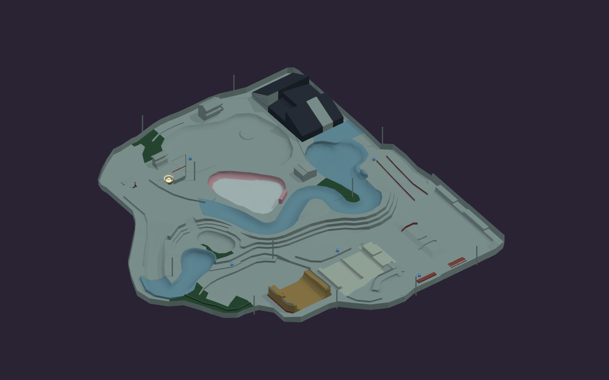

# Kona PS1 reconstruction

The source-owned `kona` level recreates the Kona layout in the supplied THPS4 **PS1** VGCartography overview. Select **Kona · PS1** in MENU, or open `/?playtest&level=kona`. K/L move between five supported checkpoints.

The initial image-traced version was replaced after a geometric survey became available. `src/levels/kona-survey.json` preserves 163 surface groups and 97 connected grind paths from the publicly shared [PS1 Kona conversion](https://thpsgoat.com/mods/item-info?item=360), credited in its metadata to **tyler.thpsX** and uploaded by **TonyGourmand**. The collision reader was checked against the published [THPS scene importer](https://github.com/denetii/io_thps_scene/blob/main/import_thug2.py). Original archive files, textures, scripts, character assets, audio and sky geometry are not included. The survey is derived third-party geometry data, not a claim of ownership of the original game assets; this iteration remains local.

## Scale and geometry

One uniform scale, **0.025 world metres per surveyed unit**, makes the entire park **2× larger than the first reconstruction** following the user's skater-relative scale feedback. The first pass over-relied on collision-capsule height; the visible skater needed more room. All axes, grind paths, checkpoints and camera positions scale together. Movement tuning and character size remain unchanged. Coordinates are rotated into Three.js Y-up space.

| Feature | Authored metric measurement |
| --- | ---: |
| Low street rail | 1.236 m above the street |
| Mini transition curve | 2.788 m rise |
| Mini extension / long quarter height | 4.544 m |
| Timber transition lips | 6.866–7.622 m |
| Raised timber roll-in | 10.412 m |
| Tombstone principal rim | 6.056 m above street datum |
| Tombstone extension | 9.900 m above street datum |
| Lower kidney's lowest floor | −1.834 m relative to street datum |

Every measured control vertex is retained. Bowls and curved concrete receive two tangent subdivision passes; rectangular architecture stays sharp. Straight pipe sections use eight Hermite intervals per original segment, with explicit continuous ride normals. The curved riding faces preserve vertical lip tangents while the inset timber roll-in retains its bank exit. Bowls, the snake run, graded paths and terraces use their own connected floor geometry, without a covering foundation. Existing native components provide checkpoint, gate, camera-node and arrival-zone behavior. Materials reproduce the broad reference palette; the original texture art and career-goal overlays are outside this geometry iteration.

The small shared-toolkit changes let authored `mesh` vert surfaces use existing transition contact, landing and coping drop-in behavior. Explicit `rail.coping` survives save/load and geometric capture. A shallow authored transition can pass its own coping without being treated as an ordinary street-bar collision. Ordinary elevated rails remain solid. No values in `src/tuning.ts` changed.

The collision correction separates hard ramp backs, end caps and perimeter faces from rideable vert surfaces. Ground raycasts alone cannot block horizontal motion through a vertical mesh, so those source faces also generate native two-sided `wallpath` colliders. Source VERT flags preserve the actual riding face. Straight-pipe subdivision now preserves a vertical lip tangent instead of averaging it with the flat deck; the old average curled the last section into a bank and let the rider drive out over the lip. Support probes use the same refined triangles as the runtime.

## Held-input flow and wall follow-up

The scale correction's earlier pilots released direction in the air and did not require a sustained vert hang. They missed a real control bug: carrying Up through takeoff requested a transfer after 0.13 seconds. The new checks hold the approach input through the entire air. A fresh Up after releasing it, or the explicit transfer button, still requests a transfer.

The runtime now follows authored surfaces across mesh-chunk boundaries, uses opt-in interpolated ride normals, launches at the near-vertical tangent on these smoothed pipes, and rejects discontinuous air-tracking snaps across the roll-in opening. Variable-height timber triangles share the same curved edges as their cylindrical neighbours, closing the crack that caught a slow approach. Wall contact accounts for the rider leaning into a transition. Artificial wall-slab caps behind the riding face no longer knock the board off its support; the perpendicular roll-in shoulder remains solid. Triangular end caps that had been omitted by the two-column wall importer now receive native wall footprints extending down into the solid ramp body.

`tools/test-kona-flow.mjs` covers charged straight/angled approaches on both sides of all three pipes, plus centre-start mini approaches at the previously snagging raised-deck seam. Angled timber approaches start with enough longitudinal room to land inside the pipe. The inset roll-in bank is distinct from the uninterrupted vert bay. `tools/test-kona-collision.mjs` adds diagonal grazes to the original boundary, ramp-back and architectural wall checks. Reports for this follow-up are in `docs/performance/kona-flow.json` and the visible browser-result JSON files beside it.

The final isolated candidate passes all 22 held-input approaches with 0.63–0.93 seconds of hang, safe returns and no bails. All 41 wall approaches pass with no crossings (37 reach physical contact), and all 12 slower transition cases return with measured feet penetration below 0.000005 m. The 1164-component park has 64206 mesh vertices, 43280 triangles and 2709 native wall segments. The structural check, `check:levels` and production build pass. The final full-render browser pass completes ten gameplay checks with zero console errors; lite rendering also passed during the iteration. Full-render verification was completed about 51 minutes after the bug report, including the isolated build. These are measured route checks, not a claim that every possible line has been exhaustively tested.

The unchanged baseline and corrected player both reproduce the pre-existing `test-jungle-cup-skating.mjs` charge-speed assertion at line 46, before its vert tests. The shared workspace also has unrelated unused `y0`/`y1` variables in `src/levels/codex-lab.ts` that prevent its aggregate build. The isolated Kona branch is built and tested separately; those unrelated changes are preserved. No movement tuning is changed and nothing is published.

## Earlier verification

The scale/collision follow-up adds `tools/test-kona-collision.mjs`: 25 wall approaches (23 reach physical contact), including the perimeter, mini backs and timber structure; twelve straight/angled, charged/uncharged pipe approaches; no wall crossing or bail, all pipe approaches return inside, and maximum measured feet penetration below 0.000005 m. All three pipes also pass four consecutive charged airs and landings. Both directions of the enlarged snake run remain traversable. The local `tools/kona-collision-review.html` page runs the production game with visible reports and shares its input controller with the automated browser test. The final full-render browser pass also verifies the adjacent-mini transfer, street line, grind, snake run, fall recovery and finish gate with zero console errors. At the corrected scale, the street line uses an ollie onto the first raised lip, then a second ollie to the catcher, holding grind on descent across its coping. Detailed correction results are in `docs/performance/kona-collision.json`.

The correction took approximately 39 minutes from the bug report to the verified full-render pass.

The following records describe the initial reconstruction; the correction report above and the new browser results distinguish what has been repeated at 2× scale:

- `tools/test-kona.mjs`: editor normalization, component/aggregate mesh limits, all recessed bowl floors, sampled snake support, mounted spawn, all checkpoints, authored vert tags, coping persistence and ordinary-rail collision.
- `KONA_STRICT=1 node tools/kona-pilot.mjs`: snake both directions and four consecutive airs/landings in each mini and the timber vert, using production Player input only after initial placement.
- `KONA_BOWLS=1 KONA_STRICT=1 node tools/kona-pilot.mjs`: two clean airs and landings from each bowl route.
- `tools/kona-browser-playtest.mjs`: actual menu selection and K/L controls; continuous snake traversal; four mini airs; transfer into the adjacent mini; charged north-kicker to south-catcher jump with zero lateral error; a complete street grind; fall recovery to the saved checkpoint; finish gate. All successful traversal cases remain mounted and have zero bails or deaths.
- Full-render Chrome review and the same kicker landing pass with no console errors. `tools/kona-browser-review.mjs` saves player, overview and feature views.
- `check:levels`, TypeScript and production Vite build pass. Existing rail opt-out, 48-air Blockworks vert and waterpark vert checks pass.

The isolated task-only snapshot on committed base `79cdcdc0` also passes TypeScript, the structural test and both strict input-pilot modes. This verifies the reconstruction without relying on concurrent uncommitted level or player work.

The broader `test-vert-ollie-sequence.mjs` currently fails its board-stow/slam assertion at line 546. Repeating it with **all Kona Player changes removed in a Vite load override** reproduces the same failure (line 547 in the temporary test, due to the inserted override). It is not a Kona regression; the temporary test was removed after diagnosis. The full test suite was not run.

The first image-traced playable was available about 14 minutes after the prompt. Measurement correction and gameplay/visual verification took approximately 100 minutes including independent commit validation. No remote transfer, deployment or publication was performed.
