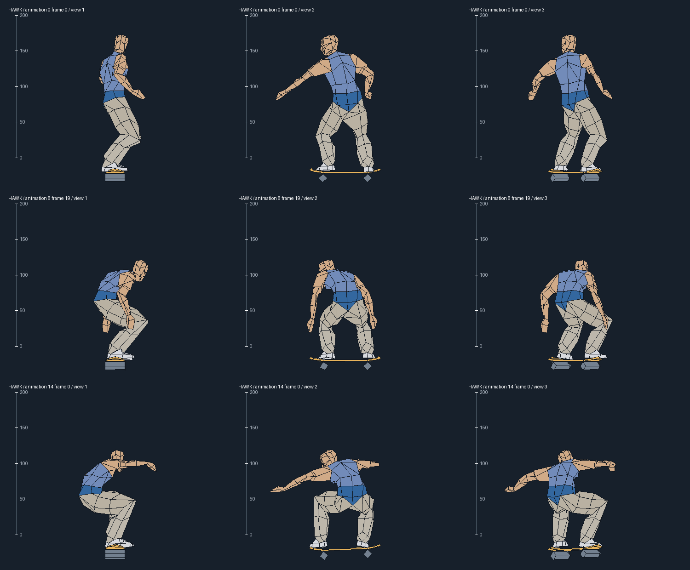
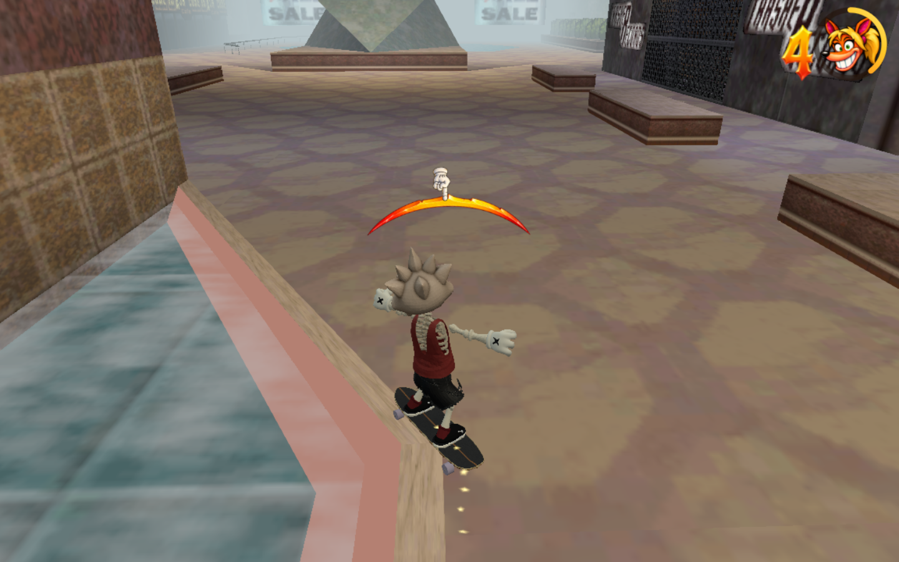
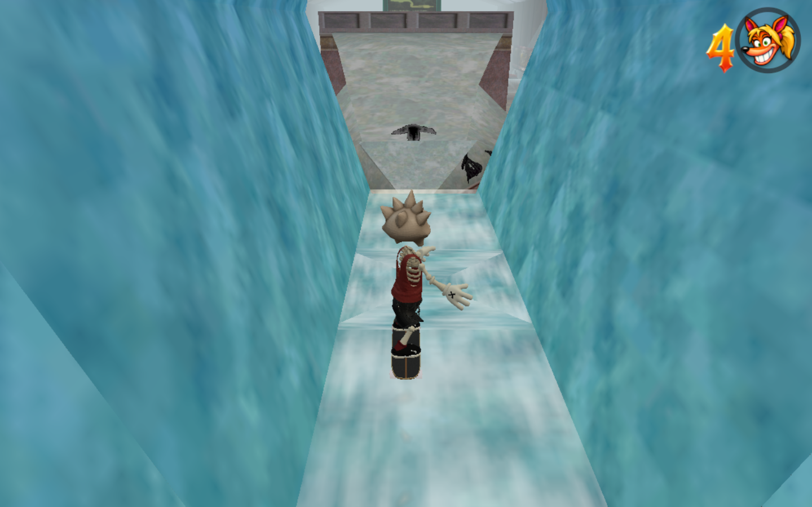
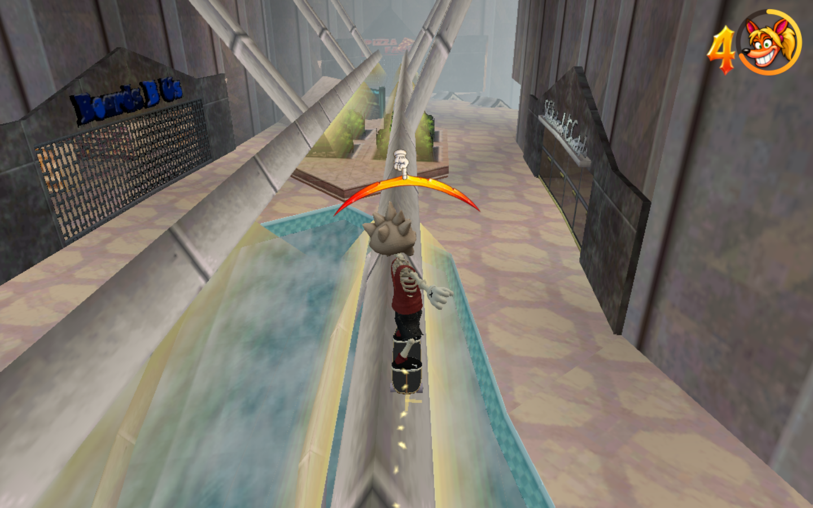
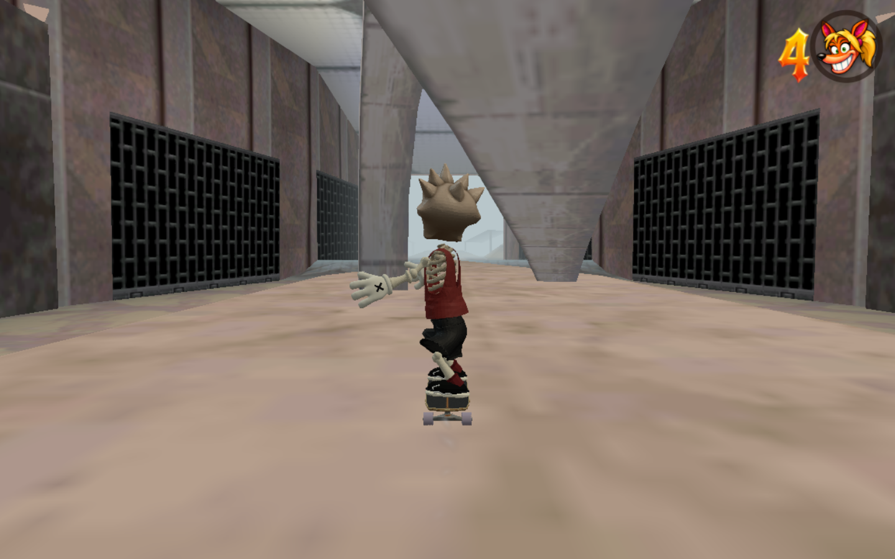

# Mall · New York

The playable Mall now uses measured PS1-derived architecture instead of the earlier image-based reconstruction. Select **Mall · New York** in MENU, or open `/?playtest&level=mall`. Add `&lite` for the fast renderer. All files, previews and commits remain local under the slow-network workflow.

WASD/arrow keys steer; hold Space to build speed and release to ollie; E grinds. K/L move between the five checkpoints. M shows developer controls if MENU is hidden.

## Source and provenance

The supplied VGCartography cutaway and [original PS1 footage](https://www.youtube.com/watch?v=n0kosmzFb0A) establish the intended version. The geometry and static art come from [letmynutzgo’s public THPS Mall conversion](https://thpsx.com/creation-details/?obj=958), released 18 July 2018. Its readme credits the original PS1 level to Neversoft, extraction and nodes to letmynutzgo, and conversion scripting to TylerLasagna.

Static art and collision came from a converted PS1 source, not a byte-for-byte verification of the 1999 disc. Its authored conversion rails have now been replaced by measured original-format rail chains retained in THPS2 retail. The altered cereal boxes, multiplayer nodes and gameplay helper objects are excluded. Third-party asset provenance is recorded in [the art README](../public/mall-reference/README.md); these game assets are not relicensed as Apache source code.

`tools/mall-reference-survey.py` reads bounded collision and literal node records without executing game scripts. `tools/mall-reference-art.py` independently reads SCN/TEX data and decodes the original DXT textures to PNG. The [THPS Blender importer](https://github.com/denetii/io_thps_scene) documents those formats. Archive, member and image hashes are retained in the source data. No executable game code or audio is included.

A bounded read of the retail data pack recovered `SKMALL.PSX` (418,280 bytes) and `SKMALL_T.TRG` (28,532 bytes), with sizes matching the published PS1 THPS2 inventory. A uniform transform registers 8,232 conversion vertex records (97.49% of distinct floating-point positions) to the retail geometry, with at most 0.00751 conversion units of error. This confirms the coordinate relationship independently of the earlier quantization inference; it does not prove a byte-identical THPS1 revision. See [retail-reference.json](mall/retail-reference.json) for hashes, measured registration and provenance. The bounded measurement tool shares the School decoder; raw retail binaries stay outside the repository.

Rail activation matters. The normal `Re_Start_Mall` restart pulses command points 0 and 441. Their rail chains produce 73 native paths, 214 segments including four authored overlaps, and 210 unique edges. Command point 759 adds alternate-restart rails and is excluded from the normal course. The runtime preserves each activated source chain and its endpoints; it no longer generates paths from the conversion's duplicated return edges. Terrain-specific original grind audio remains unimplemented.

## Geometry and scale

[src/levels/mall-measured.ts](../src/levels/mall-measured.ts) retains all **8,650 referenced static collision control vertices**. The 9,826 original static triangles comprise 8,678 solid triangles and 1,148 pass-through/detail triangles. A single axis rotation, translation and uniform scale transforms the source coordinates into the fork’s Y-up world. Static vertices already contain world positions; their separate conversion node offsets must not be applied again.

The retained scale is **0.045 world metres per conversion unit**, or **0.01808 m per original engine unit**. A source-animation survey now supports this choice for charged riding: HAWK’s crouch-loop body spans **2.535–2.637 m**, while the fork’s visible charged rider spans **2.587–2.630 m** after reaching normal charged speed. Their mean heights differ by about 1%. This compares posed body vertices with body vertices, excluding the boards, hidden alternate parts and render helpers. The earlier whole-player bounds were not a reliable actor measurement. The independently tested arcade route still has at least **0.36 m of head clearance**.

This is a gameplay-pose calibration, not an exact match of all proportions. The fork’s coasting pose is about 24% shorter than HAWK’s coasting pose at the retained scale; its cruiser deck is about 9% longer, while deck width differs by about 2%. A single uniform level scale cannot remove those differences. See [actor-scale.json](mall/actor-scale.json) and the source-pose review below. No character, global movement or geometry scale changed during this survey.

The source’s folded entrance, concourses, gallery, angled atrium, escalator, crossed arcade arches, courtyard quarters, canopies, pool, exit passage and parking retain their relative positions and elevations. The recovered normal-start rail graph preserves **210 unique edges in 73 native paths**, including its authored overlapping segments. Every native rail control point matches its transformed source position within numerical precision.

The source marks only the upper parts of some quarters as VERT. Classification follows smooth connected faces down to their toes and across storage-sector seams, covering 379 source triangles. Three subdivision passes add tangent midpoints without moving the source control vertices. Shared vertical tangents keep straight wall extensions straight. Native contact follows its current mesh, so continuous quarters use overlapping spatial chunks with a 1.2 m halo. Chunk dimensions follow source scale; this keeps the source connections stable and the full level within existing editor limits. The final data has 2,305 components, 60,615 mesh vertices and 68,091 mesh triangles, occupying about 6.9 MB as JSON.

Original static scenery supplies 25 sectors, 208 meshes, 9,750 render triangles, 126 single-pass materials and 125 decoded textures. Native measured surfaces own collision; the original render meshes own appearance. Shared runtime support registers those textures and their unlit materials, and lets level data opt out of automatic huge-drop damage. Mall uses that option for its original gallery drop. The level now opts into source-scaled auto-kick, drag, gravity and ollie parameters. Global tuning, other levels, steering and camera implementation retain their prior behavior; remaining movement differences are listed below. Course direction, a lower arcade camera view, five supported checkpoints and a finish gate are level data.

The native wall proxies omit buried spans at continuous floor joins. The first up-escalator previously tripped the board against the deck’s front face just before reaching the landing. The correction splits that proxy at measured floor edges and checks strict support on both sides; exposed deck sides and actual guardrails remain collidable. Source render and collision control vertices stay unchanged.

Connected wall frames also retain their openings. The fountain previously looked open but had a solid bounding rectangle across its passage. Nineteen wall envelopes are now clipped to their measured coplanar triangles. The shared School toolkit's `wallHeights` field gives the resulting 69 profiles their measured lower and upper edges; 1,035 interior samples remain inside source polygons. Both old fountain exits bailed. Both corrected exits pass with ordinary input and clean landings, natively and in the full renderer. Sills and lintels remain solid. See [wall-openings.json](mall/wall-openings.json).

The separate [scale and physics research](mall/scale-physics-research.json) records the importer's coordinate conversion, the earlier inferred quantization, the newly measured retail registration, and original PS1 charge/gravity/kick calculations. The actor survey separately supports charged-riding scale. The earlier partial flight experiment is superseded by the scoped parameter profile below. The source's `mMaxSpeed` selects stronger drag rather than imposing a universal hard cap.

## Source movement parameters

Mall alone sets `skateReference` with the measured **0.0180799983 m per original unit** and Tony's first stat-upgrade ollie/speed/air/balance stats **4/8/8/5** (base **3/7/7/4** plus one each). [skateReferencePhysics.ts](../src/skateReferencePhysics.ts) converts the pinned PS1 source's 30 Hz/Q12 parameters into the fork's 60 Hz runtime. Ground gravity is about **25.82 m/s²**, air and vert gravity **51.64 m/s²**, full flat pop **17.09 m/s**, full air-stat pop **17.90 m/s**, and full charge **0.30 s**. Flat and grind ollies use the same stat curve, carrying the supporting surface/rail's vertical velocity into flight.

Auto-kick applies four original units of acceleration for five ticks in each twenty-tick ground cycle, including neutral-stick riding. The clock pauses in air. Standing/crouched kick targets are about **21.79/26.15 m/s**; exceeding a target stops the push without erasing earned speed. Ground drag is linear, with a stronger coefficient above **40.97 m/s**. The separate final `DoPhysics` cap limits the full velocity vector to **50.56 m/s**. This corrects pass 22, which inspected the drag threshold but missed the final cap. Global `TUNING` and the existing park parameter object are unchanged. A 960-frame drive/turn/jump/brake/coast comparison without the option is byte-identical to the previous frozen runtime, and the existing park-tuning checks pass. Strict import validation and editor capture preserve the option.

This is a measured parameter adaptation, not a complete PS1 physics port. It integrates continuously at 60 Hz rather than reproducing every 30 Hz fixed-point rounding step. Steering, braking, ground-contact tracking, rail catch eligibility and substep node placement still use fork rules. Under-rail hangs and perfect-grind rewards remain fork extensions. Original push-animation gating, slow decay of the temporary crouched kick target, terrain-specific friction and special-mode speed changes remain to be compared. The scope and evidence are in [reference-physics.json](mall/reference-physics.json).

Rail entry now projects the incoming **3D** velocity and adds the original speed-stat impulse (**7.05 m/s** here). Rail gravity uses the source air-gravity value. Low-speed assistance runs at its original 30 Hz decision rate and permits an uphill grind to reverse. Ordinary rail ends retain the full tangent velocity without an extra pop; directional ollies rotate that velocity by **17.578125°** within the rail plane before adding the pop. The source handles jump release before rail traversal, so a release on the last supported sample launches correctly. The independent cadence, entry, runoff, direction and endpoint tests are recorded in [rail-physics.json](mall/rail-physics.json). No original rail node moved.

Source balance is now optional in the movement profile and enabled on Mall with balance stat **5**. The original integer equations run at 30 Hz, including neutral arming after a catch, air-history retention, same-chain re-entry difficulty and ground reset. The strict native bail threshold replaces the fork’s balance grace for this profile. Eighteen traces at 30/60/120 Hz match a C++ oracle compiled directly from the pinned source statements. Production countersteering sustains an eight-second rail line; leaving it unattended bails after 123 steps. The oracle supplies the same random/state/input stream to both implementations; production still uses the fork RNG and post-step state sampling, so this is not a claim of complete frame-exact source behavior.

Soft rail joins now project momentum onto the next segment. The original display chain **61→59→60→62** carries **24.99→21.14→17.90 m/s** through both bends. A controller-only approach grinds 111 frames, then ollies outward eight metres before the endpoint and rolls away for thirty grounded frames. Natural runoff hits the actual storefront wall beside the last node. All five measured rail approaches pass in the full renderer; no original vertex, wall or node changed. The complete tape route reaches a maximum balance deflection of **8.425%** and retains its 242-frame beam grind. See [rail-balance.json](mall/rail-balance.json).

The complete upper-display → car-ramp → fountain → receiving-ramp route now passes with ordinary controller input and four deliberate ollies. The previously failing rollout hit the receiving ramp's actual raised curb: source collision triangles 1744–1745 form that wall. Its geometry was correct and remains intact. An ollie from the rear fountain ledge near conversion X=-8390 reaches the ramp. The longer rollout also identified a false rail landing at the receiving ramp's final coping (original nodes 24→26). The rider had not jumped and was still within ground-departure grace, but the downhill velocity triggered the generic rail smack. The source profile now preserves that fresh coping roll-off; actual jumps, later falls, ordinary bars and existing levels retain their collision rule. Three nearby car-release timings each finish on the flat concourse with thirty consecutive grounded frames. See [fountain-route.json](mall/fountain-route.json).

## Authored gaps and landing policy

The [original PS1 guide](https://gamefaqs.gamespot.com/ps/199060-tony-hawks-pro-skater/faqs/5073) distinguishes the Flying Leap from the secret-tape transfer: the former drops from the high gallery, while the latter uses the right-hand rail beside the descending route to reach the suspended beams. The failed earlier probe mixed those approaches.

The gallery jump exposed a runtime mismatch. A correctly aligned landing from this approximately 48 m apex-to-floor drop triggered the fork’s automatic 24 m huge-drop bail. The published [PS1 physics decompilation](https://github.com/LANCommander/TonyWasAProSkater/blob/main/game/src/physics.cpp) checks landing alignment, leaning and trick completion; its inspected ground-contact path does not impose that height rule. Mall now sets `hugeDropBail:false`. This level option preserves existing defaults and all other landing judgement; it does not change the flight trajectory or global tuning. It survives editor capture/import. Both airborne and wall-ride ground contacts respect it.

Two normal-input Flying Leap releases now clear the front guard and roll away without a bail. The separate tape-route test catches original chain 282→281, transfers to suspended beam 134→135, grinds **127.03 m over 242 frames**, runs off the far end and rolls away. Native and full-production browser fixtures agree. At the corrected entry speed, this fixture uses a straight charged ollie near conversion X=-4135. Its timing tolerance still needs broader comparison with original gameplay.

## Original glass and directories

The two intact glass barriers and all five directory signs now break on body contact. Render sectors are linked to their collision objects by checksum: collision directories 33–37 are render sectors 27–31. Collision helper 38 has no intact render counterpart and does not create an extra door. The entrance glass has two visual meshes that break together.

Contact sweeps the existing body bounds across each fixed step, including thin panes at speed. It changes no movement, score, tuning or collision surfaces. Native tests compare identical controller inputs with breaking enabled and disabled; every recorded position, state and speed agrees. Broken objects stay absent after a fall and return on a new run. Fragments retain the source textures, shrink promptly to keep the rider visible, expire after 0.9 seconds, and use one draw per source mesh with bounded work. The breakup motion is procedural and the sound reuses an existing local effect; those are not recovered PS1 effects.

All seven objects pass full-production browser approaches, including the transverse atrium sign. Tests also check grouped visibility, diagonal near misses, reset behavior, resource disposal, editor round-trip and invalid imports. The count is retained for later directory-goal integration; no goal completion reward is implemented yet.

## Validation

Current evidence is saved in [validation.json](mall/validation.json), including hashes of the frozen runtime used while other chats edited the shared checkout.

The complete native and full-render route uses normal controller input from the source restart to the parking finish: **64.02 simulation seconds, no bail or death, at least 23.43 m/s after the entrance**. Pass 24 repeats the main route, Flying Leap, complete tape-beam transfer and five measured rail approaches after adopting source balance and corner projection. The complete fountain route, escalators and three vert returns retain their separately stamped pass-23 evidence. The seven dedicated breakable browser fixtures retain their pass-18 evidence; older wall-opening browser evidence is identified with its pass-19 build. Source equality, unchanged global tuning and zero console errors are checked. The main route uses the courtyard's sloped takeoff before clearing its raised lip.

Auto-kick runs while the browser loads, so the main browser fixture explicitly starts a fresh run before beginning its controller sequence. The initial test that omitted this reset started tens of metres down the entry and failed; it is not used as passing evidence. After the one initial reset, the main route makes no pose, speed or state edits.

Focused native checks cover source control-point retention, 58 measured surface probes, supported spawn and five checkpoints, editor save/load, curved garden-skirt collision, both courtyard wall airs, and the atrium wall return. A separate data test checks three scales: transition and rail connectivity remain identical, and each version stays below the existing mesh and file-size caps. Rail section tests require the intended source path, a sustained grind and a clean exit, using ordinary controller samples after an initial supported placement.

Both escalators are checked uphill and downhill with ordinary input, no ollie and no in-run placement or speed edits. All four routes retain support across their landings; minimum seam speeds range from 10.48 to 22.90 m/s. The actual inner handrail on the first escalator is separately verified: original chain 5→4, 24 grind frames, 8.28 m travelled and a clean landing back on the ramp. This is distinct from the adjacent display ledge checked in the previous pass.

The production build and required level checks are run locally. MENU selection, K/L warps and reserve-life pit recovery use the real browser. The full suite is not run. The related endpoint-height wall support and shared check are included in the local Mall commit. Other concurrent runtime changes are excluded from that commit and identified in the frozen preview's manifest.

## Reproduction

`python3 tools/test-psx-skater-survey.py <local-HAWK.PSX> <local-psyq-data.cpp>` checks the original actor hash, all 78 compressed clips, fixed-point rotation table, stitch references and transform hierarchy. `python3 tools/psx-skater-survey.py <local-HAWK.PSX> --trig-source <local-psyq-data.cpp> --out <report.json>` regenerates the measurement. The input paths and pinned primary-source URLs are in actor-scale.json; original binaries stay outside the repository. `node tools/mall-actor-scale-browser.mjs <local-url>` and its `--full` variant measure the fork’s visible posed rider at rest, coasting and fully charged speed.

- `node tools/test-skate-reference-balance.mjs` (requires the pinned local C++ source; override `THPS_PHYSICS_CPP` if needed)
- `node tools/test-skate-reference-rails.mjs`
- `node tools/mall-measured-rails-browser.mjs <local-url>`
- `node tools/test-skate-reference-physics.mjs`
- `node tools/test-skate-reference-coping.mjs`
- `node tools/test-park-tuning.mjs`
- `node tools/test-mall-fountain-route.mjs`
- `node tools/mall-fountain-route-browser.mjs <local-url>`
- `node tools/test-mall-measured-topology.mjs`
- `node tools/test-mall-measured-surfaces.mjs`
- `node tools/test-mall-measured-verts.mjs`
- `node tools/test-mall-measured-rails.mjs`
- `node tools/test-mall-measured-upper.mjs`
- `node tools/test-mall-measured-gaps.mjs`
- `node tools/test-mall-wall-proxies.mjs`
- `node tools/test-mall-wall-openings.mjs`
- `node tools/test-school-wall-profile.mjs`
- `node tools/mall-wall-openings-browser.mjs <local-url>`
- `node tools/test-mall-landing-policy.mjs`
- `node tools/test-breakable-scenery.mjs`
- `node tools/test-mall-breakables.mjs`
- `node tools/mall-breakables-browser.mjs <local-url>`
- `node tools/test-mall-measured.mjs`
- `node tools/mall-measured-browser.mjs <local-url> --full`
- `node tools/mall-measured-upper-browser.mjs <local-url>`
- `node tools/mall-measured-gaps-browser.mjs <local-url>`
- `node tools/mall-smoke.mjs <local-url>`

The retail-reference audit can be reproduced with `python3 tools/test-mall-retail-reference.py /private/tmp/mall-recreation/research/retail`. The decoder dependency is the School tool from local commit `b69bb15`; concurrent geometry-export additions are not required.

Set `PLAYWRIGHT_MODULE` when Playwright is installed outside this repository. Use `npm run check:levels` and `npm run build` for the repository’s required checks. The old `mall-pilot.mjs`, `test-mall.mjs`, and their related route tools describe the superseded image-based level at commit `2508077121b87c2b606c515ac025556bd05f44af`; they are historical evidence, not tests of the measured replacement.

## Remaining fidelity work

The goal remains active. The complete fountain route, Flying Leap, suspended-beam route, both escalators and measured handrails pass input-only checks. Source-like parameter calibration now makes these routes reachable without scaling individual obstacles or moving their control vertices. Remaining alternate upper routes and timing tolerance still need comparison with original gameplay. The movement-profile limitations above, differing coasting/board proportions, and a byte-identical 1999 THPS1 revision remain unresolved. The retained retail rail graph is measured and applied, but original grind audio is unverified. The source directories and glass break; directory-goal rewards, original box stacks, collectibles, sky and animated water are still incomplete. Breakup motion and sound are local approximations. These limitations prevent calling the recreation a completed literal 1:1 match.
