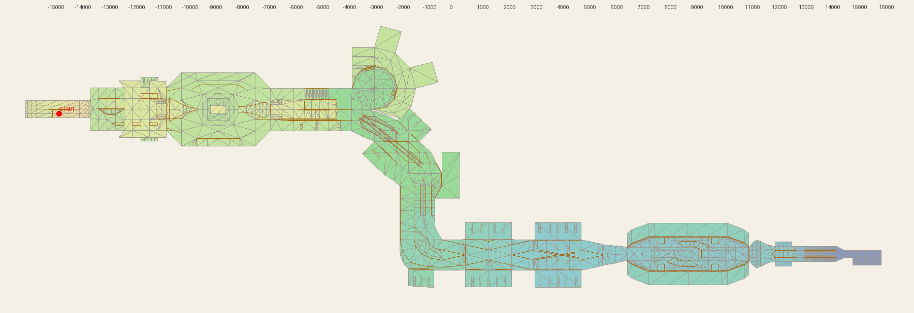

# Mall · New York

Source-owned reconstruction of the original 1999 THPS Mall for the fork's existing skater. Select **Mall · New York** in MENU, or open `/?playtest&level=mall`. Add `&lite` for the fast renderer. All work remains local under the slow-network workflow.

Arrow keys/WASD steer; hold Space to build speed and release to ollie; E grinds; F spins. K/L move between the five checkpoints. M shows developer controls if MENU is hidden.

## Reference and scale

The supplied VGCartography cutaway is the primary layout reference. The [higher-resolution VGMaps image](https://www.vgmaps.com/Atlas/PSX/TonyHawk%27sProSkater-Mall.png), [original PS1 footage by Marcanine](https://www.youtube.com/watch?v=n0kosmzFb0A), [Planet Tony Hawk guide](https://planettonyhawk.gamespy.com/Viewf1e2.html?id=5&view=thps_faqs_guides.Detail) and [Tom Hayes's PlayStation walkthrough](https://www.cheatcodes.com/guide/faq-walkthrough-tony-hawks-pro-skater-playstation-15891/) resolve obscured surfaces and route connections. Later remakes are not dimensional evidence for this reconstruction.

World units are metres. The main station chain is now 466 m long, with the folded entrance preceding its lower lane. Spawn is at Y=30; the parking floor is Y=-10. Scale is checked against the existing skater's body, ollie, grind and vert behaviour. Dimensions remain inferred from images and footage; these tests do not establish an exact match to the original mesh.

## Playable arrangement

| Section | Current geometry and connections |
| --- | --- |
| Folded entrance | Upper ramp to gold quarter, descending return lane to blue quarter, then lower lane through glass doors. Both quarters have 3.2 m radii. |
| First concourse | Offset up escalator and adjacent water trough; centered oval bench; directory; lower aisle beneath the raised island. |
| Fountain and gallery | Launch into a real intermediate passage, then landing bank to the gallery. Separate second up escalator, car kicker/access bank and Coffee Grind remain usable. |
| Flying Leap and atrium | Straight paired upper/lower light beams, actual upper-beam reward transfer, water channel and elevator quarters. |
| Lower mall | Broad escalator, lower arcade and two straight diagonal crossrails with separated crossing heights. |
| Courtyard | Four broad battered tree planters on low ledges; continuous wall quarters; two raised curved canopy roofs; shallow blue pool between tan launch/landing wedges. |
| Exit mezzanine | Flat upper passage above a descending lower approach; separate lower corridor with low grindable side ledges. Both a native right-wallride/wallie and the rear-wedge ollie reach the mezzanine; a breakable box stack sits near its end. |
| Stairs and parking | Separate 32-stair flight, two handrails and small wall-base fillets; glass doorway; parking room with two column rows and the finish beyond it. |

The courtyard has four 3.5 × 5.8 m battered tree planters at s=336/365, u=±7.5. Their tops are Y=1.35 on 0.3 m ledges. The long inside grinds are at u=±5.65. The courtyard facade is 5.8 m high with a window band. The pool's side banks now meet the raised ledges continuously.

The pool is 0.8 m deep with a 10.4 × 7 m footprint and 1.15 m tan wedges. The closed canopy roofs now rise from 3.55 to 4.75 m, plus their small end curvature. Their height was checked against the rendered character, including the taller pose on a raised side ledge. Four edge grinds remain distinct. Inner roof grinds transfer onto the lower ledges when grind stays held; outer edges run off onto the wall transitions. A straight roof line outside each rear tree returns to the courtyard floor.

Original footage at 6:16–6:22 establishes the corrected exit order. The last directory is centered before the raised passage. The lower approach drops to Y=-3; its ledged corridor runs from s=388 to 410. The mezzanine spans s=377–408 at Y=2.8 with its soffit at Y=2.6. The separate 32-stair flight descends over s=414–432 to Y=-10. The doorway is at s=438 with 6.2 m clear width, followed by the parking room and gate at s=463. The former long courtyard access ramp and oversized exit halfpipe were removed. Small 0.65 m wall-base fillets now sit beside the stairs. These measurements remain inferred.

Low follow views clear the mezzanine and parking ceilings. A closer stair view keeps the camera above the uphill floor behind a descending skater. All are local camera components. This Mall iteration does not alter shared movement, rail, collision or tuning. Concurrent chase-camera work is included in the validated local runtime; hashes and exclusions are recorded in the evidence file. Native checkpoints, collectibles and the finish are used; the original directories and glass currently have pass-through visual representations.

Pass 13 demonstrates the original wallride approach with ordinary input. Keep to the courtyard’s right side, ollie toward the narrowing wall near the exit, hold grind to catch it, briefly pump jump, then release into the upper passage. Three launch stations spanning two metres succeed from the actual spawn. Six native empty crates form the central three/two/one stack seen at 6:17. Both upper routes skate through it, then ollie past all 32 stairs. The corridor roof now has an 8.1 m underside; small closure meshes seal the gap above the descending stair walls. Short, inward follow views keep the courtyard approach clear.

## Validation

Local build `f6678e9bf971b38c90cb` has 503 components and 52 authored grind paths. `check:levels`, TypeScript and production build pass; the full suite was not run. A one-line `.at(-1)` compatibility repair in concurrent School work was needed for the final build and remains outside the Mall commit.

Ten complete native-input routes finish without bail or death: main, controlled/fast fountain, car, Coffee Grind, second escalator, underpass, pool, rear-wedge mezzanine and wallride mezzanine. The main route takes 25.95 seconds and retains at least 22.56 m/s after the entrance. The rear-wedge route retains 21.16 m/s after breaking the boxes. Wallride landings across launch stations 369–371 retain 18.17–18.35 m/s; the nominal run takes 26.45 seconds and records 58 supported upper-deck frames. Both upper routes first land beyond the final stair after their deck-end ollies. These are measurements of this skater, not original-game timing claims.

Surface probes, supported spawn/five checkpoints, pit recovery and both exit ledge/stair-rail pairs pass. The six boxes form supported tiers; the lower main route leaves them intact. Current native courtyard/pool checks cover both wall returns, ledge/coping grinds, pool roll/jump outcomes, roofs and canopy edges. Earlier bench, entrance, trough and fountain section checks keep their original provenance.

Lite wallride, full wallride, full mezzanine and full main runs use matching source and the normal camera. Four additional full-render section replays reproduce the courtyard wall airs and pool roll/jump endpoints. There are no console errors, head/roof intersections or broad or sustained sightline obstructions. QA records thin-column centre-ray crossings separately and allows at most three simulation frames (50 ms); the final main and wallride runs report none. MENU, K/L and reserve-life pit recovery pass.

All ten complete native routes, four complete browser routes, four courtyard replays, menu/recovery checks and the final build use the pinned local snapshot at `/private/tmp/mall-recreation/snapshot-13`. This freezes the runtime while other chats continue work in the shared checkout. The snapshot source manifest and tested runtime hashes are recorded in the evidence. Detailed results and historical evidence remain in [validation.json](mall/validation.json).

## Evidence and reproduction

[Courtyard](mall/plaza.png), [lower exit approach](mall/exit-underpass.png), [mezzanine](mall/mezzanine.png), [wallride approach](mall/wallride.png), [breakable box stack](mall/mezzanine-boxes.png), [exit corridor](mall/exit.png), [stairs](mall/exit-stairs.png), [parking](mall/parking.png), [pool jump](mall/pool-jump.png), [basin roll-through](mall/pool-roll.png), and [wall return](mall/courtyard-return.png) use the normal game camera. Screenshots are sampled during continuous runs. The [cutaway](mall/cutaway.png) and [plaza inspection](mall/plaza-inspection.png) use inspection cameras with foreground walls, roof and fog hidden.

Run `node tools/test-mall.mjs --route=<name>` for the ten routes above; use `upper`, `upper-fast`, `car`, `coffee`, `escalator`, `mezzanine`, `underpass`, `pool`, `wallride` or `main`. Add `--wallride-entry=369` or `371` to repeat the access timing variants. The focused tools are `test-mall-surfaces.mjs`, `test-mall-courtyard.mjs`, `test-mall-pool.mjs`, `test-mall-exit.mjs` and `test-mall-details.mjs` in `tools/`. `mall-browser.mjs <local-url> --route=<name> --full`, `mall-courtyard-browser.mjs <local-url>` and `mall-smoke.mjs <local-url>` reproduce Chrome checks. Run native courtyard/pool tests before their browser replays. Set `PLAYWRIGHT_MODULE` to the installed module when it is outside the repo.

## Remaining fidelity work

The final source audit identified a concrete mismatch in the crossrail arcade. Original footage at 5:59–6:04 shows a recessed approach between raised side aisles, a curved launch, a pointed central directory island and broad pale beams with curved end connections. The current thin rails and offset directory do not recreate that arrangement and are the next geometry correction.

Exact metric dimensions, architectural proportions, storefronts and materials remain inferred. Directories and glass still use pass-through visuals. The goal remains active; working route tests do not establish a completed 1:1 recreation. The user has authorized original PS1 extraction research. A converted PS1 collision survey is now available below; its scale, conversion changes and playable integration still need validation.

## Original geometry survey

After pass 13, a [public Mall conversion by letmynutzgo](https://thpsx.com/creation-details/?obj=958) supplied a stronger measurement source. Its readme credits PS1 extraction through THUG Tools and conversion scripting by TylerLasagna. The extracted floor plan matches the reference's section order and plan: first concourse/fountain, angled atrium, lower arcade, courtyard and exit. This is a converted mesh reference, not a byte-for-byte verification against a retail PS1 disc.

[source-survey.json](mall/source-survey.json) preserves 60 collision objects, 8,872 vertex records and 10,110 triangles in source coordinates, plus 773 conversion rail nodes and 649 directed links. The raw bounds are X −15,830.285…16,359.346, Y −2,324.922…1,927.495, Z −2,751.972…7,034.135. No scale has been applied. The conversion's single-player restart is at (−14,573.575, 1,120.475, 532.113), facing +X. Static collision vertices are world positions; movable objects use separate placements.

The rail network and collision flags were authored or adapted during conversion and need comparison with the original gameplay. The package also changes cereal-box appearance and includes multiplayer nodes. These are explicit limitations, not evidence of original features. The saved survey contains geometry, flags and placements; original texture art, audio, render meshes and executable scripts are omitted. It is not yet used by the playable level.

`python3 tools/mall-reference-survey.py <THPS1Mallv2.0.zip> <output.json>` reproduces the survey without executing game scripts. The reader checks archive bounds, collision counts/indices/vertex bounds, literal node-array structure and rail-link targets. It uses the same documented COL v10 layout as the [THPS Blender importer](https://github.com/denetii/io_thps_scene/blob/main/import_thug2.py); archive and member hashes are recorded in the survey. Small public PSX/TRG readers in [TonyWasAProSkater](https://github.com/LANCommander/TonyWasAProSkater) and the [Neversoft Multitool](https://github.com/slfx77/neversoft-multitool) provide another route if retail data becomes available.

The next pass will fit one uniform scale to the existing skater, replace inferred geometry with measured surfaces, and validate the source rail/vert/jump connections. Existing movement tuning remains the baseline. All files and commits stay local.
