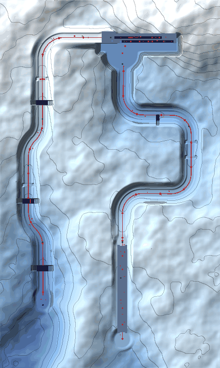

# Powderkeg Peak

A snow mountain above a sea of cloud. You climb it on foot and come down it on
the board, twice. Built from scratch for the brief "a new level based on the
shape and length of Crash levels recorded in the bible" (`docs/GAMEPLAY_DESIGN_BIBLE.md`).
It borrows structure only: the layout, content and scenery are original.

- Level id `powderkeg-peak`, source `src/levels/powderkeg-peak.ts`
- Bonus round `bonus-powderkeg-peak` ("Cold Storage"), source `src/levels/powderkeg-bonus.ts`
- Mountain toolkit `src/levels/powderkeg-terrain.ts`, scenery in code `src/levels/powderkeg-art.ts`
- Play-through pilots `tools/test-powderkeg-journey.mjs`, `tools/test-powderkeg-bonus.mjs`

## Shape

North is up. The climb starts bottom centre and runs north; the first run
swings east and back to the frozen tarn; the headwall crosses the top of the
map; the last run leaves the summit (top left), runs west along the ridge and
south down the long face to the powder works (bottom left).

Two shapes from the bible's record are combined:

| Source in the bible | What was taken |
| --- | --- |
| Crash 2 mountain levels | Into the screen, a vertical join with a checkpoint, side-on rows up a wall, a one-way turn, into the screen again |
| Air Crash | Strict alternation of on-foot and on-board legs, each ending at a checkpoint |
| Crash 2/3 course length | Four main sections of about ten beats, one bonus round, one gem route |

The house rule for this engine decides which leg is which: climbs are walked and
carry the pits, ledges and enemies; speed lives on the two descents.

| Section | Mode | Length | New idea | Checkpoints |
| --- | --- | --- | --- | --- |
| S1 Kindling Steps | Foot, into the screen, 12 m walled gully | 197 m, +10.5 m | Ice underfoot | C1 powder landing, C2 crest |
| S2 First Tracks | Board, square-wave descent | 561 m, -18.5 m | Rolling snowballs | C3 past the boulders, C4 tarn |
| Tarn and hoist | Foot, hub; the camera turns side-on on the way up | 14 m lift | (rest) | C5 hoist landing |
| S3 The Headwall | Foot, side-on: east along the lower row, up the buttress, west along the upper row | 2 × 105 m, +22 m | Ice stampers | C6 east landing, C7 summit |
| S4 Powderkeg Run | Board, ridge then the long face | 656 m, -40 m | Everything, combined | C8, C9, C10 |

## Beats

**S1 Kindling Steps.** Yard stack → snow crab alone on a wide shelf → mill pond
(first ice, a crate row to spin while sliding) → snowball in its trough (stand,
watch, cross behind it) → half crevasse with a crate over the open half → arrow
crate with a pair 8.3 m overhead (only the bounce with a double jump reaches
it) → first full crevasse → ice shelf with a firm snow lip above the second
crevasse → TNT debut on the powder landing (C1) → bristleback alone on a wide
shelf → three pillars, the last with a crab on it → lookout shelf: a reward
block and a Nitro pair at rest by the wall (first Nitro, on foot) → crest (C2).

**S2 First Tracks.** First stack dead ahead at the foot of the first pitch →
tall stack on the inside of the bend → slalom pair → Nitro pair on the edge of
a straight, in view for all of it → apex stack → two snowball troughs, each a
second and a half past the bend → tall stack and checkpoint C3 → the half
crevasse: ride on down the sound half, ollie it, or grind the log across it;
the two risky lines meet at one tall stack → bend stack → run-out stacks → shore.

**The tarn.** Ice with a block in the middle, a watcher on firm snow by the
hoist (its debut), the hoist up the wall.

**S3 lower row (east).** Stamper over solid ledge with eleven metres to watch it
from → bristleback on the take-off → lone pillar → stamper pair with a one-crate
pocket → rotten ice plank (debut, level with both banks) → TNT between two boxes
at the near end of the rest ledge → jump to a far bank under a stamper → three
buttress tiers, one a dead end with a reward → east landing (C6).

**S3 upper row (west).** Stamper over glazed ice (wait on the dry landing, then
run) → pillar with a bristleback on its far half → three rotten shelves → switch
ledge: `!` by the lip, a life framed by Nitro against the wall → switch bridge
of five crates → four metres of floor, a mask → twin stampers half a cycle apart
with a crab in the pocket → last pillar → summit (C7, the crystal, the bonus pad).

**S4 Powderkeg Run.** Block to ram on the level ridge (only a held push reaches
smashing speed; a mask is in it) → ridge rail with a watcher over it → tall
stacks down the first face → twin snowballs rolling in step → first full
crevasse → tall stack, C8 → chicane with Nitro on the inside of each bend →
tall stack, C9 → fast snowball → second crevasse with a one-way crate bridge to
grind → Nitro on both edges at once → tall stack, C10 → the long gap (11 m) →
works yard, the green `!`, the gate.

## Ladders

Each hazard is introduced with room, developed, twisted, then used in the last run.

| Element | Introduce | Develop | Twist | Conclude |
| --- | --- | --- | --- | --- |
| Ice | Mill pond | Ice shelf before a crevasse | Glazed gallery under a stamper | Adit drift with Nitro beside the slide |
| Snowball | S1 trough on foot | Two troughs on First Tracks | Twin snowballs in step | Fast snowball before the crate bridge |
| Stamper | Solid ledge, long watch | Pair with a pocket; far bank | Over ice; twins with a crab | Adit: quick pair |
| Crevasse (board) | Half width with a sound lane | Full width, 9 m | Full width with a crate bridge | The long gap, 11 m |
| Nitro | Pair at rest on the lookout | Pair beside a straight on a board | Inside of each chicane bend; life framed on foot | Both edges at once; the green `!` |
| Arrow | Pair 8.3 m overhead | Steel arrow to the adit door | Steel arrow to the gem shelf | (bonus round's arrow gate) |
| Bristleback | Alone on a wide shelf | On a take-off | On the far half of a landing pillar | Adit pillar past a 4 m gap |

## Crates

143 crates in the level (139 counted) in 54 clusters, mean cluster size 2.59,
5 single crates (9 %); 10 checkpoints; 17 more in the bonus round; gem tally 166.
Every cluster has one named job in its label (teach, reward, bait, landing
marker, count trap, checkpoint group).

Three rules were adopted for the board runs after measurement:

1. A checkpoint is a box, and a board below 12.5 m/s trips on boxes. Level
   board speed is 12 m/s and a restart on a shallow grade stays near it, so a
   checkpoint closes its crate group: the stack comes first, then the
   checkpoint on the same line, then clear snow.
2. Every box on a run can be had in one pass. Where two lines split (the ollie
   and the log over the half crevasse) they meet again at one shared stack.
3. No explosive sits on a forced line. Nitro shapes lanes from the edges.

## Optional routes

**The Old Adit (blue gem).** A mine door 8.6 m up the wall above the east
landing, with a broken ladder under it and a steel arrow in the corner. Arrow,
double jump and a grab reach 9.0 m; a floor double jump with a grab reaches
7.0 m, 8.1 m off a stomped box. Inside, a detached ice gallery recombines what
the lower row has just taught: ice with Nitro beside the slide, two rotten
shelves, quick twin stampers with sound floor before and a six metre run-up
after, a 4 m gap onto a pillar whose near half is clear, a steel arrow to the
gem shelf (8.5 m). No checkpoint stands inside, so the restart point never
moves into the adit; a ring by the entrance leads back out, as does the ring
past the gem.

**Cold Storage (bonus round).** Entered from the summit, once the Headwall has
taught everything in it. Seventeen counted boxes: an arrow gate with a pair
overhead, a stamper, a rotten plank, a TNT trap, a Nitro-framed life, a `!`
bridge and a green `!`.

## Measured in this engine

| Fact | Value |
| --- | --- |
| Board speed on the level; smashing speed | 12 m/s; 12.5 m/s (6–12.5 m/s trips over the box) |
| Coasting cap on grades of 4 % or more | 23 m/s |
| From a standing start, coasting on 2 % | 12.0 m/s after 11 m, 12.8 m/s after 56 m |
| From a standing start, coasting on 8 % | 12.6 m/s after 10 m, 16.7 after 30 m, 19.1 after 45 m |
| From a standing start, pushing | 15.5 m/s after 11 m, 23 m/s after 31 m |
| Ollie at 23 m/s | 0.62 s in the air, 14.2 m |
| Each smash | costs 19 % of speed (a whole stack is one contact); a checkpoint costs 8 % |
| Jump, double jump (feet) | 2.84 m, 4.59 m; a grab adds 2.4 m |
| Arrow bounce | 16 m/s, 20 m/s with Jump held on impact |
| Spin | active 0.3 s, 0.15 s cool-down, 0.8 m reach |
| Run speed on foot; TNT and Nitro blast | 9 m/s; 2.75 m |

Authoring traps met here: a component label over 120 characters makes the whole
level invalid (the level file now throws at authoring time); a portal's trigger
box starts at its base, so each base sits a little under the floor it serves;
snow drawn beyond a walked pad is scenery, so every pad is closed by an unseen
wall with a post-and-rail fence to explain it.

## How it is built

One height function describes the whole mountain (`Mountain`: knolls, roughness,
ordered carves). Ridden pistes and walked pads are fine solid patches of that
function; the slopes are coarse tiles of the same function; crevasses are part
of the bed carve (full or part width) with an ice rim, a band of hard blue and a
dark drop so the far wall reads from a board. Rock is slate scenery pieces
backed by faceted faces made in code; ice faces, snow caps, timber and fences
are made in code too. Huts, lamps, arches, kegs and pines are existing assets.

## Verification

| Check | Result |
| --- | --- |
| Input-only pilot, main route | Finishes in 175.2 s, no deaths |
| Input-only pilot with the gem route | 204.4 s, no deaths |
| Collector's line (`POWDERKEG_COLLECT=1`) | 217.6 s, no deaths; all 10 checkpoints and 123 of the 139 counted crates |
| Bonus round pilot | 39.5 s, 17 of 17 counted boxes |
| `npm run check:levels` | passes |
| Crate report (`tools/crate-placement-report.mjs --levels powderkeg-peak`) | figures above |

The sixteen crates the collector leaves are known: the two TNT clusters (five)
and the adit's bait pair (the pilot will not spin beside an explosive), the
five switch-bridge crates it walks on, and four far crates of S1 clusters its
spin does not reach. No crate on either board run is left.

Medal times: gold 165 s, silver 195 s, bronze 240 s (main route).

## Known limits

- The bible's geometry report follows the camera lane, so it under-reports the
  two side-on rows and the adit.
- The pilots prove one line and its collector variant, not every line a player
  can choose; the half crevasse's ollie line and the chicane edges were checked
  by measurement and by eye.
- An independent review of the first complete version found two blockers and
  twelve fairness items; all were addressed in this version, which has not yet
  had a second independent review or a human play test.
- Rock is built from existing slate pieces and code-made faces. Bespoke
  modelled pieces would need the owner's Tripo account, which this cloud session
  cannot reach.
