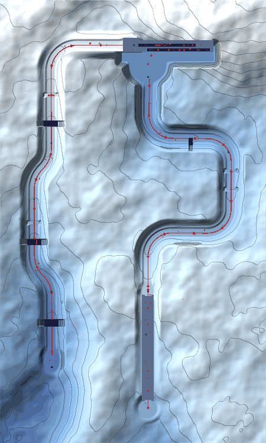

# Powderkeg Peak

A snow mountain above a sea of cloud. You climb it on foot and come down it on
the board, twice. Built from scratch for the brief "a new level based on the
shape and length of Crash levels recorded in the bible" (`docs/GAMEPLAY_DESIGN_BIBLE.md`).
It borrows structure only: the layout, content and scenery are original.

- Level id `powderkeg-peak`, source `src/levels/powderkeg-peak.ts`
- Bonus round `bonus-powderkeg-peak` ("Cold Storage"), source `src/levels/powderkeg-bonus.ts`
- Mountain toolkit `src/levels/powderkeg-terrain.ts`, scenery in code `src/levels/powderkeg-art.ts`
- Play-through pilots `tools/test-powderkeg-journey.mjs`, `tools/test-powderkeg-bonus.mjs`
- Edges of the world `tools/test-powderkeg-bounds.mjs`; fair restarts and landings `tools/test-powderkeg-fairness.mjs`
- All four run with `npm run check:powderkeg`

## Shape

North is up. The climb starts bottom centre and runs north; the first run
swings east and back to the frozen tarn; the headwall crosses the top of the
map; the last run leaves the summit (top left), runs west along the ridge and
south down the long face to the powder works (bottom left).

Two shapes from the bible's record are combined:

| Source in the bible | What was taken |
| --- | --- |
| Crash 2 mountain levels | Into the screen, a vertical join with a checkpoint, side-on rows up a wall, a one-way turn, into the screen again |
| Air Crash | Strict alternation of on-foot and on-board legs, each ending at a checkpoint |
| Crash 2/3 course length | Four main sections of about ten beats, one bonus round, one gem route |

The house rule for this engine decides which leg is which: climbs are walked and
carry the pits, ledges and enemies; speed lives on the two descents.

| Section | Mode | Length | New idea | Checkpoints |
| --- | --- | --- | --- | --- |
| S1 Kindling Steps | Foot, into the screen, 12 m walled gully | 197 m, +10.5 m | Ice underfoot | C1 first landing, C2 powder landing, C3 crest |
| S2 First Tracks | Board, square-wave descent | 561 m, -18.5 m | Rolling ice boulders | C4 past the boulders, C5 tarn |
| Tarn and hoist | Foot, hub; the camera turns side-on on the way up | 14 m lift | (rest) | C6 hoist landing |
| S3 The Headwall | Foot, side-on: east along the lower row, up the buttress, west along the upper row | 2 × 105 m, +22 m | Ice stampers | C7 east landing, C8 switch ledge, C9 summit |
| S4 Powderkeg Run | Board, ridge then the long face | 656 m, -40 m | Everything, combined | C10, C11, C12 |

## Beats

**S1 Kindling Steps.** Yard stack → snow crab alone on a wide shelf → mill pond
(first ice, a crate row to spin while sliding) → ice boulder on its blue track
(stand, watch, cross behind it) → half crevasse with a crate over the open half → arrow
crate with a pair side by side 8.3 m overhead (only the bounce with a double
jump at its top reaches it; fruit rises toward it) → first full crevasse, and
checkpoint C1 dead ahead of where the jump comes down → ice shelf with a firm
snow lip above the second crevasse → TNT debut on the powder landing (C2) →
bristleback alone on a wide shelf → three pillars, the last with a crab on it →
lookout shelf: a reward block and a Nitro pair at rest by the wall (first
Nitro, on foot) → crest (C3), a piste sign each side of the start arch.

**S2 First Tracks.** First stack dead ahead at the foot of the first pitch →
tall stack on the inside of the bend → slalom pair → Nitro pair on the edge of
a straight, in view for all of it → apex stack → two boulder troughs, each a
second and a half past the bend → tall stack and checkpoint C4, both on the
side that stays sound → the half crevasse: the plain fruit rides on down the
sound half; a bowed line of fruit offers the ollie and a log the grind, and
those two lines meet at one tall stack → bend stack → run-out stacks (the
fruit passes beside the first: the run-out is nearly level, and a board that
only coasts from C4 is under smashing speed by then) → shore.

**The tarn.** Ice with a block in the middle, a watcher on firm snow by the
hoist (its debut), the hoist up the wall.

**S3 lower row (east).** Stamper over solid ledge with eleven metres to watch it
from → bristleback on the take-off → lone pillar → stamper pair with a one-crate
pocket → rotten ice plank (debut, level with both banks) → TNT between two boxes
on the rest ledge, its blast clear of both the plank and the take-off → jump to
a far bank under a stamper, in plain view (the east landing stands back from
it) → three buttress tiers, one a dead end with a reward → east landing: a
balcony over the far bank, then into the screen to the landing proper (C7).
Its other edges are railed; fruit draws the turn.

**S3 upper row (west).** Stamper over glazed ice (wait on the dry landing, then
run) → pillar whose near four metres are clear, a bristleback keeping to its
far end (a full running jump off the ice lands 2.6 m short of it) →
three rotten shelves → switch ledge: checkpoint C8 by the lip, a life framed
by Nitro against the wall, three clear metres, the `!` by
the lip → switch bridge of four crates → four metres of floor, a mask → twin
stampers half a cycle apart with a crab in the pocket → last pillar → summit
(C9, the crystal, the bonus pad, a calm pile with the mask for the last run).

**S4 Powderkeg Run.** Piste signs and fruit down the dead-level ridge → ridge
rail with a watcher over it → tall
stacks down the first face → twin boulders rolling in step → first full
crevasse → tall stack, C10 → chicane with Nitro on the inside of each bend →
tall stack, C11 → fast boulder, then forty metres to line up → second crevasse
with a one-way crate bridge to grind → Nitro on both edges at once → tall
stack, C12 → the long gap (10 m: from its checkpoint the ollie has to be held
for the last four metres or so; a bare tap falls short) →
works yard, the green `!`, the gate.

## Ladders

Each hazard is introduced with room, developed, twisted, then used in the last run.

| Element | Introduce | Develop | Twist | Conclude |
| --- | --- | --- | --- | --- |
| Ice | Mill pond | Ice shelf before a crevasse | Glazed gallery under a stamper | Adit drift with Nitro beside the slide |
| Ice boulder | S1 track on foot | Two troughs on First Tracks | Twin boulders in step | Fast boulder before the crate bridge |
| Stamper | Solid ledge, long watch | Pair with a pocket; far bank | Over ice; twins with a crab | Adit: quick pair |
| Crevasse (board) | Half width with a sound lane | Full width, 9 m | Full width with a crate bridge | The long gap, 10 m |
| Nitro | Pair at rest on the lookout | Pair beside a straight on a board | Inside of each chicane bend; life framed on foot | Both edges at once; the green `!` |
| Arrow | Pair 8.3 m overhead | Steel arrow to the adit door | Steel arrow to the gem shelf | (bonus round's arrow gate) |
| Bristleback | Alone on a wide shelf | On a take-off | At the far end of a landing pillar | Adit pillar past a 4 m gap |

## Crates

142 crates in the level (138 counted) in 54 clusters, mean cluster size 2.57,
5 single crates (9 %); 12 checkpoints; 17 more in the bonus round; gem tally 166.
Every cluster has one named job in its label (teach, reward, bait, landing
marker, count trap, checkpoint group).

Three rules were adopted for the board runs after measurement:

1. A checkpoint is a box, and a board below 12.5 m/s trips on boxes. Level
   board speed is 12 m/s and a restart on a shallow grade stays near it, so a
   checkpoint closes its crate group: the stack comes first, then the
   checkpoint on the same line, then clear snow.
2. Every box on a run can be had in one pass. Where two lines split (the ollie
   and the log over the half crevasse) they meet again at one shared stack.
3. No explosive sits on a forced line. Nitro shapes lanes from the edges.

## Optional routes

**The Old Adit (blue gem).** A mine door 8.6 m up the wall above the east
landing, with a broken ladder under it and a steel arrow in the corner. Arrow,
double jump and a grab reach 9.0 m; a floor double jump with a grab reaches
7.0 m, 8.1 m off a stomped box. Inside, a detached ice gallery recombines what
the lower row has just taught: ice with Nitro beside the slide, two rotten
shelves, quick twin stampers with sound floor before and a six metre run-up
after (their pocket's one crate stands against the wall, so the pocket is
three clear metres), a 4 m gap onto a pillar whose near three metres are clear,
a steel arrow to the gem shelf (8.5 m). No checkpoint stands inside, so the
restart point never moves into the adit. Both ways out are rings on the back
wall, entered into the screen like the door outside: one by the entrance, one
past the gem. Each end of the gallery is a wall of ice against the last shelf.

**Cold Storage (bonus round).** Entered from the summit, once the Headwall has
taught everything in it. Seventeen counted boxes: an arrow gate with a pair
overhead, a stamper, a rotten plank, a TNT trap, a Nitro-framed life, a `!`
bridge and a green `!`. It is dressed as an ice store inside the mountain: a
wall of blue ice, timber framing, cut ice stacked along the back, each ledge a
column of ice (rock under the powder vault, a trestle under the switch landing).

## Measured in this engine

| Fact | Value |
| --- | --- |
| Board speed on the level; smashing speed | 12 m/s; 12.5 m/s (6–12.5 m/s trips over the box) |
| Coasting cap on grades of 4 % or more | 23 m/s |
| From a standing start, coasting on 2 % | 12.0 m/s after 11 m, 12.8 m/s after 56 m |
| From a standing start, coasting on 8 % | 12.6 m/s after 10 m, 16.7 after 30 m, 19.1 after 45 m |
| From a standing start, pushing | 15.5 m/s after 11 m, 23 m/s after 31 m |
| Ollie at 23 m/s, held | 0.62 s in the air, 14.2 m |
| Ollie, bare tap | 0.44 s in the air back to take-off height: 7.5 m at 17 m/s, 8.5 m at 19 m/s, about 10 m at 23 m/s |
| From the long gap's checkpoint (48 m back), coasting | 16.7 m/s at the lip; the ollie held over the last 4 m pops at 18.5 m/s and just lands, over the last 6 m at 19.6 m/s and lands clean |
| Each smash | costs 19 % of speed (a whole stack is one contact); a checkpoint costs 8 % |
| Jump, double jump (feet) | 2.84 m, 4.59 m; a grab adds 2.4 m |
| Breaking a floating crate from below | by the top of the silhouette, about 3.0 m above the feet: floor double jump 7.6 m, plain arrow bounce 7.9 m, arrow bounce with a double jump about 9.5 m |
| Arrow bounce | 16 m/s, 20 m/s with Jump held on impact |
| Spin | active 0.3 s, 0.15 s cool-down, 0.8 m reach |
| Run speed on foot; TNT and Nitro blast | 9 m/s; 2.75 m |

Authoring traps met here: a component label over 120 characters makes the whole
level invalid (the level file now throws at authoring time); a portal's trigger
box starts at its base, so each base sits a little under the floor it serves;
snow drawn beyond a walked pad is scenery, so every pad is closed by an unseen
wall with a post-and-rail fence to explain it.

More, from the polish pass:

- A mask spends itself on a kill sheet and its wearer falls on through. Every
  pit here has an unseen deadly floor just under its sheet (`kill()` adds both),
  or a masked player stands alive at the bottom, or falls out of the world.
- A crevasse drawn in the piste is scenery. Each is closed by unseen walls just
  under the snow at both lips, and the kill sheet steps down under the landing:
  a board that comes in just under the far lip rides over a low wall.
- A sheer far lip knocks down a board that arrives a hand low. Each crevasse
  has a landing apron of packed snow under its far lip (a ramp 1.6 m out and
  0.9 m down) that carries such a board up onto the piste.
- A lip that can be grabbed but not climbed is a false promise: an unseen fence
  stands in front of such a lip, never inside the rock behind it.
- A box whose lid is exactly flush with a floor is a wall or a step depending
  on the last bit of a floating-point sum. Crate bridges sit 2 cm under the
  floors they join.
- A rock or ice face made in code must stay in front of the dark block behind
  it (`back` on `cliff()`), or the block shows through as flat dark blots.
- Vertex colours reach the renderer as linear light. A rock tone written as the
  colour meant renders as a pale haze; the slate palettes are written darker.

## How it is built

One height function describes the whole mountain (`Mountain`: knolls, roughness,
ordered carves). Ridden pistes and walked pads are fine solid patches of that
function; the slopes are coarse tiles of the same function; crevasses are part
of the bed carve (full or part width) with an ice rim, a band of hard blue and a
dark drop so the far wall reads from a board. Rock is slate scenery pieces
backed by faceted faces made in code; ice faces, snow caps, timber, fences,
piste signs and the boulders' ice tracks are made in code too. Huts, lamps,
arches, kegs and pines are existing assets. The sky is the game's blue
"country club" painting with the light pinned to what "day" gave: the "day"
painting has green jungle towers in its cloud sea, and they loomed behind the
snow summit.

## Verification

| Check | Result |
| --- | --- |
| Input-only pilot, main route | Finishes in 175.2 s, no deaths |
| Input-only pilot with the gem route | 204.0 s, no deaths |
| Collector's line (`POWDERKEG_COLLECT=1`) | 221.3 s, no deaths; all 12 checkpoints and 123 of the 138 counted crates |
| Bonus round pilot | 39.5 s, 17 of 17 counted boxes |
| Edges of the world (`tools/test-powderkeg-bounds.mjs`) | 103 cases: the hoist pit, both banks of both runs to their last metre, every pit with and without masks, short jumps and lip grabs at all four board crevasses, the east landing's edges, two lips that used to be grabbable |
| Fair restarts and landings (`tools/test-powderkeg-fairness.mjs`) | 23 cases: every on-foot checkpoint held forward for 1.25 s, the full jump off the glazed ice, the adit's pocket, arrival and wide gap, coasting down the fruit of both runs, the long gap from its checkpoint |
| `npm run check:levels` | passes |
| Crate report (`tools/crate-placement-report.mjs --levels powderkeg-peak`) | figures above |

The fifteen crates the collector leaves are known: the two TNT clusters (five)
and the adit's bait pair (the pilot will not spin beside an explosive), the
four switch-bridge crates it walks on, and four far crates of S1 clusters its
spin does not reach. No crate on either board run is left.

Medal times: gold 165 s, silver 195 s, bronze 240 s (main route).

## Known limits

- The bible's geometry report follows the camera lane, so it under-reports the
  two side-on rows and the adit.
- The pilots prove one line and its collector variant, not every line a player
  can choose; the half crevasse's ollie line and the chicane edges were checked
  by measurement and by eye.
- Two independent reviews were taken. The first found two blockers and twelve
  fairness items in the first complete version; all were addressed. The second
  found no blocker and nine smaller items; eight were fixed (among them a kill
  box the rising hoist carried a rider through, a landing beside a Nitro, a
  missing checkpoint on the upper row, and fruit that led a rider into the
  first crevasse). The ninth, that the first arrow's reward needs Jump held on
  the arrow, was tested and does not hold: a plain bounce with a double jump
  breaks the pair. The pair was set side by side all the same, since a stacked
  upper box sat at the limit of that move.
- A polish pass on 15 November 2026 added a random walker, a photographed
  walk-through of the whole route in full render, and a third independent
  review (of play only). Together they found four ways out of the world or
  into a soft-lock, and thirteen fairness items; all four and twelve of the
  thirteen were fixed (see `docs/LEVEL_ITERATIONS.md`). The thirteenth, that
  nothing but the arches told a player to get on the board, now has a piste
  sign at each start; the game has no prompt component to do more.
  No human has played the level yet.
- The bible's Part XV gives head reach as feet plus 0.92 m, and the crate
  report classes the arrow pair by that figure ("arrow-perfect-double"). The
  engine now breaks floating crates with the top of the silhouette, about three
  metres above the feet, as measured above; the bible's table needs re-measuring.
- The long gap asks for a held ollie from its own checkpoint. A hold over the
  last four metres lands low on the apron and may spill; under that the rider
  hits the far wall and falls in. Nothing in the world says "hold": the fruit
  arcs over the gap, as at the other crevasses.
- A stamper cannot be ridden up to the adit door: it has no top to stand on
  (a player placed on a resting one is pushed off its side).
- Not changed in the polish pass: streaky snow on the cuts of the boulder
  troughs, the arches' legs crossing the corners of the view, and the wait for
  the hoist, which is seen side-on from 16 m with the tower in front.
- Rock is built from existing slate pieces and code-made faces. Bespoke
  modelled pieces would need the owner's Tripo account, which this cloud session
  cannot reach.
