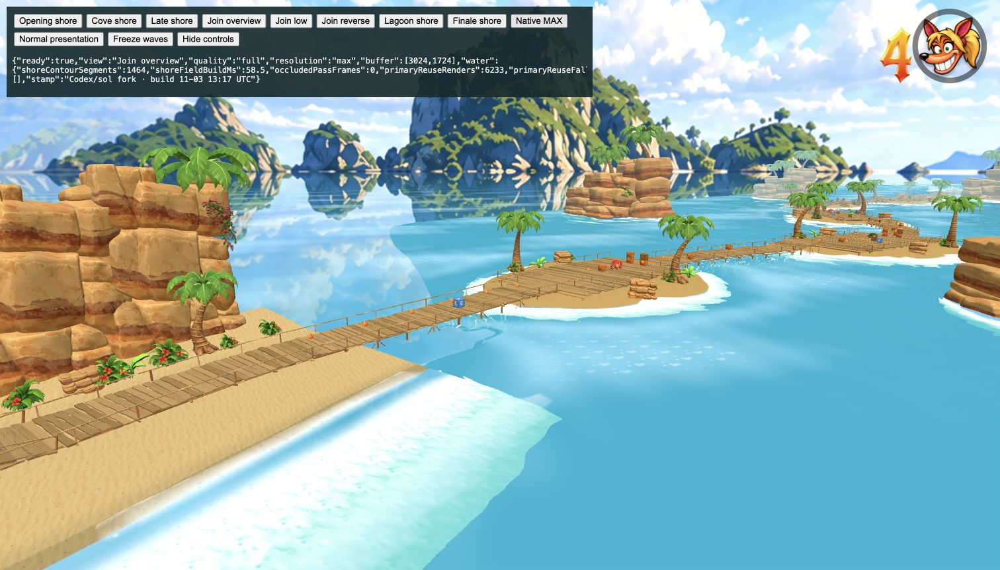
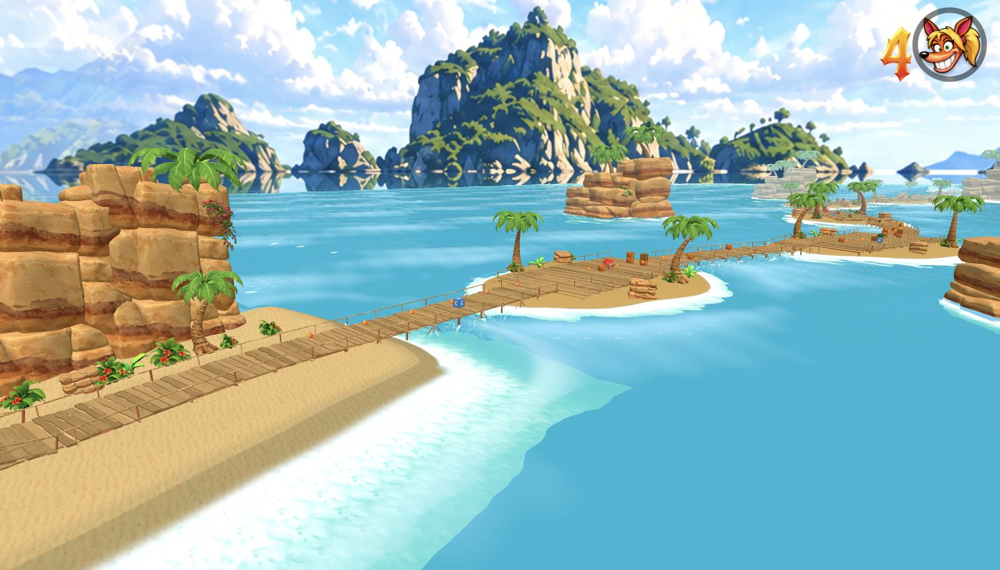
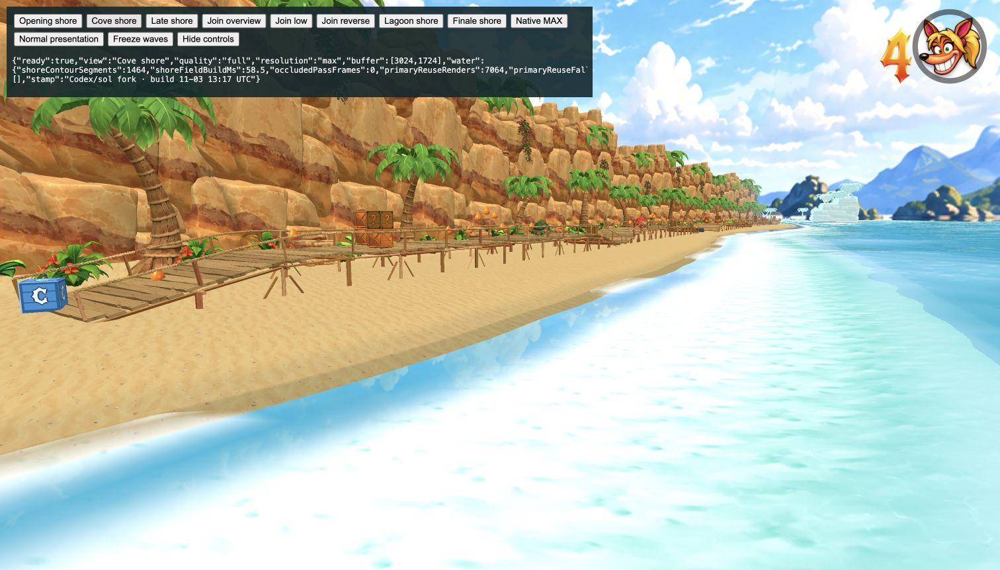
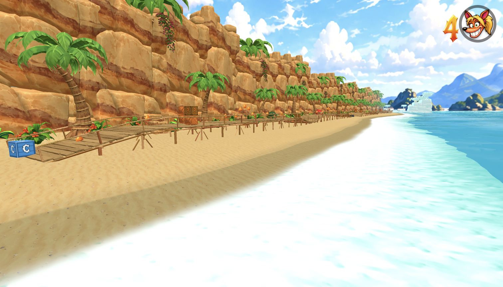

# Banana Bay shoreline and water join — 4 November 2026

Banana Bay (`beachfront`) combines the original beach and Island Hopper lagoon.
The old 300m-wide water ribbon offset every row along a changing shore normal.
At the joining turn this folded 6,506 triangles downward and produced 1,306
overlapping probe locations, with up to three water faces at one point. Its
landward edge also exposed the flat far-sea reflection beneath the departure
pier. The far fill showed through the transparent shallows as a mirror strip.

The fix uses parallel, fixed columns with 2m cells around the playable coast
and broader cells offshore. The surface covers the full departure and lagoon;
its rows cannot cross at the turn. The detailed water now has 173,680 triangles
instead of 263,168. Both full and lite geometry are below their original budgets.

The ocean edge follows the actual fine sand contour. Zero-overlap water clips
foam to the real bed and keeps landward swash below the dry beach. The far fill
shares that bed field so transparent shallows reveal sand. A welded 12-row
underwater cap rounds the original beach's rectangular end; every original
sand position remains exact, and all UV, normal and tangent buffers cover the
extension. Its outer edge lies 2.8m below world zero. The route, scenery,
distant islands and movement tuning remain authored as before.

| Before | After |
| --- | --- |
|  |  |
|  |  |

## Verification

- `node tools/test-banana-bay-water.mjs`: 16,371 join coverage probes across
  native full and rotated/translated editor copies in full/lite; no gaps,
  duplicate faces, reversed faces or degenerate faces. 1,760 dry-sand probes
  and 1,200 animated dry-shore samples pass. Exact original sand positions,
  complete extension attributes and normalized editor capture pass.
- `node tools/test-banana-bay-route.mjs`: continuous native input-only journey
  finishes in 229.05 seconds with zero deaths.
- Ocean resource/reflection, formula/sizing and Treehouse ocean regressions pass.
- `npm run check:levels`, `npm run build` and `npm run check:release` pass.
  Release output: 805,689,721 bytes. No full suite ran.
- Chrome full/native 3024×1724 and normal CRT presentation: curved shoreline,
  join overview and both directions reviewed, with no console errors. Lite
  keyboard traversal crosses the join, activates the departure checkpoint,
  deliberately falls into the lagoon and respawns on that checkpoint. A
  separate finish-approach fixture reaches the actual finish gate.

The local review page is
`/tools/banana-bay-review.html?playtest&level=beachfront` (append `&lite` for
the reduced render path). Camera and initial-position controls are review
fixtures; they do not modify the shipped game or supply synthetic outcomes.
Keyboard input handles the smoke traversal, fall, recovery and finish.

Prompt to browser-validated playable: approximately **42 minutes**
(13:14–13:56 UTC), including diagnosis, mesh and shoreline refinements, focused
regressions, full-route validation and the release build.
