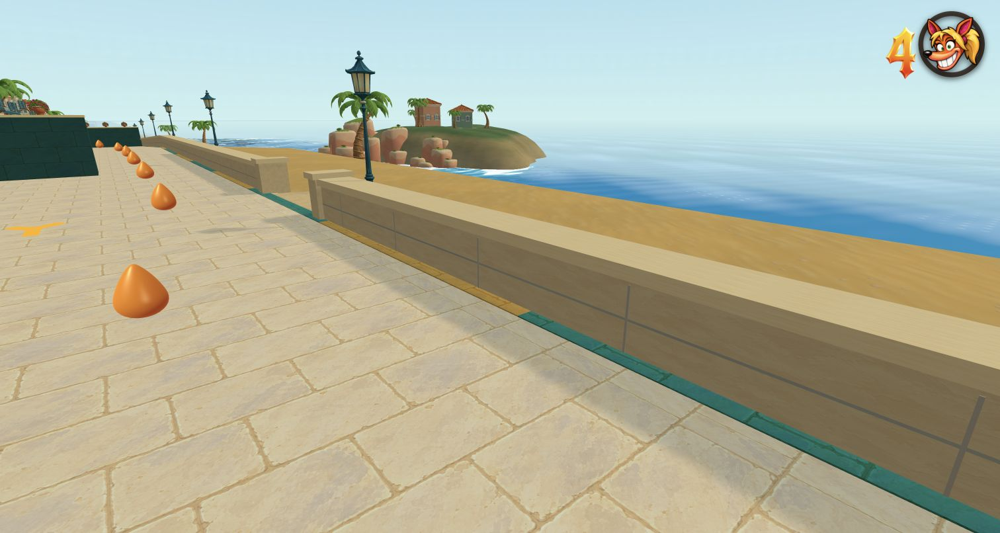
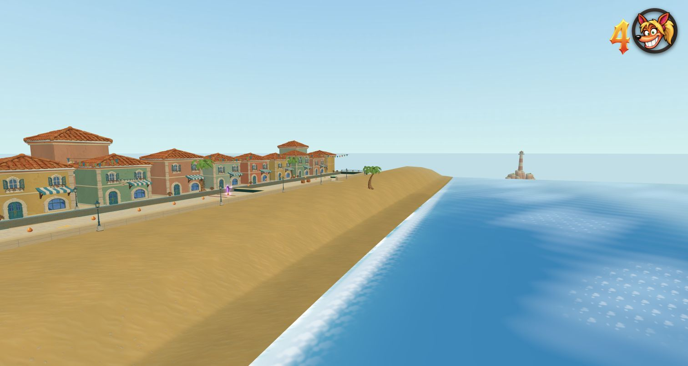
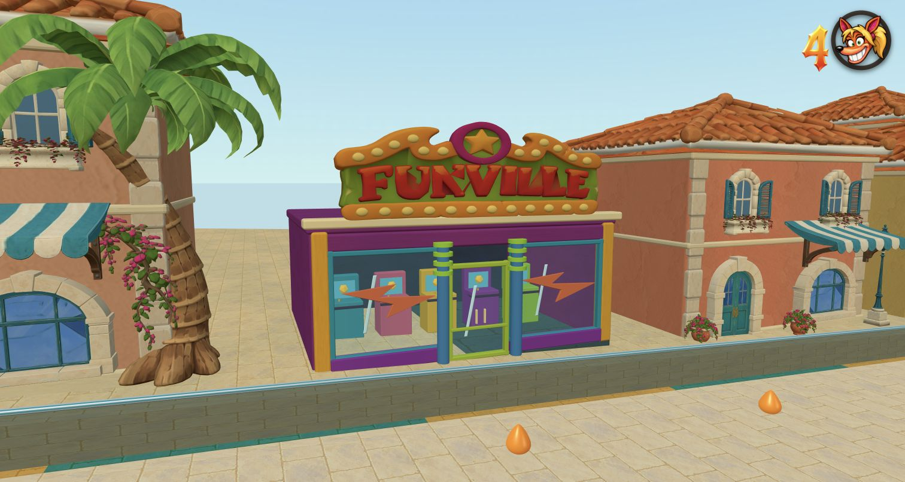
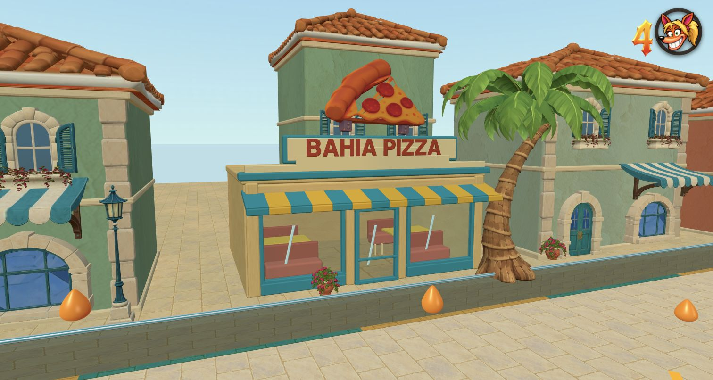
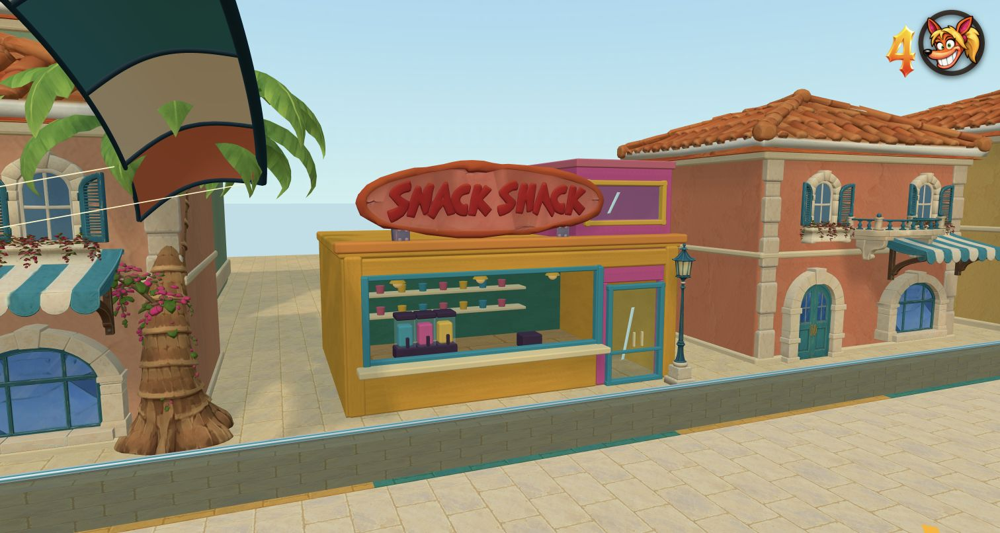

# Beach Street: Bahia Bay

The right side of `coastal-street-run` uses a continuous beach made with Treehouse Trails' `unity-sand` material, metric UVs, and curved shoreline ocean. The cream stone wall has fourteen access openings. Sand follows the existing road grades, with a broad upper shelf, and continues below sea level. Both water layers begin 0.65 m seaward of the sea-level contour. Original offshore islands, roads, pits, kite encounters, checkpoints and finish remain unchanged.

Nine business slots alternate Snack Shack, Funville and Bahia Pizza among the original shops. Walls, frames, glass, service hatches, counters, slush machines, arcade cabinets, booths and awnings are separate manually authored components. Glass has actual interior geometry behind it. The only generated meshes are the three sculpted signs.

## Reference and modelling sequence

1. Viewed Weekenders references: [beach](https://pbs.twimg.com/media/Ea7GJWrXQAAx9yy.jpg), [Snack Shack](https://img1.hotstarext.com/image/upload/f_auto/sources/r1/cms/prod/5524/1779771415524-h), [Funville](https://s2.dmcdn.net/v/Uy1jJ1aYw-Xb4yKcI/x1080), [pizza restaurant](https://www.laughingplace.com/uploads/media/2026/05/tumblr_n4nbfpY8Wd1qmj3m3o5_500.png), and [Bahia Bay context](https://disney.fandom.com/wiki/Bahia_Bay).
2. Imagegen drew Weekenders business studies, then a separate Crash Bandicoot 4 aesthetic pass for every modelling reference. Images are in `concepts/`; exact prompts are in `imagegen-prompts.json`.
3. Uploaded each sculpted sign reference separately through the Tripo web app, using plan credits. **Smart Mesh P2.0, Triangle topology**, followed by a 2K texture pass. No Tripo API credits used.
4. Exported GLBs, checked actual triangles, and losslessly compressed geometry. Import verifies every vertex value, oriented triangle and texture byte survives compression. No distance-based simplification.

| Component | Target ceiling | Exported triangles | Final GLB bytes | Plan credits |
| --- | ---: | ---: | ---: | ---: |
| Pizza slice | 3,000 | 2,926 | 648,444 | 110 |
| Snack Shack sign | 5,000 | 4,974 | 629,444 | 110 |
| Funville marquee | 8,000 | 7,372 | 843,792 | 110 |

An initial HD generation was rejected and removed before delivery. The final assets above were generated anew with Smart Mesh. `AGENTS.md` now records Smart Mesh always, a 30,000-triangle absolute per-model ceiling, smaller budgets appropriate to each object, and manual construction for simple geometry. The ceilings are not targets.

Per-asset manifests beside the GLBs record Tripo task IDs, budgets, SHA-256 hashes and compression verification. A complete manually authored shop uses approximately 6.5–8k triangles before its sign.

## Focused validation and review

`node tools/test-beach-bahia.mjs` verifies asset budgets and hashes, unchanged gameplay and islands, editor normalization, transparent panes, open beach access, shared sand edges, and separation of animated water from dry sand. It writes `shore-validation.json`.

The local-only `tools/beach-bahia-review.html?playtest&level=coastal-street-run` uses the actual game renderer and controls. Its buttons select shop and coast cameras, native MAX/normal presentation, and the existing full-route keyboard pilot. Add `&lite` for a fast initial pass. The review page is not a release entry point.

`tools/beach-bahia/import-signs.mjs` takes `pizza-slice snack-sign funville-marquee`; it expects `bahia-<name>-smart.glb` exports in `BAHIA_DOWNLOADS`. `BAHIA_GLTF_PACKAGE` points to a package.json with `@gltf-transform/core`, `@gltf-transform/extensions` and `meshoptimizer` installed. These authoring tools do not enter the game bundle.

## Completed checks

- `npm run check:levels`: pass.
- `node tools/test-beach-bahia.mjs`: pass; 8,465 dry probes, 140 supported access probes, 3,936 wave samples. Minimum animated shoreline margin: 0.645 m. 18 joined sand patches; 8,266 total level components.
- `BEACH_OUTPUT=docs/beach-bahia/gameplay node tools/test-beach-kite.mjs`: pass, including the complete route, missed-canal death and earned-checkpoint respawn.
- `npm run build`: pass; `npm run check:release`: 805,684,970 / 1,000,000,000 bytes.
- Chrome lite and full renderer: all three shops inspected; real transparent panes and open counter, no tree intrusion into the pizza window, warm sand visible from the road, intact islands and a continuous foam edge. Native buffer 3024×1612 and normal 900×480 + CRT reviewed.
- Full browser route: finished, zero crashes, 11 checkpoint states, 13 jumps, crystal collected; no console warnings/errors or failed assets. `browser-route.json` and `route-finish.png` record the outcome.

