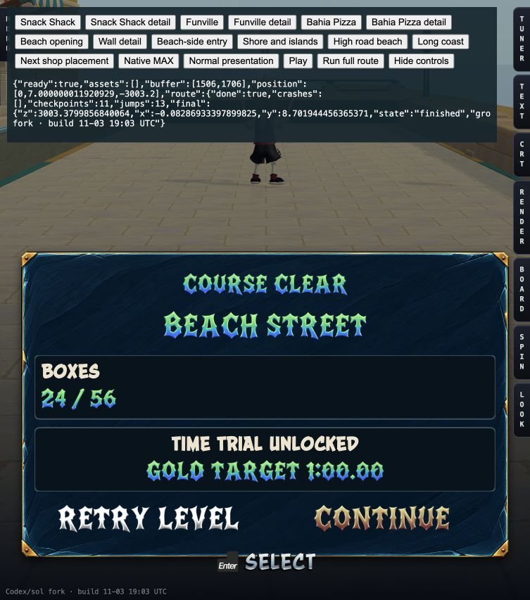
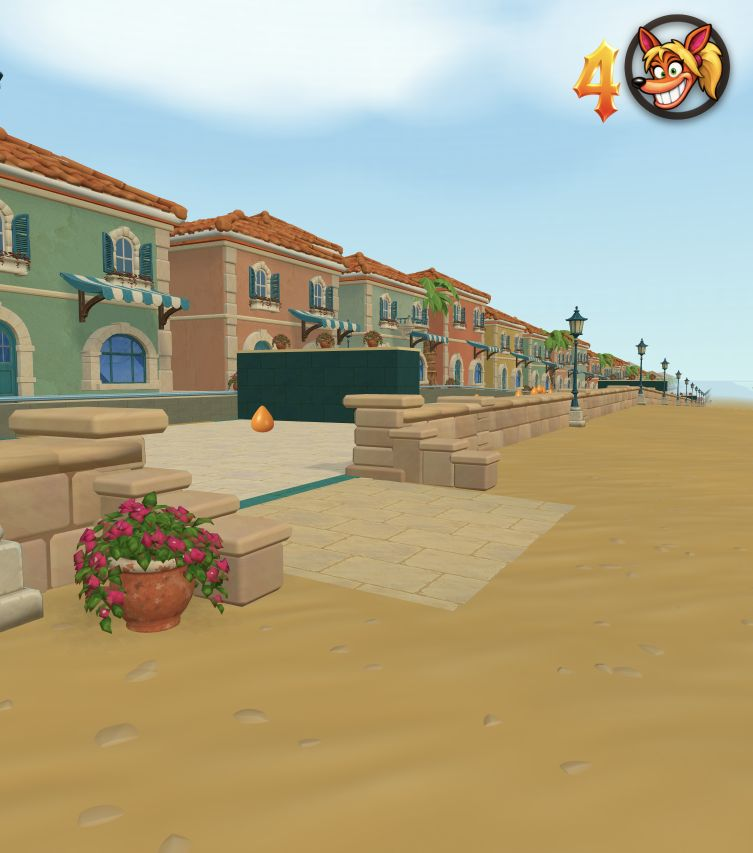
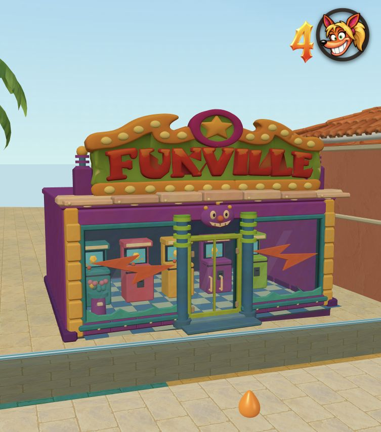
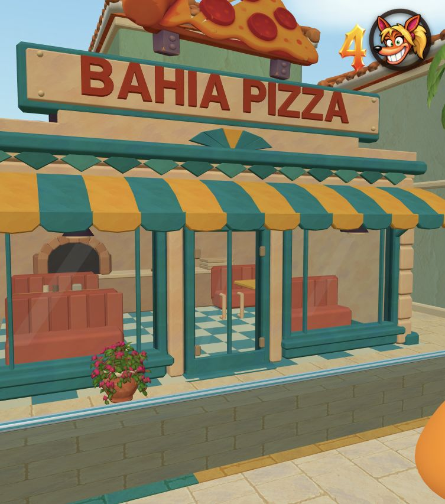
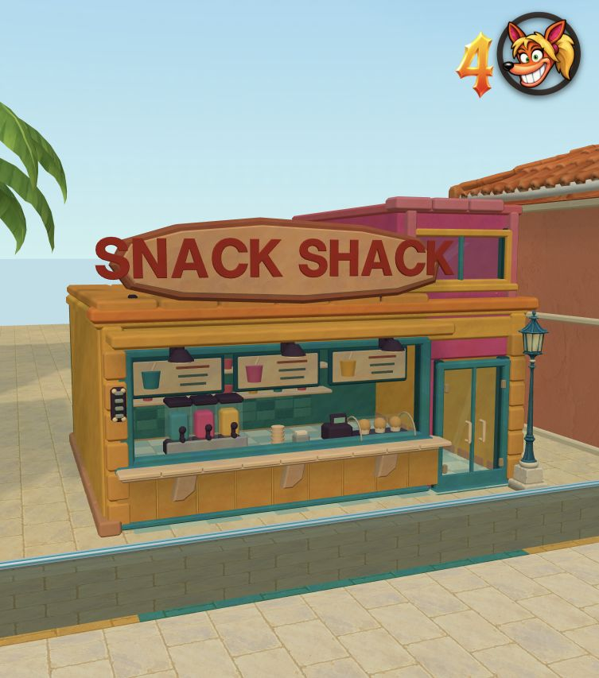

# Beach Street: second craft pass

The first Bahia pass had flat wall slabs, sparse interiors and boxy awnings.
This pass builds the architectural parts by hand against the existing Crash 4
reference images, keeping the original businesses recognizable at street speed
and at native render resolution.

The wall now has two staggered stone courses, separate softened capstones,
197 intermediate piers, and fourteen entrances with capped piers and stepped
returns. Mortar cores and fitted contacts keep the structure solid. Each of
the 259 small stone bays retains its complete geometry at all distances.

Snack Shack has a carved plaque with correctly spelled geometric lettering,
counter panels, drink menus, slush taps, shelves, cabinets and a glazed bakery
case. Funville has a dimensional canopy, a carnival face, arcade controls,
prizes and a transparent capsule dispenser. Bahia Pizza has a curved striped
awning, stepped Art Deco trim, upholstered booths, table settings, an arched
oven and a fitted kitchen. Real window reveals, sills, door pulls, hinges and
transparent panes are separate components.

All nine shop rooms sit above the highest terrace point under their footprint;
closed foundation skirts cover the change in grade. Nearby palms are clear of
their signs. Original road and gameplay components and all five offshore
islands are unchanged. The sand and ocean still use the continuous Treehouse
material/shoreline implementation with a 0.65 m offshore water margin.

| Complete business | Manual triangles | Including generated sign |
| --- | ---: | ---: |
| Snack Shack | 17,528 | 17,528 |
| Funville | 17,000 | 24,372 |
| Bahia Pizza | 13,336 | 16,262 |

The existing Smart Mesh pizza slice and Funville marquee are reused. No new
Tripo generation was needed for these simple architectural parts. The old
misspelled Snack Shack sign is no longer placed in the scene. Full silhouettes
are retained; no distance-based substitution or decimation was added. The
complete source still fits the editor's existing import limits.

## Imagegen material

The new `public/coastal-town/bahia-painted-plaster.png` is a full-resolution
1254 × 1254 hand-painted albedo from imagegen, tinted in the manual parts.
Reference: `../concepts/snack-shack-crash4.webp`. Exact prompt and output
provenance are in [material-generation.json](material-generation.json).

## Review evidence

The local review page uses the real renderer and original lighting. Still
cameras hide only the frozen player and its kite so the detached camera cannot
stretch the player's kite lines through a shop. Play and the route pilot use
the normal player, keyboard input, collision, checkpoints and finish.

- `shop-1-native.png` through `shop-9-native.png`: every placement, including
  raised rooms on sloped terraces and palm clearance.
- `*-detail-native.png`: counters, arcade equipment, booths, glazing and trim.
- `beach-entry-native.png`, `beach-road-native.png`, `high-beach-native.png`,
  `long-coast-native.png`, `shore-native.png`: entrances, wall courses, sand,
  foam and retained islands at native/MAX resolution.
- `pizza-normal.png`: normal 480-wide internal buffer and CRT presentation.

## Validation

- Required `npm run check:levels` passes.
- Focused Bahia check passes: 8,465 dry-ground probes, 140 supported-access
  probes, 3,936 animated-wave probes and exact shared edges across eighteen
  sand patches. Minimum animated shoreline separation is 0.645 m. All nine
  room floors clear their underlying terrace by at least 0.04 m.
- Complete source survives editor normalization at 9,060 components. The
  retained islands and original gameplay groups match their baseline hashes.
- [Native gameplay report](gameplay/native.json): all thirteen jumps, all 24
  main-route crates, crystal and finish; deliberate collisions, missed-canal
  death and earned-checkpoint respawn pass.
- [Full browser run](browser-route.json): finish, zero crashes, eleven checkpoint
  states, thirteen jumps and the crystal. The separate 32-crate bonus was not
  entered. Normal presentation and native 1506 × 1706 rendering were both used.
  No console warnings/errors or failed assets.
- Production build/type-check and release-size check pass: 809,015,865 bytes
  against the existing 1,000,000,000-byte hosting budget. No full suite ran.

The release checkout now skips the large `art/` and `docs/` authoring archives,
retaining the three imported level snapshots and all HTML tool-catalogue entries.
An explicitly requested full suite restores the complete checkout. Two builds
of the same commit produced the same 1,853 files and byte count; all game assets
match exactly, and all JavaScript matches after normalizing build timestamps and
generated bundle filenames. See [checkout validation](checkout-validation.json).
The authoring library remains in the repository.

