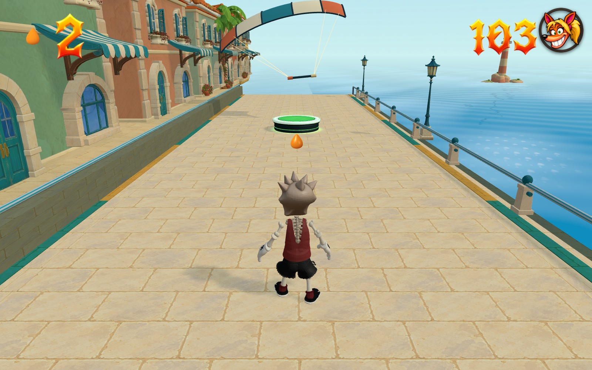
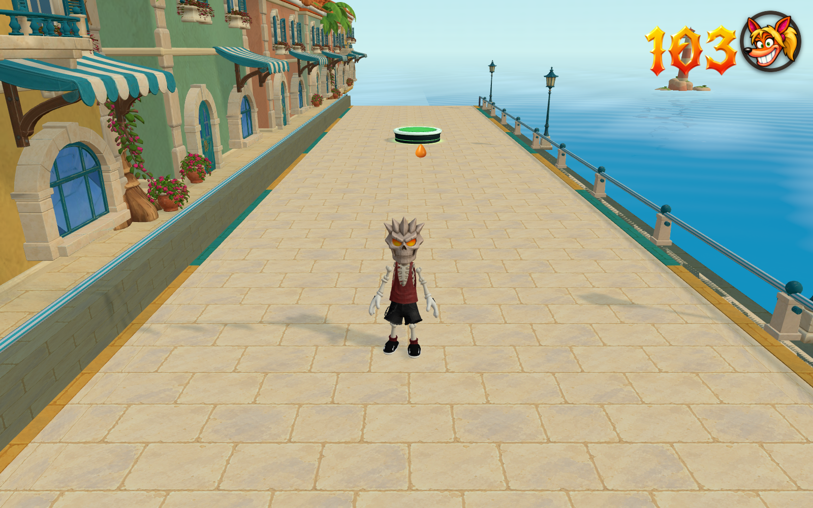

# Stronger wind and an on-foot finish

The kite now receives sustained gusts in either direction, with faster smooth
changes and a larger lateral pull. Two seeded 60-second samples show average
absolute lateral wind of 1.75 and 1.82 m/s. The same once-per-second sampling
used by the previous review rises from 0.70/0.65 to 1.73/1.83 m/s. These are
measured samples, not guarantees for every random run. Steering responds more
quickly while retaining its existing maximum authority. The canopy travels
farther sideways and rolls more visibly with the gusts.

After the last reward boxes, 20 metres before the gate, a grounded rider lets
go of the kite and steps off the board. The complete kite, bar and lines fly
forward and upward, then retire after five seconds. The rider remains intact
and uses ordinary foot movement, with room to stop, walk sideways or backwards,
and choose the final jump. A charge carried through the tow must be released
and pressed again; walking into the finish alone does not end this kite run.
Respawning restores the tethered run. Kite crash rules apply only while towing.

The approved obstacle contrast, solid islands and authored encounter layout
are preserved. No level data, public level pack or global tuning changed.

## Validation

- `motion.json`: sustained varying gusts, normal live jump/speed charge,
  conserved brake reserve and seven input-edge cases pass.
- `native-finish.json`: supported release, held-input rearm, stable idle,
  sideways/backwards exploration, deliberate finish jump and respawn reset pass.
- `native-controls.json`: ordinary kite spins, flips, grinds, pad contact and
  avoidance, uncrossed glove contacts and tethered fatal collapse pass.
- `native.json`: the connected three-kilometre course clears all 13 authored
  jumps, ten checkpoints, all 24 main boxes and the crystal. It stops before
  the finish and waits for a separate foot jump. Deliberate obstacle/gap failures
  and checkpoint retry still pass. This isolated fixture has no linked bonus.
- `pacing-review.json`: the existing conservative worst-reversal check retains
  at least 0.302 seconds under maximum adverse wind; measured landings retain
  at least 1.033 seconds before the next obstacle approach.
- `tools/test-skate-run-finish.mjs` passes the shared competition dismount,
  planted support, input lock and retry cleanup regression.
- `build-final.json`: the exact production `tsc --noEmit && vite build` passes.
  No `check:all`; no level check rerun because geometry/data are unchanged.

- `browser-lite.json` and `browser-full.json`: real keyboard journeys finish
  all three kilometres with zero crashes, 13 jumps, ten checkpoints, all 24 main
  crates and the crystal. Bypassing the 36 linked bonus crates correctly withholds
  the gem. Both stop before the finish, walk sideways and backwards, then finish
  on a fresh jump. The full pass stops at Z = -2985.24 with speed zero. Maximum
  glove-to-bar error is 0.214 mm across the two passes. Console, request and asset
  errors are empty; no reduced scenery meshes were used.
- `bonus-retry/browser-full.json`: actual bonus entry, two kill-plane failures,
  supported stationary retry, second entry, bypass and completed-return branch
  pass with the stronger gusts. The completion branch is an explicit transition
  fixture, not a claim to collect all bonus boxes.
- `browser-framing.json`: all 16 extreme wind/steering combinations pass at
  1600×1000, 815×850, 480×900 and 900×480. It projects every canopy mesh vertex,
  since an axis-aligned box includes empty corners around a rolled foil.
  MAX/native captures verify the full model, intact hands and supported rider.

The connected course/bonus evidence uses `Codex/sol fork · build 10-27 20:24 UTC`,
offline version `26eea4d2d0215c233c2f`; its build record is `build-course.json`.
The final viewport-only correction extends flying lines when the view is
narrower than 1.6:1, keeping the larger gusts from clipping a tip. It leaves
physics and the tested 1600×1000 presentation unchanged. The final build and
16-case framing review use `Codex/sol fork · build 10-27 20:35 UTC`, offline
version `dc2c6603b0dd0b9c9ca2`. The visible 5288 preview was reloaded and its
build stamp verified. Source, tool, report and image hashes are in
`verification.json`.

