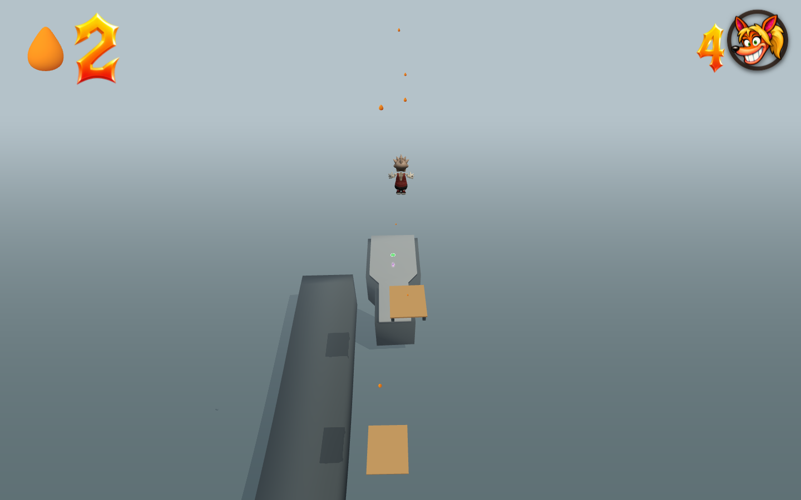

# Carlisle Coast · Tidal Relay greybox

The Maynard Quay Coming Soon slot now contains a 4,000 m coastal platforming
course. The older Uga Ambush level and its save key remain separate.

| Act | Survey distance | Development |
| --- | --- | --- |
| The Breakwater | 0–1,280 m | Surf steps, a scissor groyne, tide lifts, opposing winches and a lighthouse climb. |
| The Tidal Engine | 1,280–2,700 m | Elliptical docks, three pinwheels, a vertical bucket wheel, moving springs, counterweights and crossing crane arms. |
| The Storm Crown | 2,700–4,000 m | Exposed headlands, helical platforms, a travelling pier, opposing spirals and the homeward dive. |

There are 18 named sections, 61 primary spring transfers, one optional recovery
spring, 41 moving decks and 17 checkpoints. Distance is the surveyed horizontal
centreline; vertical arcs and lateral steering add travel. Gold/silver/bronze
targets are 500/620/780 seconds and remain provisional greybox targets.

## Physics and readability

Springs call the existing player trampoline implementation. They set vertical
launch speed and use the existing 1.25× held-jump multiplier. Gravity, terminal
fall speed, air steering, walking and skateboard momentum are unchanged. A
neutral bounce has zero horizontal displacement. Hold Jump through a landing
for the higher bounce, and use the normal movement controls to steer.

Authoring measures flight duration against the native movement model and allows
for a takeoff near the back edge of a pad and both platforms' motion ranges. No target vectors, homing, horizontal
launch impulses, gravity overrides or global tuning changes are shipped.
Spring surfaces sit 0.2 m above their approach height, preventing coplanar
walkway contacts from delaying a bounce long enough to engage hold-to-skate.

The shared mover primitive gains bounded elliptical motion, continuous yaw and
an optional native trampoline surface. Mover contact displacement includes rotation as well as translation; the
existing dynamic edge system retains grindable rims. Closed grey decks and cliffs establish the coast, amber identifies springs,
and blue-grey identifies machinery. The elevated camera keeps landing surfaces
visible at the apex of the large arcs.

## Reproducible checks

- `node tools/test-carlisle-relay.mjs`: native flights, neutral/held parity,
  source validity, 4 km survey and three-act structure. `PHASES=0,7` exercises
  all 61 transfers at two machinery timings.
- `node tools/test-kinetic-platforms.mjs`: stationary rider carry, live rim
  grinding, native held-Jump entry at three mover phases, capture round-trip
  and invalid motion rejection.
- `node tools/test-carlisle-route.mjs`: ordinary input-only route pilot; optional
  `START_S` starts once at a checkpoint, and `END_S` bounds a section review.
  It does not edit positions, velocity, gravity or machine clocks during play.
- `node tools/carlisle-relay-browser.mjs [--lite]`: real browser spawn, walking,
  neutral and giant held bounces, visible landing at apex, checkpoint/sea
  recovery, moving transforms, finish and console checks. Full mode verifies
  the native canvas, then captures the normal presentation.
- `node tools/sync-carlisle-relay.mjs`: updates only this level's published
  snapshot and stock certificate, preserving other authored levels.

See `native-physics.json`, `kinetic-contact.json` and `full-browser.json` for
measured results. Traversal reports are checkpoint-section reviews, not a claim
of an uninterrupted zero-death speedrun. The timing pilot can miss a rotating
handoff; the course deliberately retains waiting and jumping decisions.
The browser checks use isolated profiles and do not alter the user's saved games.

