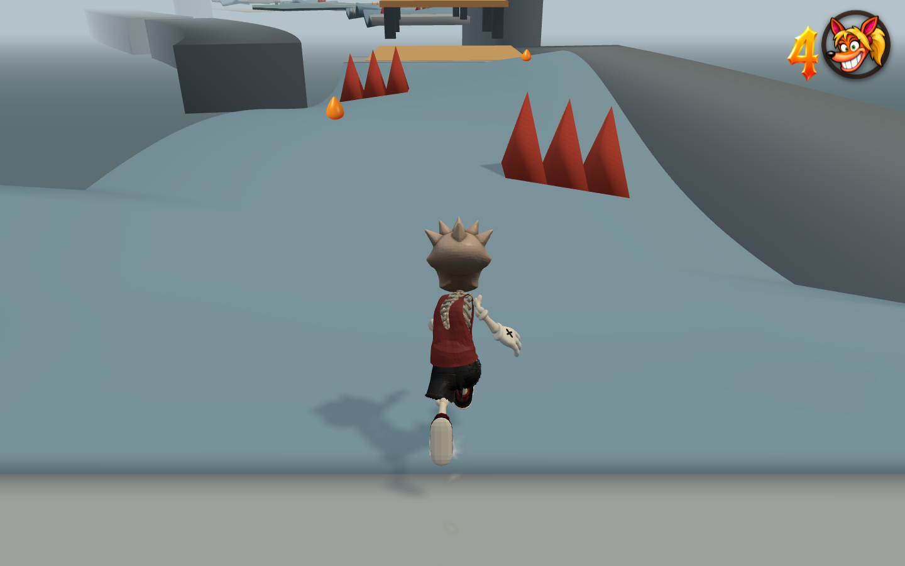

# Carlisle Coast · Tidal Relay greybox

The Maynard Quay Coming Soon slot now contains a 4,000 m coastal platforming
course. The older Uga Ambush level and its save key remain separate.

| Act | Survey distance | Development |
| --- | --- | --- |
| The Breakwater | 0–1,280 m | Surf steps, a scissor groyne, tide lifts, opposing winches and a lighthouse climb. |
| The Tidal Engine | 1,280–2,700 m | Elliptical docks, three pinwheels, open spring terraces, moving springs, counterweights and crossing crane arms. |
| The Storm Crown | 2,700–4,000 m | Exposed headlands, helical platforms, a travelling pier, opposing spirals and the homeward dive. |

There are 18 named sections, 63 primary spring transfers, one optional recovery
spring, 37 moving decks and 17 checkpoints. Distance is the surveyed horizontal
centreline; vertical arcs and lateral steering add travel. Gold/silver/bronze
targets are 500/620/780 seconds and remain provisional greybox targets.

## Physics and readability

Springs call the existing player trampoline implementation. They set vertical
launch speed and use the existing 1.25× held-jump multiplier. Air gravity,
terminal fall speed and neutral trampoline momentum are unchanged. An on-foot
neutral bounce has zero horizontal displacement. Hold Jump through a landing
for the higher bounce, and use the normal movement controls to steer.

Following playtest feedback, large trampoline airs now allow up to 60% more
lateral correction, immediate countersteering and mounted forward/back control.
Neutral input adds no sideways drift. A mounted bounce accepts the existing
fresh press/release abandon-ship jump; an on-foot bounce retains its double
jump. Small springs and ordinary jump/ollie controls retain their normal feel.

Authoring measures flight duration against the native movement model and allows
for a takeoff near the back edge of a pad and both platforms' motion ranges. No target vectors, homing, horizontal
launch impulses or bounce-gravity overrides are shipped. Global tuning is unchanged.
Spring surfaces sit 0.02 m above their approach height. This wins overlapping
support contacts while allowing a skateboard to roll onto the spring without
tripping on a raised lip. Static and moving springs use the same top offset.

The shared mover primitive gains bounded elliptical motion, continuous yaw and
an optional native trampoline surface. Mover contact displacement includes rotation as well as translation; the
existing dynamic edge system retains grindable rims. Closed grey decks and cliffs establish the coast, amber identifies springs,
and blue-grey identifies machinery. The ground camera uses normal tuning.
Large spring airs ease toward a near-overhead landing view (4.5 m behind,
26 m above, 80° tilt and 72° lens), then return to the ground view. The camera never changes
the input frame or the bounce trajectory.

The overhead revision follows the user's Jak and Daxter reference. OpenGOAL's
[Jak 1 camera contract](https://github.com/open-goal/jak-project/blob/master/goal_src/jak1/engine/camera/camera-h.gc#L328-L329)
defines separate long/short launcher camera states; Carlisle likewise scopes
its presentation to the spring air. The 80° angle and framing distances above
are this prototype's chosen values, not a claim about Jak's exact settings.

## Reproducible checks

- `node tools/test-slippery-gravity.mjs`: opt-in downhill vector acceleration,
  retained foot momentum, countersteering, board side-slip, unchanged legacy
  ice and portable capture.
- `node tools/test-carlisle-slippery.mjs`: 23 continuous input-only crossings,
  1,797 ground probes and lethal contact with all 36 visible spike obstacles.
- `node tools/carlisle-slippery-browser.mjs [--lite]`: real keyboard traversal
  of three representative crossings, neutral downhill drift, visible banks,
  spike death and dry-checkpoint recovery; full mode includes MAX and CRT views.
- `node tools/test-carlisle-dredger-terraces.mjs`: continuous input-only climb
  and its slippery upper exit at three machinery phases; no ascending floor
  catches, unexpected grounding jumps, bails or deaths.
- `node tools/carlisle-replay-audit.mjs <replay.json> [git-ref]`: replay diagnosis
  against historical player/course source without changing the checkout.
  `CARLISLE_REPLAY_LIVES` explicitly supplies missing starting life inventory.
- `node tools/test-carlisle-relay.mjs`: native flights, neutral/held parity,
  source validity, 4 km survey and three-act structure. `PHASES=0,7` exercises
  all 63 transfers at two machinery timings.
- `node tools/test-kinetic-platforms.mjs`: stationary rider carry, live rim
  grinding, on-foot and mounted entry at three mover phases, capture round-trip
  and invalid motion rejection.
- `node tools/test-trampoline-controls.mjs`: static/moving spring parity,
  sidesteps, reversal, braking, neutral carry, unchanged vertical arcs,
  abandon-ship, foot double jumps and unchanged small springs/ordinary ollies.
- `node tools/test-carlisle-route.mjs`: ordinary input-only route pilot; optional
  `START_S` starts once at a checkpoint, and `END_S` bounds a section review.
  It does not edit positions, velocity, gravity or machine clocks during play.
- `node tools/carlisle-relay-browser.mjs [--lite]`: real browser spawn, walking,
  neutral and giant held bounces, normal ground/adaptive air camera, visible
  landing at apex, mounted entry/steering/abandon-ship, continuous terrace
  traversal with real keyboard input, checkpoint/sea
  recovery, moving transforms, finish and console checks. Full mode verifies
  the native canvas, then captures the normal presentation.
- `node tools/sync-carlisle-relay.mjs`: keeps Carlisle source-owned by removing
  only its duplicate snapshot and certificate, preserving other authored levels.

See `native-physics.json`, `correction/kinetic-contact.json` and `slippery/full-browser.json`
for measured results. The correction directory records the latest controls and
camera revision. The terraces directory records the subsequent replay-driven
redesign. The slippery directory contains the current crossing evidence and
a fresh controls regression; the original browser evidence remains in this directory.
Traversal reports are checkpoint-section reviews, not a claim
of an uninterrupted zero-death speedrun. The timing pilot can miss a rotating
handoff; the course deliberately retains waiting and jumping decisions.
The browser checks use isolated profiles and do not alter the user's saved games.

## Replay-driven dredger replacement

The supplied 03:44:23 replay ends around 1,860 m, at the former Ferris dredger.
Its baskets crossed the boarding path and travelled underneath the upper quay.
The replacement uses two open spring transfers from 16 m to 32 m to 48 m,
with wide, staggered fixed catches and no overlapping vertical machinery.
The two amber pads render above the quay's depth layers so they stay visible
at normal resolution; their collision heights are unchanged.
The original incoming checkpoint and downstream discharge chain remain in place.
See `terraces/replay-diagnosis.json` for the recorded contact sequence and its
explicit starting-inventory limitation.

## Slippery crossings between sections

The long flat quays are now 23 twisting, banked crossings with 36 red spike
obstacles. The blue-grey faces have 2% of dry steering/braking grip and an
explicit gravity-driven slide. Both feet and boards gain velocity down the
actual bank; releasing the stick preserves momentum. Correct early or jump to
change the line. Ordinary surfaces, existing ice, jumps and the bounce camera
retain their previous behavior.

Bank height, direction, spacing and width vary along the course. Dry checkpoint
islands, spring mouths and moving-deck boarding overlaps remain level. Each
crossing replaces all of its old overlapping floors with one continuous
ribbon, split only for dry/slippery materials. Shared seam vertices use the
same origin; no older flat collider is left underneath a lowered bank. All
ordinary exposed edges retain their normal grinding behavior.

The new optional `slipGravity` field is bounded to 0–2 and requires `slip`.
It uses the existing ground-gravity value; Carlisle opts in with 1. Capturing
and rebuilding preserves the field, and disabling slip in the editor clears
it. There are no global tuning changes.

