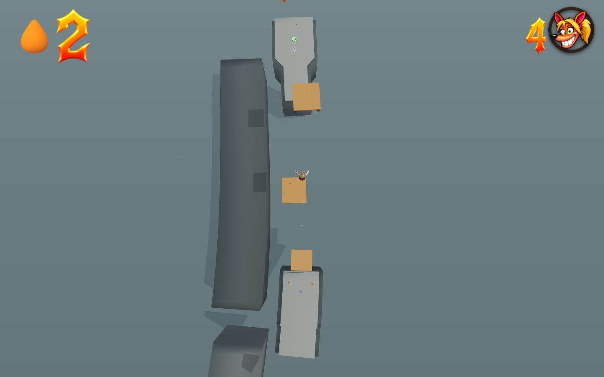
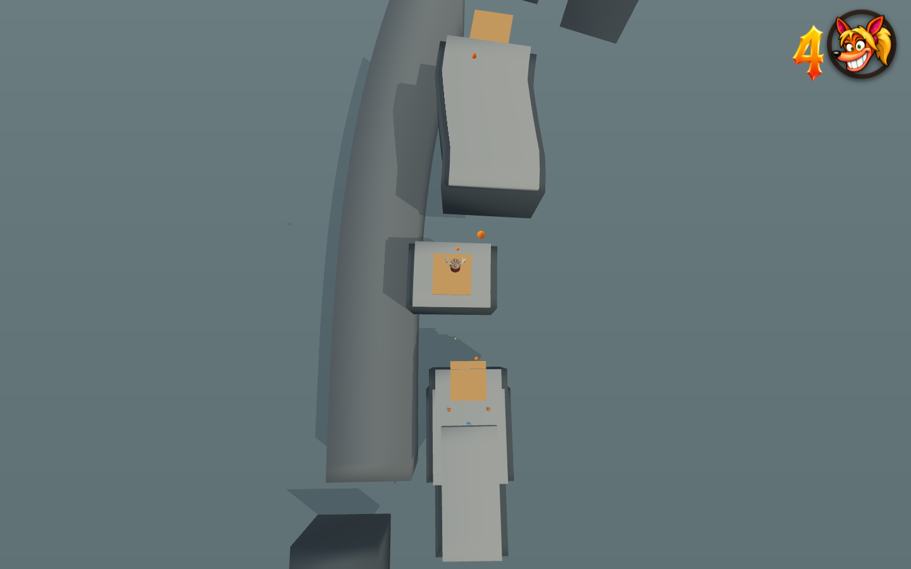
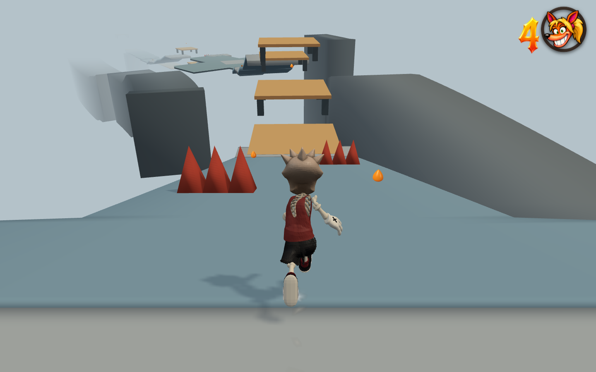
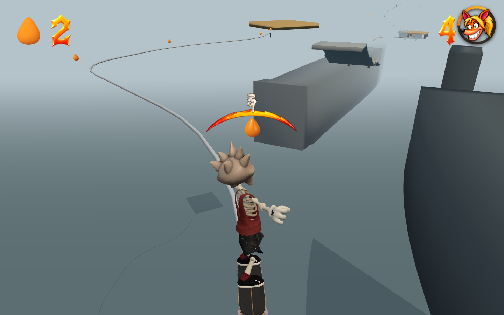

# Carlisle Coast · Tidal Relay greybox

The Maynard Quay Coming Soon slot now contains a 4,000 m coastal platforming
course. The older Uga Ambush level and its save key remain separate.

| Act | Survey distance | Development |
| --- | --- | --- |
| The Breakwater | 0–1,280 m | Surf steps, a scissor groyne, tide lifts, opposing winches and a lighthouse climb. |
| The Tidal Engine | 1,280–2,700 m | Elliptical docks, three pinwheels, open spring terraces, moving springs, counterweights and crossing crane arms. |
| The Storm Crown | 2,700–4,000 m | Exposed headlands, helical platforms, a travelling pier, required spring-to-rail catches and the homeward cable dive. |

There are 18 named sections, 55 primary spring transfers, one optional recovery
spring, 28 moving decks, four required grind rails and 17 checkpoints. The
earlier crane outrigger remains an optional fifth rail. Distance is the surveyed horizontal
centreline; vertical arcs and lateral steering add travel. Gold/silver/bronze
targets are 500/620/780 seconds and remain provisional greybox targets.

## Physics and readability

Springs call the existing player trampoline implementation. They set vertical
launch speed and use the existing 1.25× held-jump multiplier. Air gravity,
terminal fall speed and neutral trampoline momentum are unchanged. An on-foot
neutral bounce has zero horizontal displacement. Hold Jump through a landing
for the higher bounce, and use the normal movement controls to steer.

Following playtest feedback, large trampoline airs now allow up to 60% more
lateral correction, immediate countersteering and mounted forward/back control.
Neutral input adds no sideways drift. A mounted bounce accepts the existing
fresh press/release abandon-ship jump; an on-foot bounce retains its double
jump. Small springs and ordinary jump/ollie controls retain their normal feel.

Authoring measures flight duration against the native movement model and allows
for a takeoff near the back edge of a pad and both platforms' motion ranges. No target vectors, homing, horizontal
launch impulses or bounce-gravity overrides are shipped. Global tuning is unchanged.
Spring surfaces sit 0.02 m above their approach height. This wins overlapping
support contacts while allowing a skateboard to roll onto the spring without
tripping on a raised lip. Static and moving springs use the same top offset.

The shared mover primitive gains bounded elliptical motion, continuous yaw and
an optional native trampoline surface. Mover contact displacement includes rotation as well as translation; the
existing dynamic edge system retains grindable rims. Closed grey decks and cliffs establish the coast, amber identifies springs,
and blue-grey identifies machinery. The ground camera uses normal tuning.
Large spring airs ease toward a near-overhead landing view (4.5 m behind,
26 m above, 80° tilt and 72° lens), then return to the ground view. The camera never changes
the input frame or the bounce trajectory.

The overhead revision follows the user's Jak and Daxter reference. OpenGOAL's
[Jak 1 camera contract](https://github.com/open-goal/jak-project/blob/master/goal_src/jak1/engine/camera/camera-h.gc#L328-L329)
defines separate long/short launcher camera states; Carlisle likewise scopes
its presentation to the spring air. The 80° angle and framing distances above
are this prototype's chosen values, not a claim about Jak's exact settings.

## Reproducible checks

- `node tools/test-carlisle-grinds.mjs`: continuous late-section routes at
  three machinery phases, all four catches, both charged rail exits, the moving
  rebound and the final cable through the finish gate.
- `node tools/test-carlisle-grind-gaps.mjs`: open-water support probes;
  direct no-grind attempts on foot and at maximum downhill board speed;
  run-offs without the two required exit jumps.
- `node tools/carlisle-grinds-browser.mjs [--lite]`: all three routes with
  real keyboard controls, rail and apex views, console checks, MAX/native and
  normal CRT review. `--finale` isolates the final cable and finish run;
  `--presentation` captures just the normal 480p/CRT launch view.
- `node tools/test-slippery-gravity.mjs`: opt-in downhill vector acceleration,
  retained foot momentum, countersteering, board side-slip, unchanged legacy
  ice and portable capture.
- `node tools/test-carlisle-slippery.mjs`: 20 continuous input-only crossings,
  1,760 floor probes and lethal contact with all 26 visible spike obstacles.
  The three open cargo crossings are checked by the crate fixture below.
- `node tools/test-carlisle-cargo.mjs`: all three crate bridges on their wooden
  and metal rows, native grind attachment/breaking, empty water gaps, stack
  placement and spin collection.
- `node tools/carlisle-cargo-browser.mjs [--lite]`: three continuous crate
  grinds with real keyboard input, grouped-cargo views, console checks and
  full/native plus normal 480p/CRT review.
- `node tools/carlisle-slippery-browser.mjs [--lite]`: real keyboard traversal
  of three representative crossings, neutral downhill drift, visible banks,
  spike death and dry-checkpoint recovery; full mode includes MAX and CRT views.
- `node tools/test-carlisle-dredger-terraces.mjs`: continuous input-only climb
  and its slippery upper exit at three machinery phases; no ascending floor
  catches, unexpected grounding jumps, bails or deaths.
- `node tools/carlisle-replay-audit.mjs <replay.json> [git-ref]`: replay diagnosis
  against historical player/course source without changing the checkout.
  `CARLISLE_REPLAY_LIVES` explicitly supplies missing starting life inventory.
- `node tools/test-carlisle-relay.mjs`: native flights, neutral/held parity,
  source validity, 4 km survey and three-act structure. `PHASES=0,7` exercises
  all 55 transfers, including native rail catches, at two machinery timings.
- `node tools/test-kinetic-platforms.mjs`: stationary rider carry, live rim
  grinding, on-foot and mounted entry at three mover phases, capture round-trip
  and invalid motion rejection.
- `node tools/test-trampoline-controls.mjs`: static/moving spring parity,
  sidesteps, reversal, braking, neutral carry, unchanged vertical arcs,
  abandon-ship, foot double jumps and unchanged small springs/ordinary ollies.
- `node tools/test-carlisle-route.mjs`: ordinary input-only route pilot; optional
  `START_S` starts once at a checkpoint, and `END_S` bounds a section review.
  It does not edit positions, velocity, gravity or machine clocks during play.
  Use the specialized crossing/grind pilots above for the revised late sections.
- `node tools/carlisle-relay-browser.mjs [--lite]`: real browser spawn, walking,
  neutral and giant held bounces, normal ground/adaptive air camera, visible
  landing at apex, mounted entry/steering/abandon-ship, continuous terrace
  traversal with real keyboard input, checkpoint/sea
  recovery, moving transforms, finish and console checks. Full mode verifies
  the native canvas, then captures the normal presentation.
- `node tools/sync-carlisle-relay.mjs`: keeps Carlisle source-owned by removing
  only its duplicate snapshot and certificate, preserving other authored levels.

See `native-physics.json`, `correction/kinetic-contact.json` and `slippery/full-browser.json`
for measured results. The correction directory records the latest controls and
camera revision. The terraces directory records the subsequent replay-driven
redesign. The slippery directory contains the current crossing evidence and
a fresh controls regression; the original browser evidence remains in this directory.
Traversal reports are checkpoint-section reviews, not a claim
of an uninterrupted zero-death speedrun. The timing pilot can miss a rotating
handoff; the course deliberately retains waiting and jumping decisions.
The browser checks use isolated profiles and do not alter the user's saved games.

## Replay-driven dredger replacement

The supplied 03:44:23 replay ends around 1,860 m, at the former Ferris dredger.
Its baskets crossed the boarding path and travelled underneath the upper quay.
The replacement uses two open spring transfers from 16 m to 32 m to 48 m,
with wide, staggered fixed catches and no overlapping vertical machinery.
The two amber pads render above the quay's depth layers so they stay visible
at normal resolution; their collision heights are unchanged.
The original incoming checkpoint and downstream discharge chain remain in place.
See `terraces/replay-diagnosis.json` for the recorded contact sequence and its
explicit starting-inventory limitation.

## Slippery crossings between sections

The route has 18 sustained downhill slopes and five short dry connectors,
with 26 red spike clusters on the slopes. The blue-grey faces have 2% of dry steering/braking grip and an
explicit gravity-driven slide. Both feet and boards gain velocity down the
actual slope; releasing the stick preserves momentum. Correct early or jump to
change the line. Ordinary surfaces, existing ice, jumps and the bounce camera
retain their previous behavior.

On foot, downhill travel and neutral coasting use the existing slide pose,
without activating the crouch-slide move or its timers. Pushing uphill faces
into the effort and plays the normal-speed run loop. Limited traction supports
uphill movement at 28% of normal running pace; existing downhill momentum
brakes over time before reversing. Releasing the stick restores unopposed
downhill acceleration and the slide pose. This behavior applies only to the
explicit gravity slicks; board handling and legacy ice keep their usual paths.
Focused motion/cadence and real-keyboard checks are in `slope-motion/`.

The slippery pitches are 18 degrees early, 22 through the tidal engine and
26 in the finale. Each drops straight ahead and remains level across its width;
there are no alternating banks or uphill recovery humps. A cumulative elevation
profile places earlier sections higher, leaving the final harbour at its original
height. Springs, rails, machinery, scenery and checkpoints move with their
section, retaining their intended relative heights. Dry checkpoint islands,
spring mouths and moving-deck boarding overlaps remain level. Each
crossing replaces all of its old overlapping floors with one continuous
ribbon, with three dry gaps crossed by cargo rows. Shared seam vertices use the
same origin; no older flat collider is left underneath a lowered slope. All
ordinary exposed edges retain their normal grinding behavior.

Every slippery span must be at least 18 m long; the current authored descents
are 20.5–73.5 m. Short leftovers between checkpoint, landing and launch
clearances merge into their dry islands. The course elevation profile uses
only those retained slopes, so the deleted fragments leave no miniature drops.

Dock tops are cut around stationary spring footprints and moving spring/lift
berths. The former second floor under each amber pad is gone; its native
2 cm boarding lip remains. Rotating and translating decks that overlap now
have distinct heights, and counterweight lifts have separated footprints.
Quay and terrace depth-bias patches are removed. The surface-cleanup audit
checks actual native top triangles, including opposed-lift crossover phases.

The new optional `slipGravity` field is bounded to 0–2 and requires `slip`.
It uses the existing ground-gravity value; Carlisle opts in with 1. Capturing
and rebuilding preserves the field, and disabling slip in the editor clears
it. There are no global tuning changes.

The longer crane descent has a 14-metre deck to allow corrections at its higher
speed. Native invisible pit boxes follow the descending course for prompt
respawns; the sea and final harbour retain their heights. See
`downhill/validation.json` for the forward-slope checks and current evidence.

## Required grinds in the final 650 metres

The last three sections replace thirteen similar spring transfers with five
springs and four long, exposed grind lines. The rails use the game's ordinary
catch, speed, balance and charged-exit rules. They have no floor underneath;
fruit marks the bright native rails and their entry/exit points.

- **Rigging slingshot:** bounce onto a sweeping outboard cable, balance through
  its curve, then charge and release a rail jump onto a raised, turning spring.
  That moving rebound sends the rider back to the coast.
- **Broken crown:** catch the outer cable, jump its broken end into a rebound
  spring, then cross the gap sideways onto the higher return cable. Its descent
  leads to a small dry catch before the next checkpoint.
- **Homecoming cable:** a short forward, high vertical bounce catches the final
  cable. The long descending curve builds speed, straightens toward the harbour
  and feeds the finish approach. Its launch cannot clear the whole water gap
  in the tested maximum-speed direct attempt.

The two raised rebound pads sit beyond the ordinary rail run-off arc; the
player has to jump off. The final cable intentionally rewards a clean run-off.
Dry landing areas use the same seven-metre clearance as trampoline catches.
Shared player physics, trampoline controls and tuning are unchanged from the
slippery-crossing revision. The camera now treats a caught rail as supported
height instead of retaining the bounce apex over a void; its existing angles,
FOV and temporary bounce view remain unchanged. Browser checks keep both the
rider's head and feet inside the frame after each catch settles.
The grind design baseline is recorded in `grinds/validation.json`; the current
height-adjusted routes and source hashes are covered by `downhill/validation.json`.

## Cargo formations

The repeated pairs seven metres off either side of every checkpoint are gone.
Six compact formations put cargo within reach: a starter parcel containing the
mask, a lateral stair on the scissor hub, a two-tier winch bundle, forward-facing
counterweight stairs, grouped rigging parcels and a harbour fan beside the
finish line. The tallest stacks are three normal crates high. Their exposed
rows derive grind lines through the existing crate system.

Three dry connectors now have actual 8–10 m water gaps. A 17-crate row leaves
the Tide Dial landing, a raised 20-crate trestle follows the Dredger discharge,
and a 21-crate causeway connects the Broken Crown landing to the Homecoming
checkpoint. Each bridge begins and ends on supported dry ground. Wooden rows
break behind a grinder; an adjacent metal row stays available, and the raised
trestle has metal support beneath its wood. These are native crates, with no
invisible floor or extra authored rail. The complete cargo layout has 207
crates in nine formations; spring launch values, all slippery spans, machinery,
checkpoints, required cable grinds, camera and player physics are unchanged.

Current cargo evidence and test boundaries are in `cargo/validation.json`.
