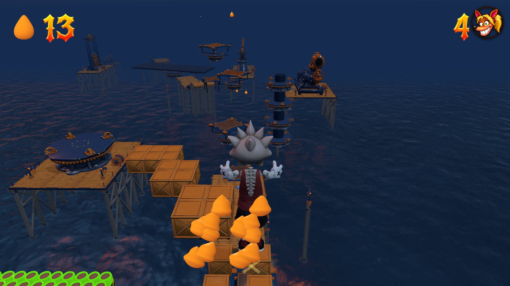

# Mid-flight crate chains — 1 November 2026

Replaced seven apex-height reward clouds with seven stepped landing chains.
The first low draft was raised in response to playtest feedback. The final
chains remain substantially above the docks and 36–63 m below the old clouds.
There are 32 landing groups and 154 wooden crates, up from 40: broad two-row
entries/exits, narrower middle steps, a gentle staircase, lateral sweeps and a
straight corridor between nitro rows. Centre gaps are 4.0–4.9 m including the
sideways offsets; every next lid is slightly lower.

All steps use ordinary breakable wood and its normal stomp pop. Twenty-two
live nitros and the home-harbour clear switch remain. Non-cargo level data has
the exact prior SHA-256 fingerprint; the 4 km route, trampolines, platforms,
camera and movement tuning are unchanged. Carlisle remains source-owned;
there is no duplicate editor-pack snapshot to update.

## Contact fix

Terminal descent covers 0.87 m per fixed tick. The old crate stomp window was
only 0.75 m deep, so certain arrival timings missed a valid lid crossing. The
crate contact pass now checks the swept sole crossing, retaining the original
edge margins, face ordering and type-specific response. Bounce strength, air
control and gravity are unchanged. A native regression fails before this fix
and passes afterward for 18 wood/arrow/metal/nitro contacts and lateral misses.

## Route verification

- All seven chains completed by native top-face stomps with regular and
  held-Jump trampoline launches; all seven held-Jump direct catch routes also
  land safely. Twenty-one native flights; no spin or double-jump assistance.
- Real keyboard hop onto the net, crate-to-crate bounces and exit landings pass
  for two early chains in lite Chrome and three later chains with full art.
- Source positions checked in the live browser, with clean consoles.
- Native 1920×1080 and normal 480p/CRT presentation reviewed.
- Required `check:levels`, crate jump/types, air rescue, trampoline contact and
  original-course/shipyard checks pass. Build and release-size check pass
  (998,294,064 bytes). No full suite was requested or run.
- Bounded checks cover the affected transfers, not an uninterrupted 4 km run.

See [layout](layout.json), [native routes](native.json),
[lite browser](browser-lite.json), [full browser](browser-full.json),
and [validation](checks.json).

