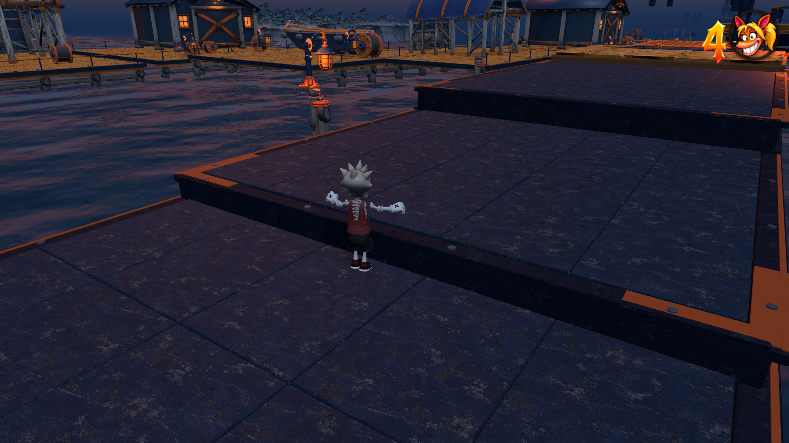
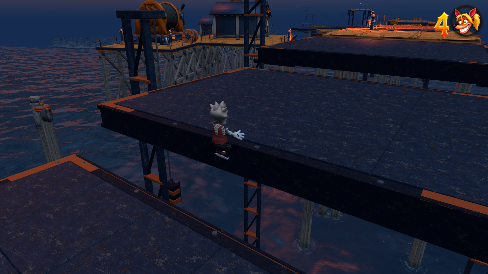
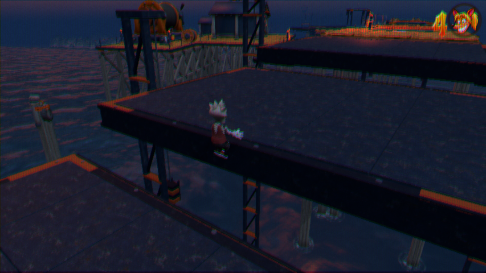

# Moving platform side collision — 31 October 2026

Moving decks had native top support and grind edges, but were absent from the
player's side-contact registry. A rising foot jump could enter the slab before
it qualified for a top landing or ledge catch. Moving decks now register their
vertical faces in the existing mesh-side solver. Motion snapshots keep those
faces aligned through translation/rotation; reset discards stale motion.

The change preserves native top/ceiling handling, lip clearance, ledge grabs,
mover carry, grind edges, trampoline contact, controls, animation and tuning.
No scenery is added to player collision and no level geometry is changed.

## Validation

- New regression fails before the fix on the first missing moving side.
- 128 side sweeps cover moving/spinning fixtures and all eight authored Tide
  Steps / Counterweight lifts, with clear routes above and beneath the decks.
- Native rising foot jump, stationary body struck by a moving side, render
  invisibility, deactivation and reset/teleport lifecycle checks pass.
- Six focused checks pass: moving collision, kinetic platforms, dynamic grind
  edges, authored ramp sides, native player solids and trampoline contact.
- Isolated Chrome against the production build passes both authored sections
  at three clock phases, in lite and full rendering. Real Arrow Up approaches
  reach the collision boundary; native top landings and 2.5-second rides pass.
- Native 1920×1080 and normal CRT/480p captures reviewed; no console errors.
- Build and release-size check pass: 998,293,556 bytes. Tuning SHA-256 remains
  `74fc4258f953316c9cd9674faff8df9934adefdda572f1465822dec367088a41`.

Commands and results: [checks.json](checks.json), [browser.json](browser.json).
Browser runner: `tools/review-moving-platform-collision.mjs`.

## Supplied replay

`replay-CarlisleCoast-2026-10-31T00-06-33.json`: 10,863 input frames (181.05 s),
SHA-256 `0a6e266d98dc127c71cfb34fa745c4f8088760610ca27715936c11547adf1310`.
The fresh native and browser replays did not reach the reported ending. The
format does not record K/L checkpoint warps, so this is not a claimed exact
end-of-replay reproduction. Direct regressions reproduce the missing side
contact and validate both plausible moving vertical-platform sections.

