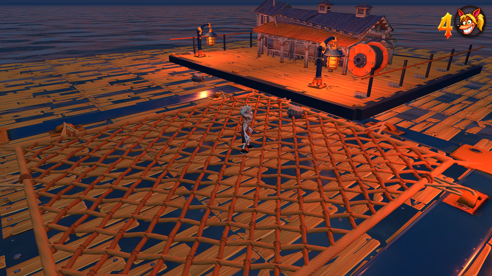

# Trampoline net and metal contact — 31 October 2026

Walking onto a trampoline now keeps ordinary grounded support. Jumping and
landing on the net starts its bounce; successive airborne landings still chain.
Grounded skateboard wheels catch in the net and use the existing forward trip.
Jump and grind input resolve before that supported-contact check.

Carlisle's marine housing is a separate, non-bouncy surface. Rendering and
collision share the measured asymmetric rope opening, evaluated in deck-local
coordinates so moving and spinning platforms retain the correct boundary.
Feet and wheels can use the metal rim normally. A fast descending landing from
a large spring flight into that metal uses the existing heavy-impact ragdoll,
including impact strength, mask protection and contact response. It cannot
produce a spring launch, a net ripple or a clean landing roll.

No movement tuning, camera, authored level geometry, rope geometry or normal
edge-grinding policy changed. This exception uses the existing large-drop
height and impact-speed thresholds; ordinary low hops onto metal remain safe.

Validation:

- Nine focused checks pass: contact policy, trampoline controls, trampoline air
  jump, landing rolls, actual Carlisle launches, skate entry, kinetic platforms,
  crouch/jump/slam and ordinary heavy-landing policy.
- Native input cases cover walking, held jump without release, a real foot
  hop and board ollie into the net, chained bounces, net trips, safe metal
  walking/skating/low-hop contact, high-energy metal impact and moving bounds.
- Existing air-control tests now start with an incoming landing; old roll-on
  expectations were updated to the requested grounded walking/tripping rules.
- Real Chrome keyboard smoke passes in lite and full/native 1920×1080, with
  normal 480p review and no console errors. The isolated marine-net fixture
  verifies walking, jump-before-bounce, rim impact and net versus metal skating.
- Production build and release-size check pass: 998,291,223 bytes.

Run `npm run check:trampoline` for the contact and bounce regressions, and
`node tools/review-trampoline-contact.mjs URL` for the portable browser review
(`--full` runs the full-render pass alone).

