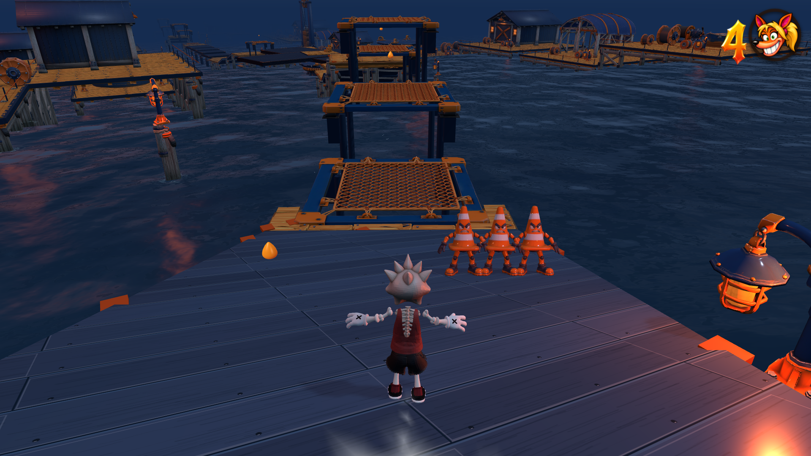

# Carlisle unintended skating fix — 30 October 2026

The supplied 104-second recording mounted the board at frames 4285 and 5178
(71.42 and 86.30 seconds), with every button released, no direction, and no skate
charge. A slippery foot jump cleared `iceSlideCarry`, so its touchdown speed
passed the existing skate-entry speed branch. Trampoline slide cleanup erased
the same flag when a downhill coast reached a spring.

Preserve the existing foot-momentum flag through air and trampoline launches.
Other traversal boundaries, bails, resets and deliberate mounts still retire it.
No velocity, gravity, steering, camera, animation, geometry or tuning values
changed. The ordinary hold-and-direction gesture remains authoritative for
mounting out of this foot coast; already-mounted skating remains unchanged.

Validation:

- Both regression cases fail before their respective fixes: a quick foot-jump
  landing, and a passive slope → native trampoline → slope landing.
- All 6,240 input frames, with recorded tuning and the unmodified initial life
  inventory, now produce **zero board mounts**. These are input-replay checks,
  not a claim that the original recording completes the level after correction.
- Ten focused checks pass: skate entry, authored ice, surface friction,
  slide jump, Carlisle slippery traversal, trampoline controls, trampoline air
  jump, abandon steering, kinetic platforms and competition skating.
- Carlisle traversal covers 20 crossings, 1,760 support probes and 26 lethal
  contacts. No level geometry changed.
- Real Chrome keyboard checks pass in lite and full/native 1920×1080. Quick
  Space release lands at 14.82 m/s on foot and continues downhill to 17.04 m/s;
  Space + Up mounts after the existing 0.55-second commitment. No console errors.
- Production build and release-size check pass: 998,290,184 bytes.

The earlier full-suite run is documented separately in `../regression-repair/`;
this increment ran focused checks rather than claiming a new full-suite result.

Run the portable regression with `node tools/test-skate-entry.mjs`; it also runs
under `npm run check:surface-friction`. The isolated keyboard smoke is
`node tools/carlisle-skate-entry-review.mjs` (add `--lite` for the first pass).
The supplied take is identified by SHA-256 in `replay-and-checks.json`.

