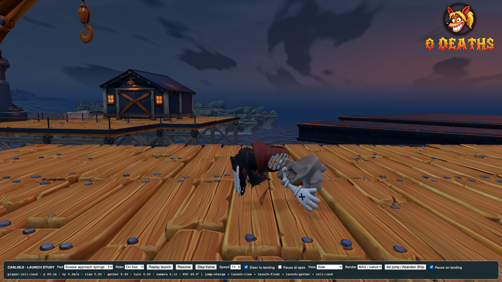

# Ordinary trampoline landing roll — 30 October 2026

Clean on-foot trampoline landings now play the existing forward shoulder roll,
even without an Abandon Ship jump. Only the animation is shared. The ordinary
landing keeps its velocity, steering, skate-entry rules and immediate next-jump
input. Mounted landings retain their board animation; repeat spring contacts,
slam attacks and genuine bails keep their existing priority.

The roll recovers into the downhill shoe-glide pose on slippery slopes, rather
than briefly playing a running stride. It uses the existing contact correction,
elasticity and finite roll duration; no whole-rig scaling or physics retuning.

Validation:

- Six focused checks pass: ordinary spring rolls, existing Abandon Ship rolls,
  trampoline second jumps, authored Carlisle launches, skate entry and the
  character animation runtime.
- Paired traces with only the new animation disabled/enabled match exactly on
  dry ground, flat ice and a downhill slope. They cover neutral/held direction,
  mounted landings and immediately jumping again. Minimum sampled roll support
  clearance is 0.006 m; downhill recovery never samples a running stride.
- Actual Carlisle “Scissor approach springs · 3” completes its native flight,
  ordinary landing, roll and idle recovery at MAX/native 1920×1080, then normal
  480p presentation. Zero deaths and zero console errors.
- Isolated real Chrome keyboard checks cover deck/downhill landings in lite and
  full/native presentation, including front/side pose review and finite recovery.
- Production build and release-size check pass: 998,290,520 bytes.

Run the movement/animation regression with `npm run check:roll-landing` and the
portable browser review with `node tools/review-trampoline-roll-landing.mjs URL`.
`PLAYWRIGHT_MODULE` can supply the host's Playwright module. The browser fixture
places only the spawn/supports; the trampoline and keyboard perform the flight.

The earlier full-suite result belongs to `../regression-repair/`; this focused
animation increment does not claim a new full-suite run.

