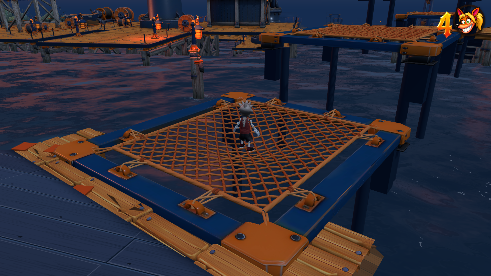
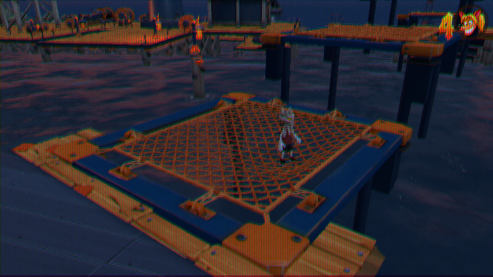

# Walking weight on marine nets — 31 October 2026

The rope net now forms a local dent under a supported walker, including when
standing still. The dent follows the player in the deck’s local coordinates,
so moving and spinning springs retain the same contact. It eases down under
weight and returns to rest after departure; the tied housing anchors stay fixed.
The existing impact ripple and rebound remain separate.

Only rendered positions move. The skater follows the dent during drawing and
releases that visual offset smoothly at takeoff. Collision support, actual
position, velocity, input, trampoline launches, camera tuning and board policy
are unchanged. Metal rims cannot renew the weight contact. Main, depth and
shadow-distance shaders share the same live weight field.

Validation:

- Six focused checks pass: local weight and exact movement/jump parity;
  net/rim contact; bounce controls; trampoline air jump; ordinary landing rolls;
  render interpolation and restoration.
- Production build and release size pass at 998,293,354 bytes.
- Native keyboard browser evidence covers lite and full rendering, walking
  without bouncing, actual jump-before-bounce, safe rim skating, net trips and
  high-energy metal impacts.

Use `npm run check:trampoline` for the focused contact checks and
`node tools/review-marine-net-weight.mjs URL` for the actual-course visual review.

The actual Carlisle route also passes a 2.4 m sideways walk: the dent follows
that new location, with feet seated and no bounce impact. The weight returns to
zero after an ordinary input-gated jump. Reviewed at native 1920×1080 and the
normal 480p CRT presentation, with no console errors. The contact fixture is
raised clear of its underlying deck so the sag can be inspected without a
fixture floor occluding the ropes. No course geometry was changed.

