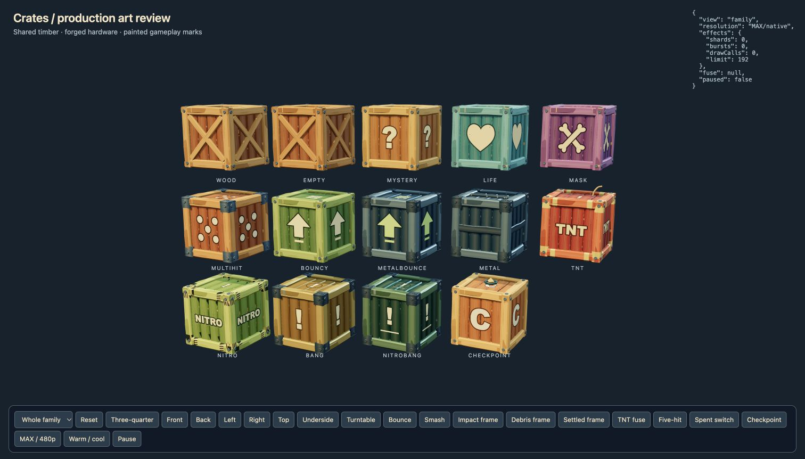

# Crate production validation — 5 November 2026



All fourteen variants use the same modeled timber/hardware kit. Complete model
counts, including fuse and checkpoint accessories, range from 3,480 to 5,280
triangles. The art retains its full geometry at every distance. The shared shell
uses one draw; painted identifiers add one. Accessories are separate meshes.
`geometry-and-debris.json` records the measured counts.

## Checks completed

- TypeScript typecheck and the production build passed.
- `node tools/test-crate-art.mjs`: all six outward faces, finite geometry, shared
  resources, complete model budgets, finite recoil, stable collision owners,
  run/outline markings, debris support and settling, bounded chain blasts,
  finite expiry, reset and checkpoint-marker lifecycle.
- `node tools/test-life-multihit-crates.mjs`: rewards, contact behavior, five-hit
  progression, checkpoint restoration and capture round-trip.
- `node tools/test-explosive-bundles.mjs`: new art bounds, independent three-second
  TNT clocks, pause, detonation, reset, outlines and Nitro's seated collider.
- `node tools/test-nitro-clear-switch.mjs`: placement, tally, reset, ownership and
  capture exclusion for systemic Nitro-clear switches.
- `node tools/test-bonus-checkpoint.mjs`: production bonus success/failure,
  durable inventory, checkpoint restoration, switches, partial crate/bridge
  state, exact box counts and fresh reset.

The final review removed an unnecessary new `activateCheckpoint` early return
so repeat calls preserve the pre-existing snapshot API. Final checkpoint check
and production rebuild are pending the shared validation slot. No level data,
movement tuning, authored colliders, fuse timing or blast radius were changed.
No full `check:all` suite was requested or run.

## Browser evidence

Chrome reviewed the gallery at native and 480p, including the front, back, left,
right, top and underside of the shared shell. TNT's rear markings and countdown,
Nitro's impact accent, flying splinters, settled pieces and checkpoint activation
were inspected. The 128px impact star was replaced with a clean 512px source
after the native review exposed rough edges.

The actual game was tested first with `?lite`, then with full rendering:

- Real keyboard forward movement and spin break the wood crate in both modes.
- Five stomps exhaust the five-hit crate; the metal bounce crate survives.
- TNT counts down and detonates; Nitro-clear emits a bounded chain blast while
  the switch stays solid with its spent check mark.
- The outline switch materializes its targets and retains its collider.
- Checkpoint activation replaces the consumed box with the saved-state compass;
  a real pit death returns to that checkpoint. Hard reset restores the intact box,
  outlines and switches, and clears transient debris.
- Time-trial numbers remain on the modeled shell.
- Full/native uses a 3024×1724 drawing buffer. The CRT pass uses 842×480.
  `gameplay-full.json` records both settings and an empty error console.

`gameplay-lite.json` records the focused interaction states. Selecting a type in
the test harness starts a fresh scenario using production respawn; checkpoint
activation/death/reset were exercised within one selection. The native gameplay
fixture does not write a level pack or campaign save. Its camera controls are
review-only and are not included in the production entrypoints.

The initial dev startup failed because the mutable cache under shared
`node_modules/.vite` disappeared during concurrent work. A worktree-local cache
resolved it; the final game session had no console errors. The dedicated review
config below keeps that cache separate without changing production config.

## Reproduce locally

From the task checkout, use the shared heavy-job guard to run:

```sh
npm run dev -- --config tools/crate-review-vite.config.ts --host 127.0.0.1 --port 5187 --strictPort
```

Open `/crate-art-review.html` for all sides and held impact/debris frames. Open
`/crate-game-review.html?lite&playtest&level=flats` for focused gameplay, then
remove `lite` for full rendering. The temporary crate grid occupies the clear
apron behind the stock spawn. The gameplay harness exposes existing runtime
actions and reports the selected crate state in visible DOM text.

## Timing and delivery

The prompt began at 12:34:56 UTC. The first live keyboard move/spin confirmation
was around 13:27 UTC: approximately 52 minutes prompt to playable. This wall-clock
interval includes the machine restart, checkout recovery and shared validation
queue. Those interruptions are excluded from productive authoring; an exact
active-authoring split was not captured. Full/native review finished around
13:34 UTC and the first build passed around 13:37 UTC.

Publication belongs to the active release coordinator. This feature does not
depend on the held animation branch or the separate particle experiment.
