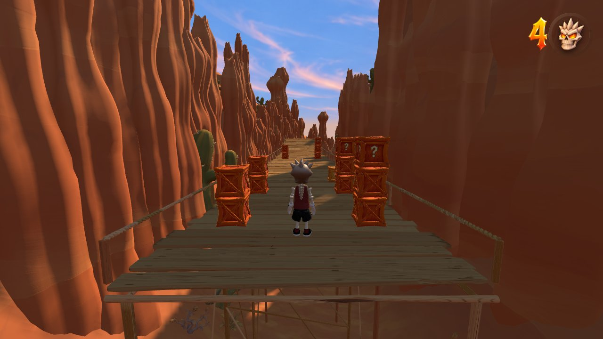
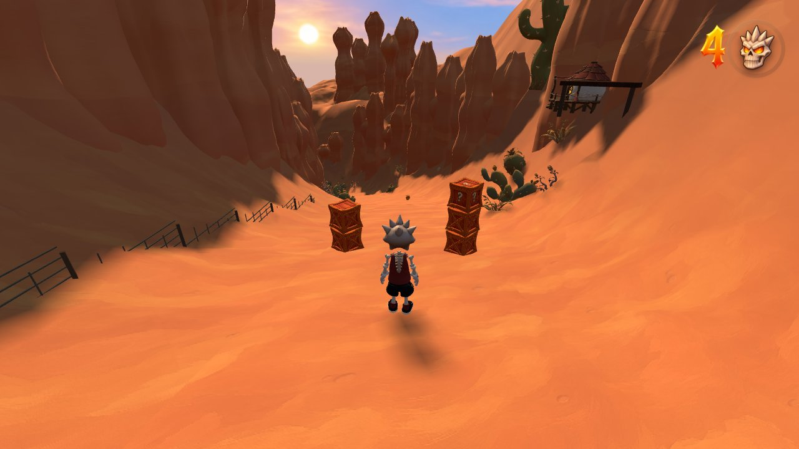
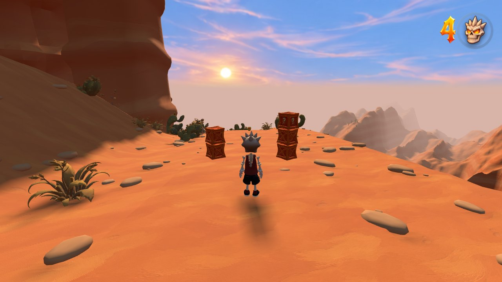
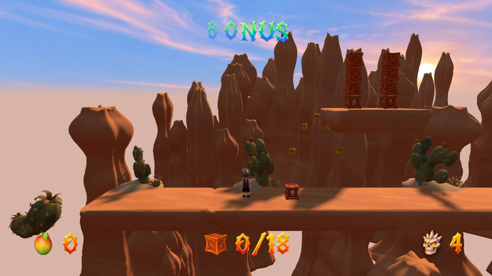
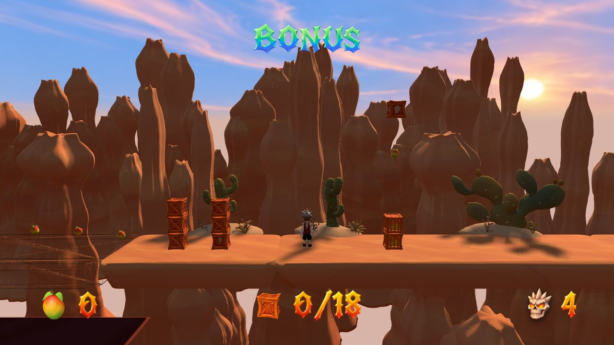

# Dusty Road and Cactus Cache — crate/enemy review

The 5.63 km descent previously had no regular crates. Added **36 paired supply stops**, each with one two-high wood stack and one three-high stack capped by a mystery crate. This gives **180 main crates**, ten in each of the 18 checkpoint sections. With the retained 17 checkpoints and enlarged 18-box bonus, the parent tally is **215**. Both jump runups and the centre line remain clear. The existing gaps and lethal slopes provide the hazards; no patrols were added to the fast descent. The first supplies reward looking behind the start. The last stop was moved 22 m earlier after the initial harvest test crossed the finish too soon.

Cactus Cache grows from eight to **18 counted crates**, with four-high upper reward columns and three-high bridge-receiver columns. Its arrow, twelve-metre switch bridge, finite supports, two earned lives and nine-metre cap preserve their original dependencies.

Validation:

- Seventy-two separately staged normal-input approaches from the centre route collect all 180 crates without deaths. Full reset restores all crates. The maximum lower-tier corner height difference is 0.231 m on the retained slopes. Generic audit warnings for 18 overhanging crates are resolved by native corner support probes; these stacks are not on flattened terrain.
- A separate native centre-route traversal clears the full descent in 729.07 simulated seconds, including both airborne gaps and the finish. It uses the actual terrain and native GLB geometry. There are 8,394 support probes, individual support checks for all 17 checkpoints, separate checkpoint banking/pit recovery, supported shoulder and lethal valley tests, and exact hashes for 173 native vista cells. This is not an all-crate or all-checkpoint/crystal run.
- The continuous 18-box bonus finishes in 43.55 simulated seconds without deaths. Three wrong orders verify the upper donor, bridge and finite-support dependencies. Reset restores all 19 physical crates and hides the bridge. A normal jump activates the real bonus entrance once, followed by a supported parent return.
- Browser checks pass opening collection, checkpoint activation, restoration of two boxes after death, a staged finish, bonus failure/retry and continuous 18-box banking into the same parent. Consoles are clean. The successful lite test samples draw calls while retaining ordinary physics and input processing; earlier slow attempts are retained in the evidence. Five inspected 1280×720 views use normal full rendering and complete authored geometry.
- All 5,138 original non-crate components retain their serialized values. Settings, movement, animation, artwork and the published level pack are unchanged.
- Required level checks, build and release-size check pass: `de1c87dc733b80c294fe`, 959,312,251 / 1,000,000,000 bytes.

Elapsed: approximately 37.6 minutes from 15:35:50 UTC, exceeding the requested 15 + 5 minute budget because of the finish-stop correction and slow full rendering. Raw probes and the browser driver remain in `/workspace/crate-review/bryce-canyon`. Publishing is authorized and awaits GitHub authentication. See `validation.json` for the complete limitations.

