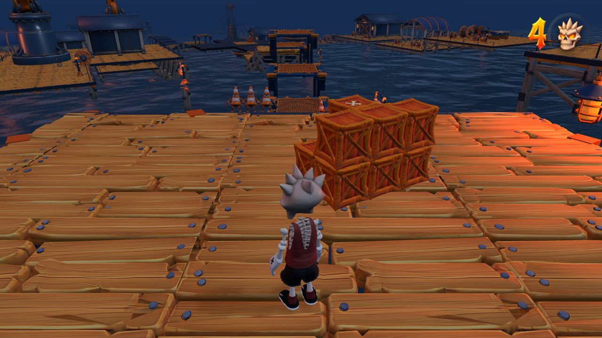
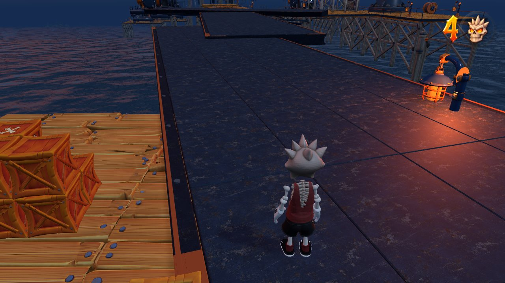
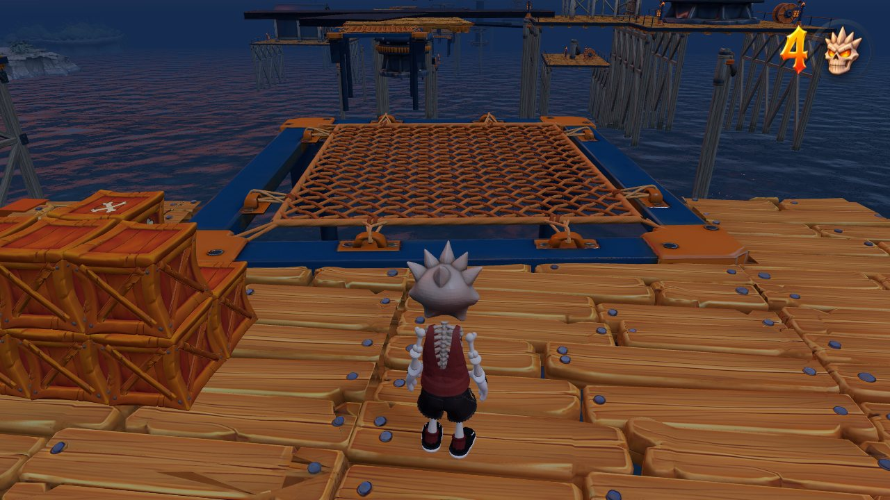
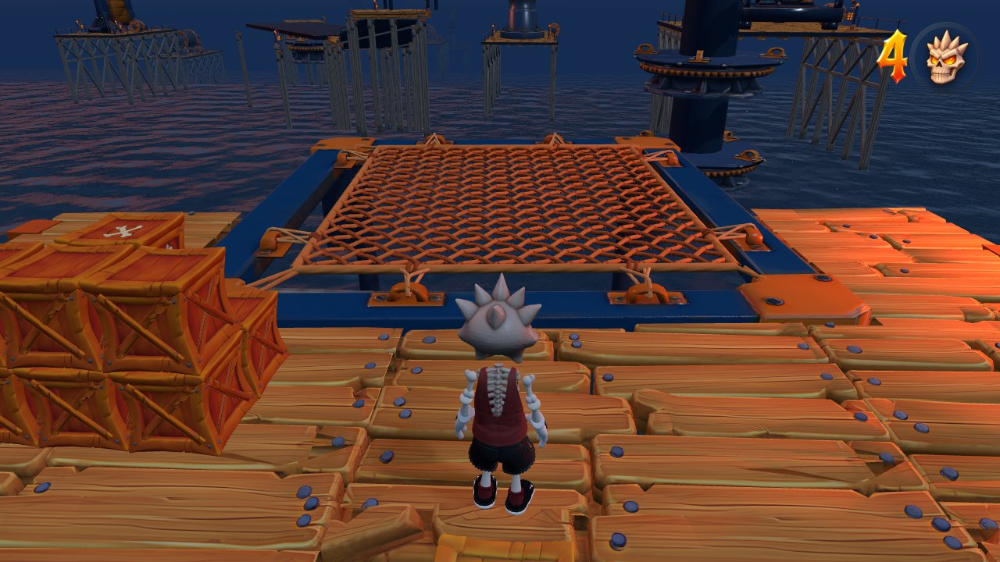
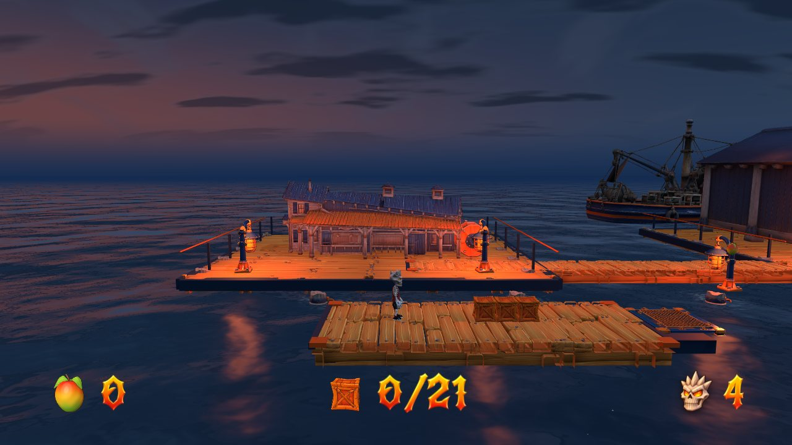
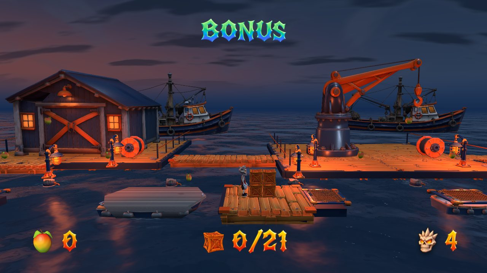
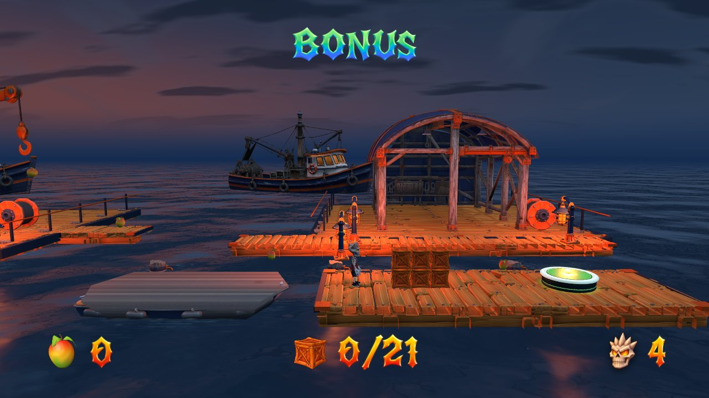

# Carlisle Coast and Springtide Skippers — crate/enemy review

Added ten-crate supply piles to the fixed Pinwheel, Scissors and Helical quays, filling three empty checkpoint sections. Expanded the seven-crate starter parcel and eight-crate Winch bundle to ten each. Each new quay pile contains one mask before the moving-platform or spring sequence. The course now has **338 counted main crates**, **17 checkpoints** and **21 bonus crates**, for a **376-box parent tally**. Its 80 steel boxes and one Nitro-clear switch are uncounted; 419 physical crates are present. There are four masks and no life crates.

All 384 original crate components and all 977 non-crate components remain exact, as do the level settings. The three consumable cargo bridges retain their durable steel spines. Seven aerial pallet chains and their 22 off-line Nitro frames remain intact, with the remote clear switch at the home harbour. No patrol enemies are added: the existing moving platforms, springs and exposed landings already supply the course's timing and precision demands. The clear flight can bypass each aerial chain; the all-box flight deliberately revisits every parcel in each pallet before moving on.

Every checkpoint section now has at least ten counted crates. The dense sections retain their structural bridge and aerial-pallet payloads, rather than breaking those tools into unrelated checkpoint quotas. The new ground supplies sit off the clear line, on fixed quays. All 104 ground-pile crates have supported lower-tier footprints; measured floor error is zero.

Springtide keeps five grouped cargo quays, four moving boats and its spring sequence. Its final safe-quay life crate is now a wood reward, retaining all 21 box credits without paying a life for no additional risk. There are no enemies or irreversible crate supports in this bonus.

Validation:

- Nine staged normal-input ground harvests collect all 104 quay crates. Three wooden bridge crossings collect all 58 bridge parcels; three separate steel-lane crossings also succeed without a death or bail.
- Seven staged spring approaches collect every one of the 154 aerial wood crates by repeated native stomps, then reach their receiving landings without a death or bail. Twenty-one original collect/bypass cases also pass; a deliberate Nitro landing remains lethal and the end switch clears all 22 Nitro crates. Together these separate approaches account for all 338 main crates. A continuous main-course all-box clear is not claimed.
- Springtide clears all 21 crates continuously at boat phases 0, 7 and 19. Run times are 29.92, 39.10, 30.72 simulated seconds. The old pilot held Jump indefinitely on a net; it now releases an ordinary hop and lands to activate the existing spring rule.
- The lite browser collects the starter and Pinwheel supplies, restores the ten-crate Pinwheel pile after a staged checkpoint fall, activates the end Nitro switch and crosses a staged finish. Its continuous bonus journey banks all 21 crates into the parent. A separate water failure preserves lives, banks no bonus credit and leaves the bonus retryable.
- Seven inspected full-render views cover the starter, three new supply quays and three bonus views at 1280×720. Both browser consoles are clean.
- Older native cargo tests assume legacy authored coordinates, and an older aerial test pins a whole-course hash that already failed before this change. Their failure evidence is retained. The new tests use migrated live crate positions and separate flight access from unrelated map snapshots.
- Required level checks, production build and release-size check pass: version `eab91b0f7c3d18e839f3`, 959,307,795 / 1,000,000,000 bytes. The published editor pack, movement, animation and native artwork are unchanged.

Elapsed: approximately 38.5 minutes from 12:59:32 UTC, exceeding the requested fifteen-minute main plus five-minute bonus budget. Raw probes and logs remain in `/workspace/crate-review/carlisle-coast`. Publishing is authorized and awaits GitHub authentication.

