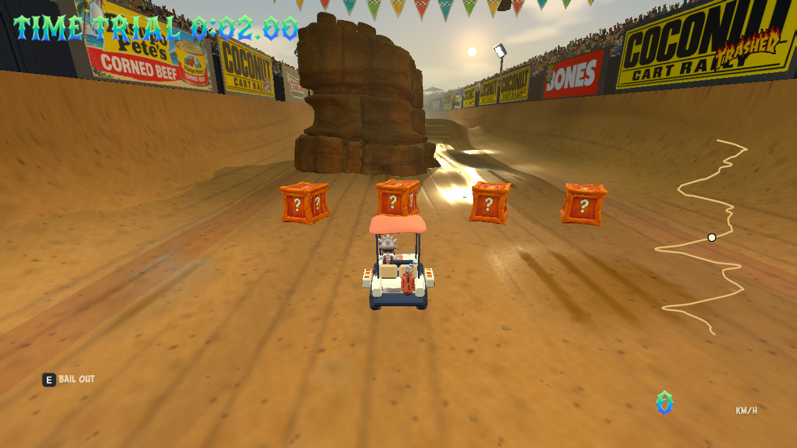
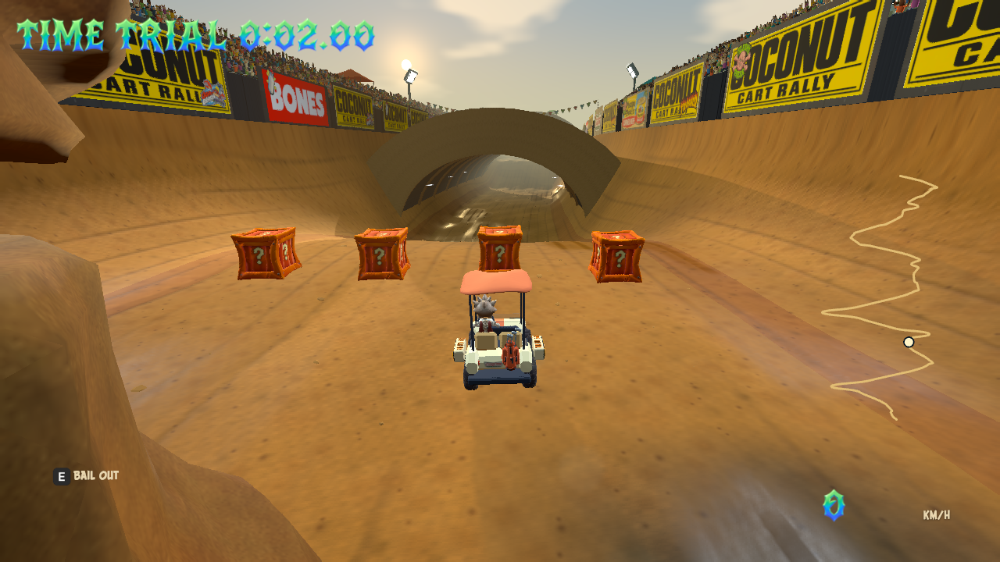

# Coconut Cart Rally — crate/enemy review

Retained **52 replenishing item pickups in thirteen four-lane rows** and moved four extension rows away from rock collision. Two pickups in the old 3156m row were inside rock bodies; thirteen lanes across four rows had less than the existing 8m clearance requirement. Every row now clears rocks by at least **8.55m** and crosses the approach within 2.31 degrees of perpendicular. The four changes move sixteen pickups; all non-crate components and settings compare exactly.

| Row | Previous station | New station | Job |
|---|---:|---:|---|
| 8 | 2360m | 2340m | Supply before the extension rock chicane |
| 10 | 3156m | 3175m | Clear pickup choice before the tunnel descent |
| 11 | 3680m | 3710m | Supply beyond the rock and before the next launch |
| 13 | 4500m | 4530m | Final supply beyond the last rock |

Parts VIII and XIII.6 apply: lanes offer steering choices, launches stay open, and the seven racing rivals provide moving opposition. Ordinary enemy patrols would compete with the vehicle controls and existing weapons. No attack enemies, planted explosive crates, checkpoints or bonus are added. The gem remains a **race-win reward**, independent of item pickups. Platform-level cluster and checkpoint quotas therefore do not apply.

All 52 pickups are collected through real cart controls in isolated approaches without rock hits or falls. All 208 authored anchor corners have dirt support, with at most 0.308m variation from the corrugated surface. The runtime item cubes intentionally float above those anchors. Item respawn and a full retry pass. The complete eight-racer replay finishes; its human result is rank 1 at 161.08s. A separate continuous solo run flies across all eighteen jumps, finishes at 160.62s, and records zero falls and rolls. Deliberately driving into the rim produces a real impact while retaining safe support. Winning, losing and trial fixtures verify gem persistence and reject a losing all-box award.

Chrome verifies physical throttle, steering and braking, staged pickup approaches in all four changed rows plus an unchanged control row, a real finish crossing and full restart. Two inspected native-resolution views have clean consoles. One initial browser fixture started inside the preceding rock; the corrected supported approach passes. This was a test-start error. Legacy checks were updated from the old twelve-jump/seven-row layout to the current eighteen-jump/thirteen-row course.

The published rally snapshot and its exact certificate are synchronized; every other pack entry is identical. Two previous source/published snapshots, four raw/migrated saves and twenty-eight authored variants pass preservation checks. Four archive fingerprints protect the old stock. Required level checks, production build and release gate pass: `44bce024d7abb2edb14e`, **959,322,064 / 1,000,000,000 bytes**. The current campaign UI matches the review roster: **34 playable courses, 24 unique bonuses, five unbuilt placeholders excluded**.

The pickup probes are staged; continuous race/solo completion is separate. A [left-lane camera fixture](full-tunnel-left-camera.png) shows the retained camera intersecting the preceding rock; the clear central approach is inspected separately. Camera and artwork remain unchanged. Elapsed: **31.3 minutes**, exceeding the requested fifteen-minute allowance.

