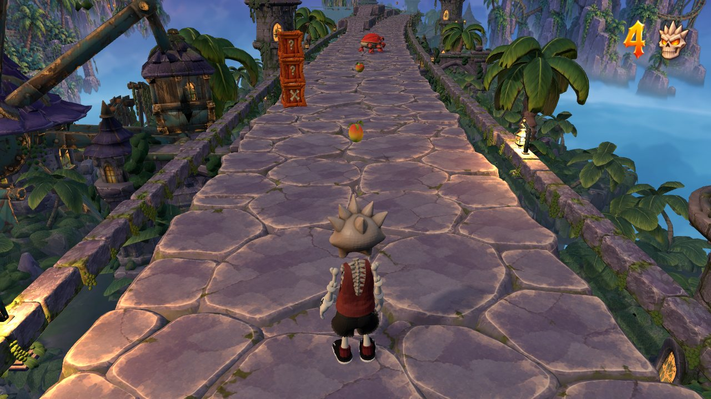
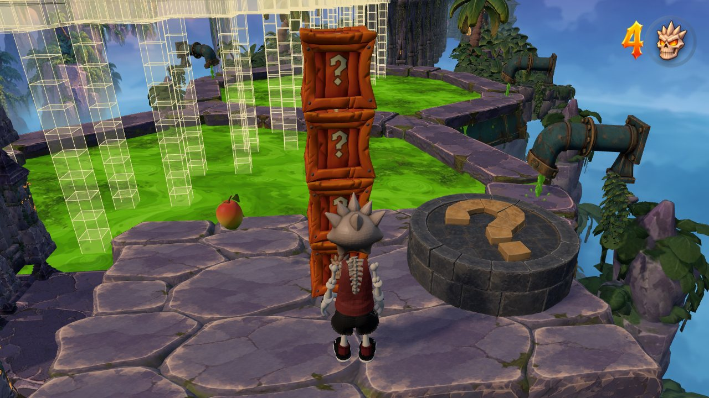
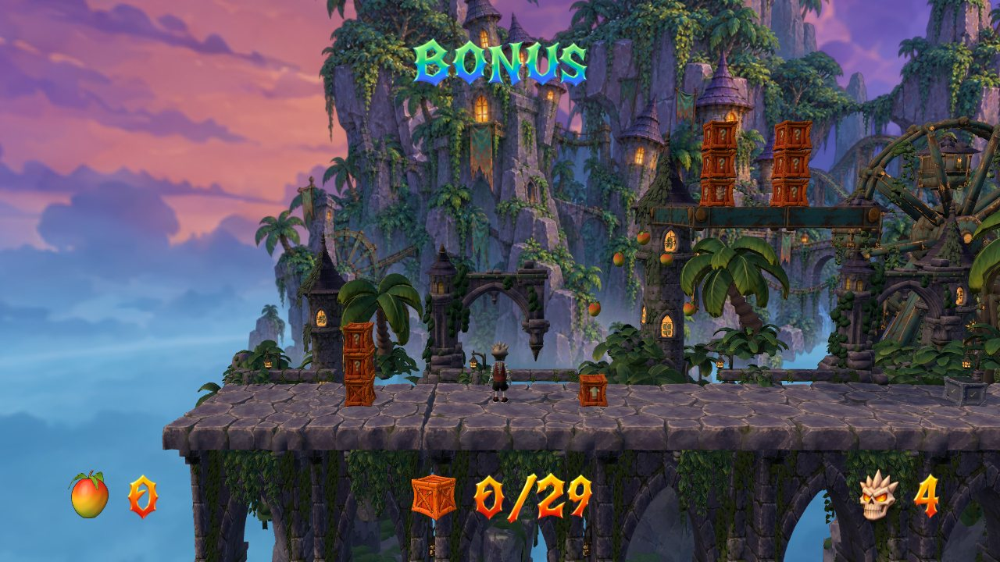

# Haunted Hassle — main and bonus crate/enemy review

The main course grows from eight to seventy counted crates, ten per checkpoint section. Nineteen fixed-floor cargo groups contain sixty-four boxes; six original high-air targets retain their deliberate pumped-vert role. Mean cluster size is 2.8, with only six singles (8.6% of counted boxes). Jump approaches, movers and grind lines remain clear. Entry and roof-relay masks precede encounters; the optional foundry perch now awards a life, while the high-air life remains.

Five existing enemy positions now use three grunts and two turtles, replacing four kinds with two repeated counters. Patrol positions, ranges and speeds are identical. All 700 structural steel boxes, their three switches, and their revealed routes remain exact.

The bonus grows from eight to twenty-nine counted boxes around its preserved return arrow, bridge switch and finite-bounce cap. Its gallery payload sits on the native 8.4 m deck, and the upper striped support uses the final 1.152 m grid. Recovery and earned bridge cargo add count decisions without replacing the launch tools.

Validation:

- Nineteen separate normal-input harvests collect all sixty-four new main boxes; footprint support and full reset pass. Six separate floor-start pump sessions collect every retained high-air target without air placement or movement changes.
- One continuous native main journey clears all mechanics, banks six checkpoints, visits the optional foundry reward and finishes in 346.05 simulated seconds without death or reset. No continuous main all-box clear is claimed.
- Native and lite-browser bonus journeys collect all twenty-nine boxes, earn the gem and finish without death. Lost arrow, skipped bridge and exhausted upper finite support cause their intended failures; retry restores all boxes, nine crate outlines and both reveal surfaces. Three additional staged neighboring-cargo attempts fail to bypass the tools.
- Enemy checks verify supported patrols, contact versus spin choices and a turtle stomp with safe continuation.
- Main browser checks cover the opening harvest, staged checkpoint activation, kill-plane recovery and staged finish. Seven full-render 1280×720 views are inspected across the pair. All four browser modes have clean consoles.
- Two old pilot assumptions needed updating. The original layout reproduces the exact first-ice speed assertion failure at 23.679 m/s; the check now accepts normal full speed or retained momentum. The crown landing already traverses its first ramp before braking, so the pilot counts those recorded contacts and continues through the remaining ramps. No player movement or tuning changed.
- All 3,991 main and 143 bonus non-crate/enemy components, environment settings and original art remain identical. The editor pack is unchanged. Required level checks, build and release check pass: 959,305,099 / 1,000,000,000 bytes, version `f4ff42fff48dd4aec559`.

Elapsed: approximately 27.4 minutes from 10:59 UTC. This exceeded the requested fifteen-minute main plus five-minute bonus budget. Publishing remains authorized and awaits GitHub authentication.

