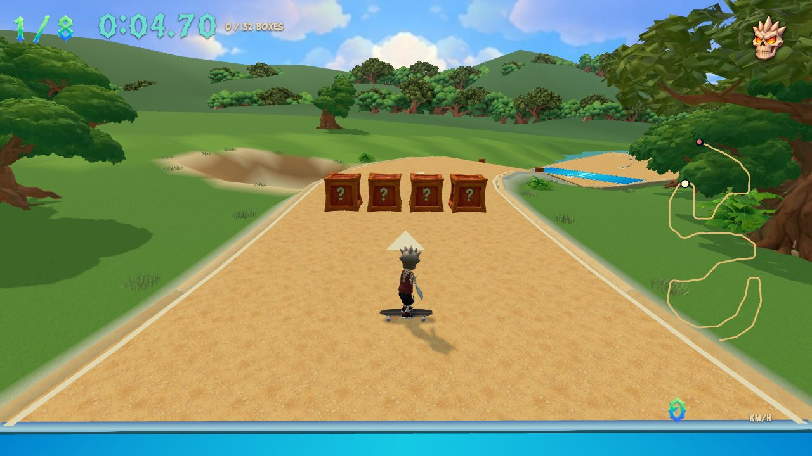
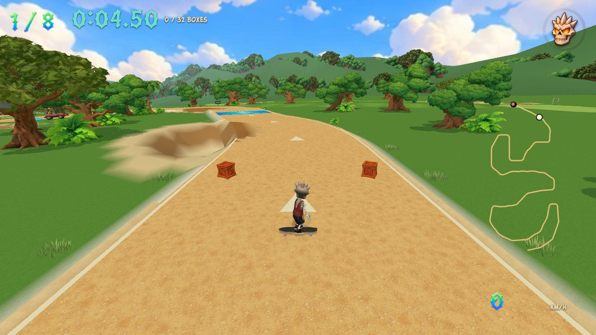
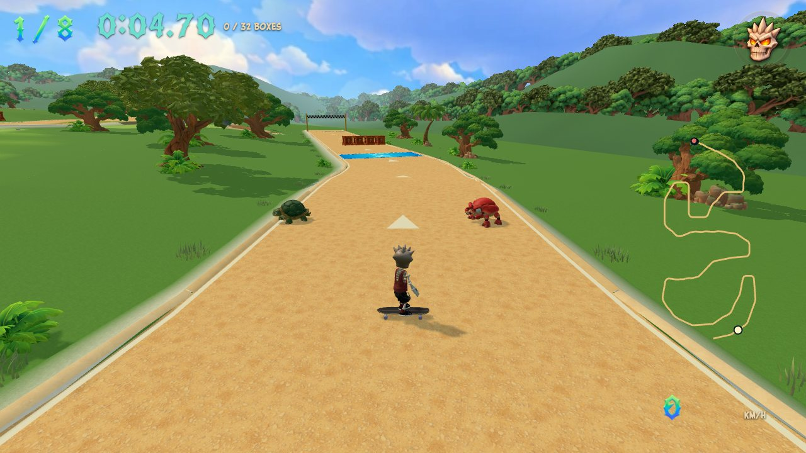

# Country Club Circuit — crate/enemy review

Retained the existing race layout: **32 gem boxes in sixteen optional left/right pairs**, **28 item pickups in seven four-choice rows**, and **12 side patrols**. Eleven gem boxes become numbered time-freeze targets in time trial. There are no checkpoint crates, bonus room, life or mask crates, or placed explosives. Item rows avoid sharp corners, launches, boost plates and deep sand. The published entry matches the current built-in course exactly.

The paired boxes ask for shoulder choices while the clear racing line remains open. The four-choice rows allow item collection at speed. The existing patrols stand roughly six to seven metres from the path centre: individual crabs, turtles and hoppers precede a final opposite-side pair. They have supported approaches and ordinary spin counters. They do not serve as required traversal tools. Seven rivals and twenty roaming carts supply additional race pressure. Existing shields and race attacks provide the mode's protection and counters; adding adventure masks, lives or checkpoint quotas would not serve that mode.

Validation:

- Separate normal-input approaches collect all 32 gem boxes and all 28 item pickups with no fall. All four choices in every item row have ground underneath them. Retry restores all boxes and clears the rider's unique credit.
- Twelve separate normal-input approaches defeat every patrol by spinning, without a fall or death. Retry restores every enemy.
- A complete native race traverses the 3924.99 m route with all seven rivals and twenty live roaming carts. The human finishes in 104.77 simulated seconds with 0 falls and 3 gem boxes. All eight racers finish and record zero deaths. No continuous all-box clear is claimed.
- The lite browser starts the event and drives the opening alongside rivals and moving carts. Separate staged checks collect a gem box, recover from a real fall with life and box credit preserved, cross the finish and restore all crates on retry.
- Three inspected 1280×720 full-render views show a four-choice item row, an optional box pair and the final patrol pair. Both browser consoles are clean. Positions and race time are staged for those views.
- The generic crate audit skips races; the dedicated runtime inventory above supplies the counts. The immediately preceding Carlisle checks remain valid because game source and assets are unchanged: build `eab91b0f7c3d18e839f3`, 959,307,795 / 1,000,000,000 bytes.

Elapsed: approximately 13.1 minutes from 13:38:18 UTC. Raw probes remain in `/workspace/crate-review/country-club`. Publication is authorized and awaits GitHub authentication.

