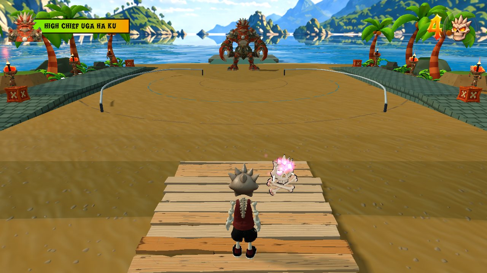

# High Chief Uga Ha ku — campaign crate/enemy review

Retain the four optional mask crates and the dedicated three-phase boss encounter. Each single crate sits on a side terrace and has a clear protection/recovery job. Ordinary cargo clusters or patrols would obstruct the encounter lanes and change the protection economy. Adventure checkpoint density does not apply to this boss arena. There is no linked bonus room.

The player starts and retries with two masks; collecting a third grants temporary invincibility while the stored mask count remains two. All four crates are separately harvestable with normal movement/spin inputs, and a full retry restores them. Source, geometry, movement, animation, artwork and enemy behavior are unchanged.

Validation:

- Existing core suite passes supported spawn, editor round trip, phase-specific hit constraints, telegraphs, model geometry and mask damage rules.
- Eight staged lagoon deaths across normal/endless modes cover all three phases and the defeat settle. Each resets the boss to phase one and 9/9 health, clears temporary tongue/ramp geometry and correctly accounts for lives.
- A continuous native input journey wins in 5,079 frames (84.65 simulated seconds), with nine hits, zero player hits and zero deaths: three pearl strikes, three tongue grinds and three airborne sand-ramp spins. Each tongue run travels about 19.08 m.
- Lite browser review confirms a real third-mask pickup gives temporary invincibility, followed by a lagoon death that restores the boss, both starting masks and all four crates. The fresh full-render 1280×720 arena view is supported, unblocked and visually inspected. Both consoles are clean. A full browser fight is not claimed.
- The preceding commit's passing global level checks, production build and release check remain applicable because this review changes only documentation: version `049c296150a8936710c3`, 959,301,735 bytes.

Elapsed: approximately 8.7 minutes from 10:32 UTC, within the fifteen-minute main-course budget. Publishing remains authorized and awaits GitHub authentication.

