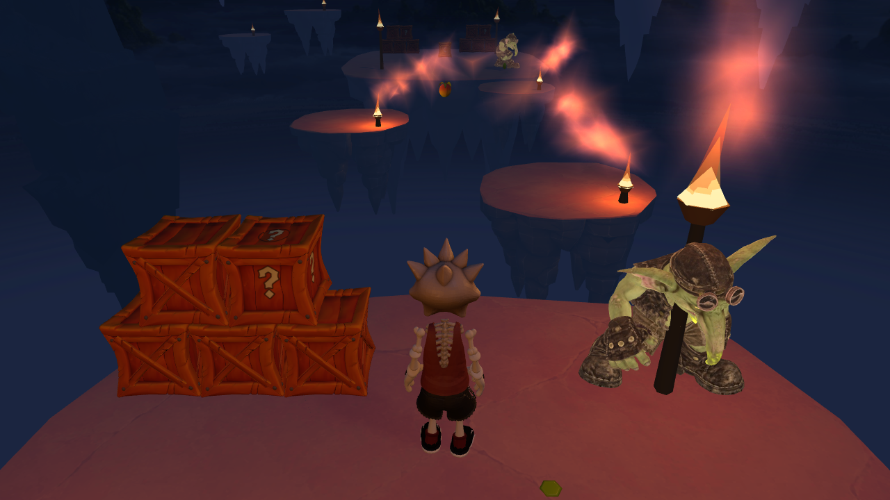
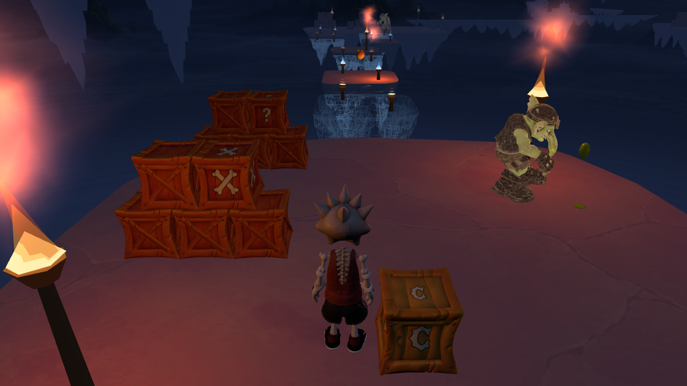
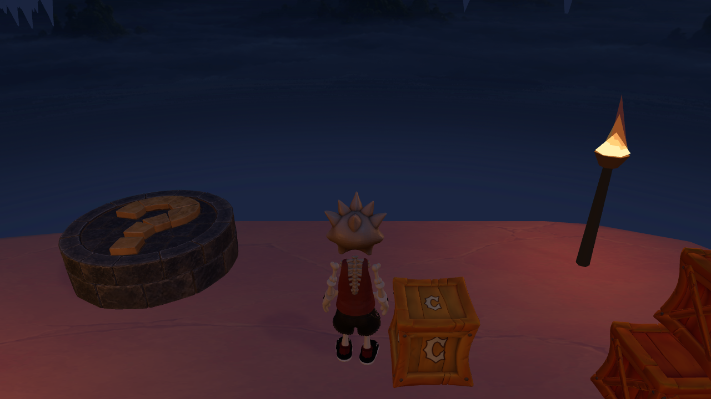
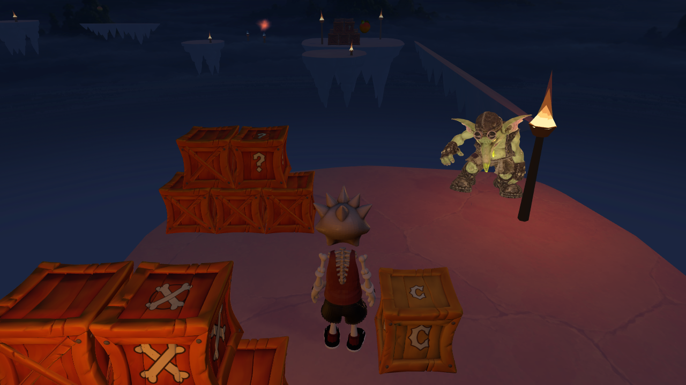
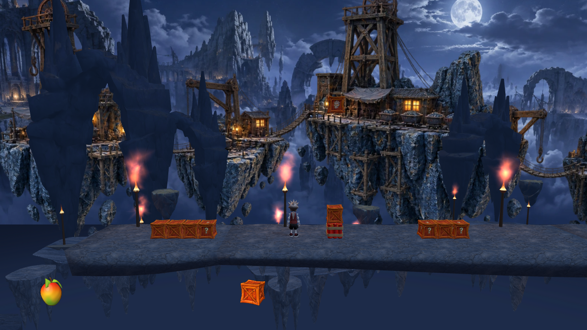
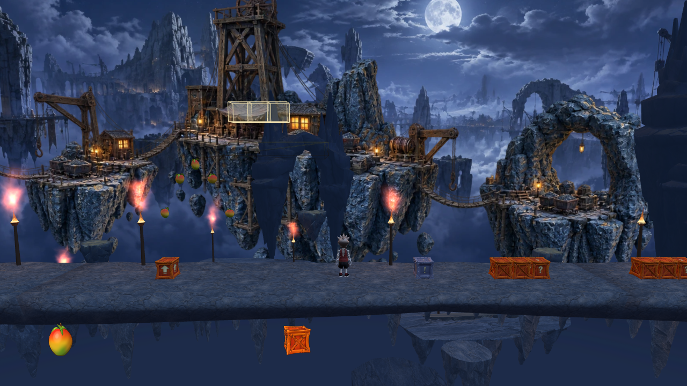

# Torchlight Trouble — crate/enemy review

Added **120 main-course crates in twenty-four five-box pyramids**, two deliveries on each permanent reading island. Three masks prepare the arrival, west receiver and summit encounters. All six original goblins remain beside the route, with their two distinct spin counters. The 34 movers, fourteen phase pads, five moving rails, four ropes, eleven checkpoints, camera views and authored artwork are unchanged.

The **twenty-box Nightworks Fuse Store** grows from seven counted boxes to eight groups averaging 2.5. Single-tier arrival, refuge, dispatch and exit rows reward safe recovery. The three high gallery targets share the original reveal circuit, and both earned lives remain elevated. Eleven checkpoints and the bonus make a **151-box parent tally**. Main route-projection counts are **10 / 10 / 12 / 10 / 8 / 15 / 5 / 18 / 8 / 9 / 10 / 5**, with a median of ten; the winding route assigns some island piles across neighboring checkpoint boundaries.

Validation:

- Twenty-four separately staged normal-input approaches collect all 120 main boxes without deaths. Every lower-tier corner is supported, and full reset restores 120 crates and six enemies. This does not establish a continuous main-course or all-box clear.
- A continuous native bonus run collects all twenty boxes and earns the gem in **64.97 simulated seconds**, without death. Early TNT detonation loses the high cap; destroying the arrow blocks the revealed gallery despite an observed real double jump. A real refuge-cargo stomp plus an asserted apex double jump reaches a maximum head height of **8.770m**, below the **9m** fuse cap. Retry restores all 21 physical crates, including the uncounted switch, with zero credit.
- A normal jump from a separately staged reading-island approach activates the actual bonus entrance once. Return lands on supported parent ground with no deaths.
- Existing Nightworks checks pass 456 surface and 456 side/corner probes, 453 ledge catches, 1,764 render/collision comparisons, camera/control checks, a moving mantle, death/finish and editor round trip. The goblin regression passes native mesh deformation, planted feet, supported patrols, two-hit counters, recoil and reset.
- Browser opening, checkpoint activation, a real fall and restoration of five post-checkpoint boxes, and staged finish pass. Bonus failure preserves parent lives and banks nothing; retry restores the room. A continuous browser bonus clear collects and banks all twenty boxes into the same parent instance.
- Six inspected full-render 1280×720 views cover four main islands and both bonus puzzles. Both browser consoles are clean. The canvas capture omits DOM HUD labels; fruit/crate icons at the bottom are HUD overlays.
- All 166 main and 79 bonus non-crate components and settings compare exactly. Movement, animation, assets and the published pack are unchanged. Required level checks, build and release-size validation pass: `fa387e11c8e1fa024fc1`, **959,314,619 / 1,000,000,000 bytes**.

The static arrow audit cannot infer the revealed gallery and labels the arrow fruit-only. Native positive and negative input trials verify its actual three-target dependency. The browser harness reads this older built-in course's source directly because its level-selector metadata has no `data` property; no gameplay fix was needed.

Elapsed: approximately **24.9 minutes** from 17:44 UTC. Raw checks and initial harness diagnostics remain in `/workspace/crate-review/dark`. Publishing is authorized and awaits GitHub authentication.

