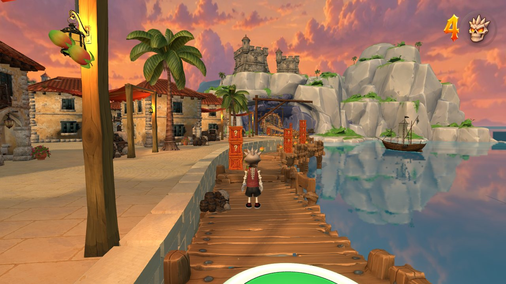
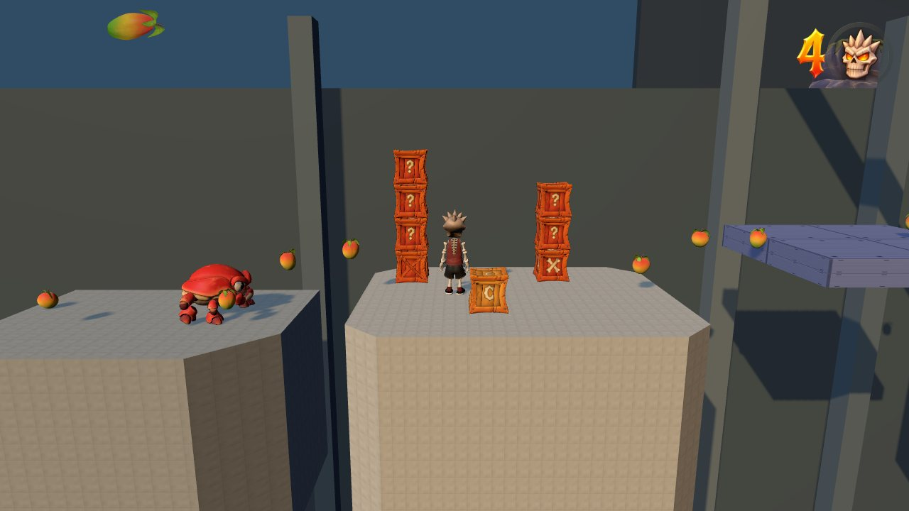
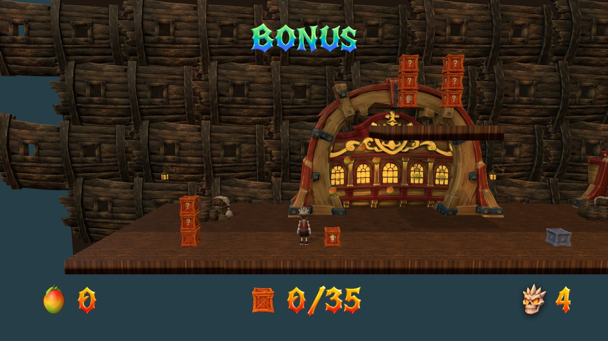

# The Merchant Wreck and The Captain’s Last Ledger

Campaign course `drowned-crown`, reviewed against Parts 0, XV and XX of the gameplay bible. [Validation](validation.json), [before](before.json), [after](after.json).

| Measure | Before | After |
|---|---:|---:|
| Main counted cargo | 10 | 184 |
| Main collectible groups | 10 | 55 |
| Main single-crate groups | 10 | 0 |
| Mean main group size | 1 | 3.35 |
| Bonus counted cargo | 9 | 35 |
| Parent tally including checkpoints and bonus | 36 | 236 |

Every checkpoint section now contains cargo: `10, 10, 14, 10, 10, 10, 10, 10, 10, 10, 10, 10, 10, 10, 10, 10, 10, 10`. The mine section includes the four-box grotto detour; the high consignment contributes four boxes alongside the collapse section’s six ordinary boxes. Ordinary groups have three or four crates, with jobs tied to fixed landings, refuge floors, guarded shoulders, both shelf branches, or the treasury count. The ferries and collapsing pallets remain clear. Two lives reward the grotto and raised consignment; five masks prepare the boarding, ferry, stern, machinery and hoist challenges. The unused solitary multi-hit hoard becomes a harvestable cargo group.

The thirteen existing crabs, turtles and hoppers retain their authored positions and tuning. Their touchdown clearance and outside lanes remain readable, with the new masks preparing the harder sequences. The main all-box layer requires optional branches but does not require a deathless route. No new explosive or tool dependency is added to the timed main route.

The Ledger keeps its return-switch gallery, TNT/high-life launch and materialized bridge. Arrival, upper-gallery, recovery, bridge and exit cargo expand the existing puzzles into thirteen collectible groups. The bridge cargo shares the actual bridge switch group. The arrow must survive until the gallery is harvested; the TNT must survive until the high life is collected. Fresh retries restore all 37 physical crates, nine outlines and both revealed surfaces.

## Validation and scope

- Fifty-five separately staged normal-input harvests collect all 184 main boxes. A separate continuous normal-input route finishes through the boarding portal and all seventeen checkpoints with zero deaths in 416.63 simulated seconds. This is a clear-route run; no continuous main all-box run is claimed.
- All 260 enemy patrol samples remain supported. Hard reset restores every main crate. The final audit has zero unsupported, void or overhanging main crates. Its existing sea-gate checkpoint corner flag is unchanged and is outside the crate refresh.
- Native and real-browser standalone bonus runs collect all 35 boxes and earn the gem without dying. Wrong-order trials verify lost-arrow access, early TNT-spin death and skipped-bridge death; all three retries restore the level. Two additional staged neighboring-cargo attempts fail to reach the gallery after arrow loss; these are documented attempts, not an exhaustive proof over all possible inputs.
- Main browser checks cover the opening harvest and separately staged checkpoint activation, forced kill-plane recovery and finish. All four lite/full modes have clean consoles; ten 1280×720 full-render views were inspected, including both corrected floor placements.
- The published pack’s edited course had its own ocean settings, so source edits alone were insufficient. Only that entry’s crates, cargo groups and layout revision change. All 1,436 other components, all thirteen enemies, the camera/atmosphere/ocean settings, and every byte outside this pack entry are preserved. Source assembly applies the same cargo after scenery and interior staging. Movement and animation are unchanged.
- Required level checks, production build and release-size check pass: 959,301,735 / 1,000,000,000 bytes, version `049c296150a8936710c3`.

Elapsed time: 41.6 minutes from approximately 09:50 UTC. This exceeded the requested fifteen-minute main plus five-minute bonus budget. Publishing is authorized and remains blocked by GitHub authentication.

