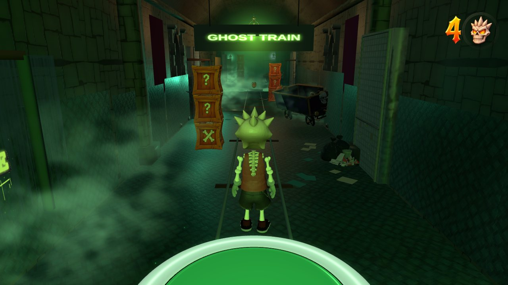
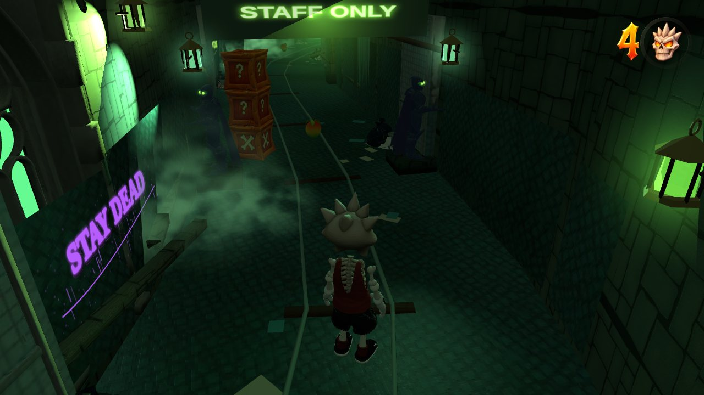
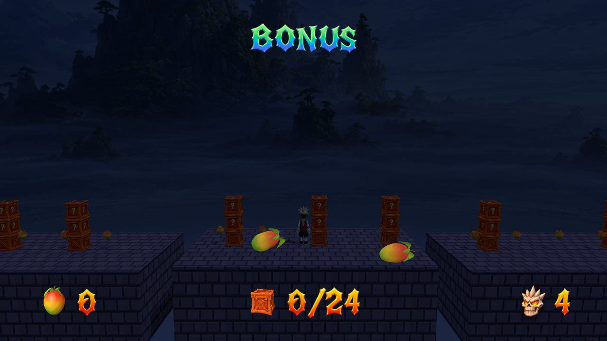

# Ghost Train and Easy Street — crate/enemy review

Ghost Train grows from seventeen to 225 counted crates in sixty-eight fixed-floor groups. The clear route follows the centre line; all-box play pauses at landing supplies and visits both shoulders. Twenty-one checkpoint sections hold ten boxes. Three short intervals hold six, three and six to keep consecutive axe windows and mode-change landings clear. The 23 checkpoints, four moving-cart relays, all rails, floor gaps and ten axes remain exact. Five masks prepare encounters; all fifteen existing enemies retain their two counters, positions and patrol settings.

Easy Street grows from eighteen scattered rewards to twenty-four boxes in eight three-crate groups. Its permanent terraces and two short jumps are unchanged. Ordinary rewards replace the safe-line life and unnecessary mask. It remains a forgiving shared room, including for the next campaign course. Its legacy 0.96 m authoring grid still normalizes once to 1.152 m. Willowmill Cache inherits the shared room's non-terrain data; freezing its original terrain anchors preserves that entire already-reviewed room exactly.

Validation:

- Sixty-eight separately staged normal-input harvests collect every new main crate. All footprints and full reset pass. Three cargo groups were moved out of existing portal collisions during these checks.
- One continuous native main journey completes in 438.90 simulated seconds, banks all 23 checkpoints and clears every cart relay, rail transfer, floor gap and axe without death or reset. No continuous main all-box clear is claimed.
- Native and browser bonus journeys collect all twenty-four boxes, earn the gem and finish without death. A failed-gap test restores the supported spawn, zero count and all boxes.
- The existing Ghost Train suite verifies supported spawn/checkpoints/patrols, actual moving-cart carry, checkpoint contact, pit death/recovery and the finish. Shared bonus jump and inventory contracts pass.
- Two stale pilot assumptions were corrected using ordinary inputs. Both original and updated layouts reproduce the held-Grind rail failure; each rail ollie now gets a fresh airborne press. The original uphill gap also fails the old single-jump pilot; an apex double jump clears it identically in both layouts. Movement, animation and tuning are unchanged.
- Main browser checks cover opening harvest, checkpoint activation, real kill-plane recovery and a staged finish. Seven full-resolution 1280×720 views are inspected; all four modes have clean consoles.
- All 3,629 main non-crate components (including the fifteen enemies), twenty-four bonus non-crate components and environment settings are exact. The editor pack is unchanged. Required level checks, production build and release-size check pass: 959,306,694 / 1,000,000,000 bytes, version `f21acc5b5dca6ca8233d`.

Elapsed: approximately 27.1 minutes from 11:27 UTC. This exceeds the requested fifteen-minute main plus five-minute bonus budget. Full raw logs and failed pilot traces remain in `/workspace/crate-review/ghost`; committed native text logs omit repeated headless asset-fallback warnings. Publishing remains authorized and awaits GitHub authentication.

