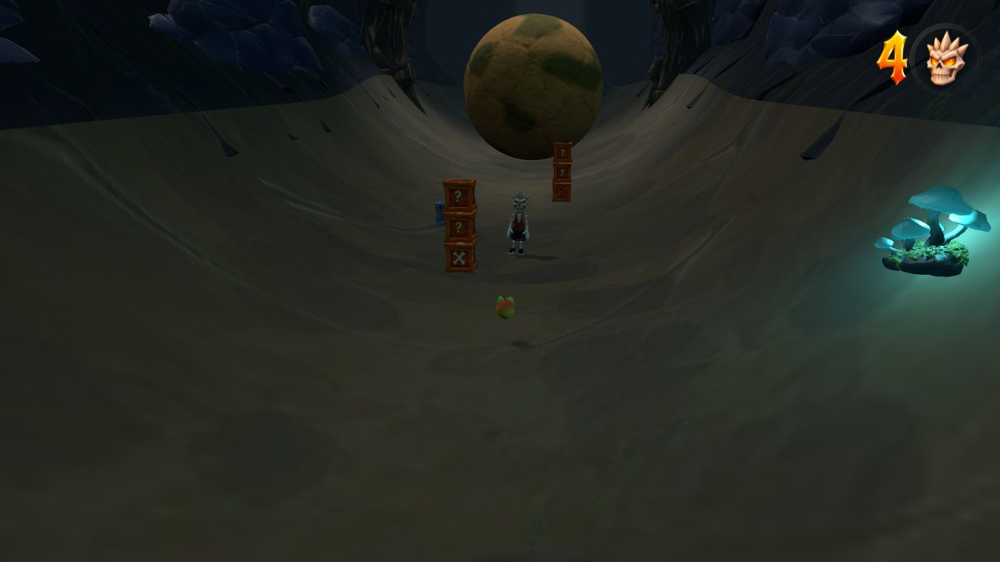
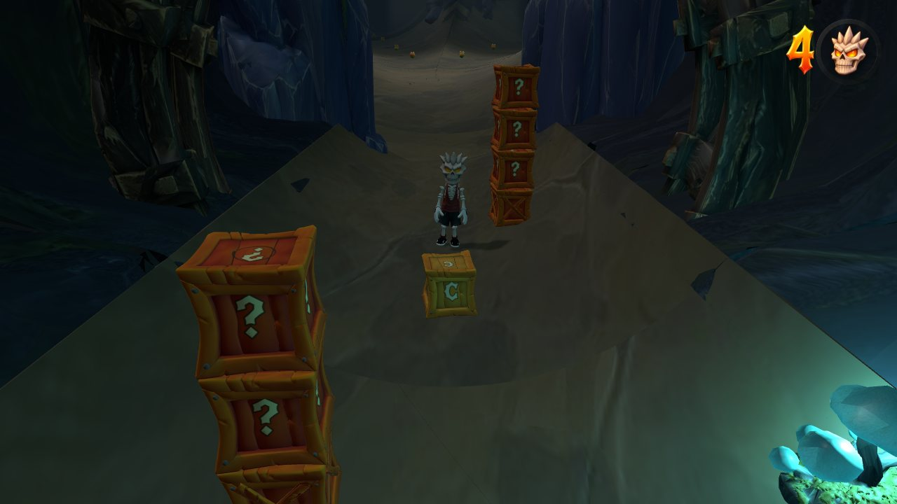
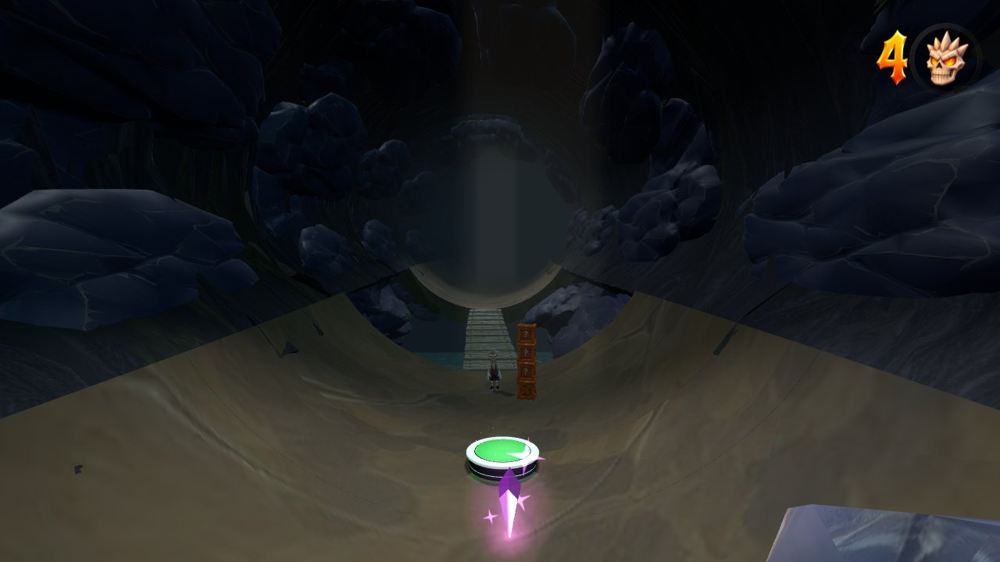

# Tunnelbore Tracks — crate/enemy review

The pursuit course grows from twelve counted rewards to sixty in eighteen groups, ten per checkpoint section. All rewards are on shared ground: before the pursuit, inside the five protected checkpoint rooms, or after the final catwalk. The behind-start group and last supplies are deliberate count checks. Four masks prepare the chase; safe rewards remain wood and mystery crates. The six steel steering obstacles and seventeen existing enemies retain their positions, patrols and three counters. Although the source considers Nitro candidates, its existing clearance filter removes all of them; the effective level has no Nitro and needs no remote switch.

Easy Street is reused unchanged from the preceding [Ghost Train review](../ghost-train/README.md), where native and browser runs collected all twenty-four crates and earned its gem. The parent tally is 89: sixty ordinary crates, five checkpoints and twenty-four bonus crates.

Validation:

- Eighteen separately staged, supported approaches harvest all sixty rewards with normal inputs and the pursuit active. Full reset restores all sixty-six physical crates. This is access evidence, not a continuous all-box clear.
- Both continuous native routes finish without death, mask loss or solid collision: the six left forks in 95.42 simulated seconds and the six right forks in 96.85. Each banks all five checkpoints; their five authored refuge-entry trips remain intentional. The routes cross sixteen and fourteen ordinary gaps respectively and defeat wildlife both through player counters and the pursuing boulder.
- Real trace replays find no decision-spine obstruction in 604 left and 617 right camera samples. Enemy validation samples 1,020 supported live patrol positions across all seventeen actors, including the three original counters.
- Two native pilot assumptions were corrected with ordinary inputs. The finish now needs a charged ollie into the actual pad glow. The right Wormwheel approach needs twelve metres of steering lookahead to keep speed through the bend. Original-layout checks reproduce both old-pilot failures at the same locations; no gameplay physics or geometry changes were needed.
- Browser lite checks pass the opening harvest, checkpoint activation, a real kill-plane fall and recovery, and a separately staged finish. Four inspected full-render views use 1280×720 native rendering. Both browser consoles are clean.
- All 2,642 non-crate components, the six steel boxes and environment settings compare exactly with the captured original source. Every cargo footprint has four supported corners on the circular floor. The audit's twenty-four planar-footprint warnings reflect curved floor height differences, at most 0.3942 m, with no void or pit below any group.
- Required level checks, production build and release-size check pass: 959,307,565 / 1,000,000,000 bytes, version `e9643c927c81ab080eea`. The published editor pack, movement, animation and native artwork are unchanged.

The reusable harvest check is `node tools/test-hollowwake-crate-grammar.mjs`; set `HOLLOWWAKE_CRATE_OUTPUT` for its reports and optionally `HOLLOWWAKE_BASELINE` to a pre-edit source JSON for exact preservation assertions. Complete route checks use `node tools/test-hollowwake.mjs left` and `right`.

Elapsed: approximately 28.9 minutes from 11:54:30 UTC, exceeding the fifteen-minute main-course request. Raw logs and failed pilot traces remain in `/workspace/crate-review/hollowwake`. Publishing remains authorized and awaits GitHub authentication.

