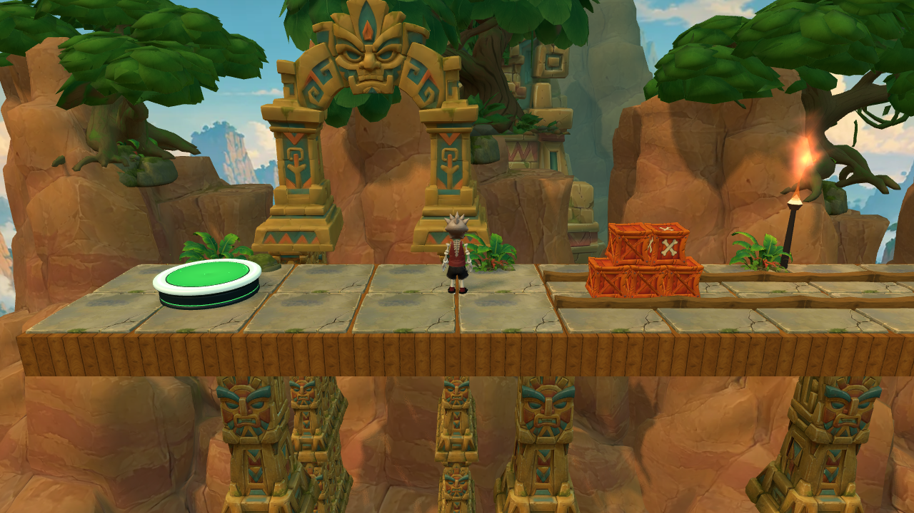
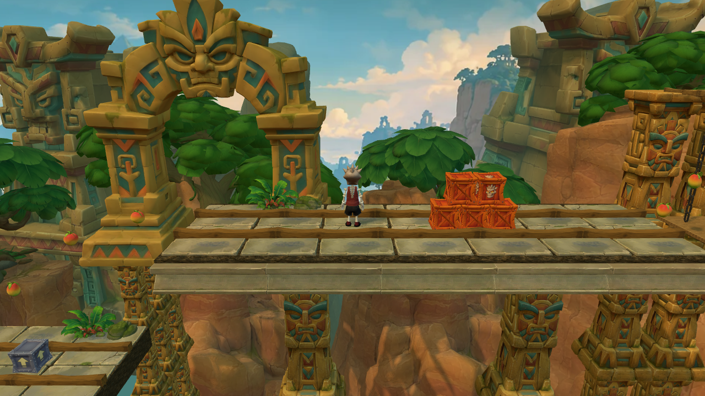
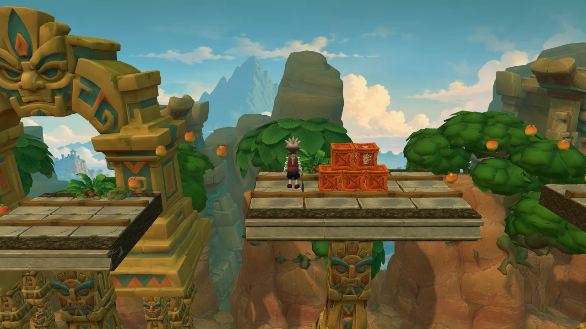
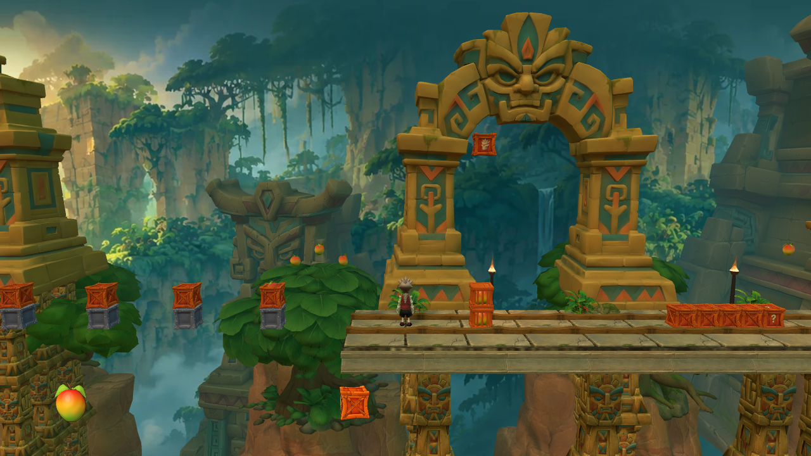
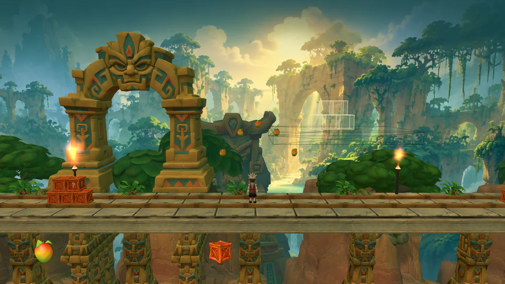

# The Ancient Gates — crate/enemy review

The route now has **119 ordinary crates in 24 supply groups**, plus its existing Nitro: **120 counted crates**. Three climb arrows, two switches and 11 checkpoints remain. Every checkpoint section contains ten counted crates. Three masks precede the difficult stretches; two lives reward elevated routes. All 16 enemies and eight enemy kinds remain.

Gatekeeper’s Hoard now contains **46 counted crates / 53 physical crates**. Seven deliveries replace isolated ordinary rewards. Two unnecessary wooden arrows are removed: the actual native clamber reaches both galleries. The finite crown rises from 8.2m to **9m**, making the upper chest necessary. The two reveal switches, three causeway stones and five steel relay anchors remain.

- A continuous native main run collects all 120 crates and 11 checkpoints in **351.78 simulated seconds**, with zero deaths and zero mask hits. The baseline took 379.73s. The aqueduct supplies sit before the run-up, clear of the fast rail landing and braking area.
- The continuous native bonus collects all 46 rewards and its standalone gem in **116.07s**, without deaths. Exhausting the upper finite chest, skipping the gallery seal, skipping the causeway seal and skipping relay footing have real consequences. Actual ordinary-cargo and final-relay rebounds plus double jumps cannot replace the finite upper chest. Full retry restores all 53 physical crates with zero credit.
- Every bottom-box corner is supported, and the final audit finds no overhanging crates. The main audit’s three arrow labels are geometric-classifier limitations: all three platform targets are reached through actual launcher contacts in the continuous run.
- Checkpoint death recovery preserves banked credit and the deployed bridge. The actual bonus platform activates once, and its return remains supported. Chrome verifies staged main harvesting, checkpoint/fall restoration, finish, failure without life loss, and a continuous 46-box bonus retry banked into the same parent instance. Five full-render 1280×720 views are inspected; consoles are clean.
- Every non-crate source component and setting is identical to the pre-refresh source, whose geometry hashes still match the historical art review. Only the two current pack entries change. Four historical source/published snapshots, eight raw/migrated saves and 56 edited variants preserve stock selection and authored saves.
- Required level checks, production build and release-size check pass: `5fee8e7cd5373175835b`, **959,319,729 / 1,000,000,000 bytes**.

The main and bonus all-box runs are separate; no combined parent clear-gem run is claimed. Browser main probes are staged. Canvas captures omit DOM HUD labels. Elapsed: approximately **54.4 minutes**, exceeding the requested 15+5-minute budget.

