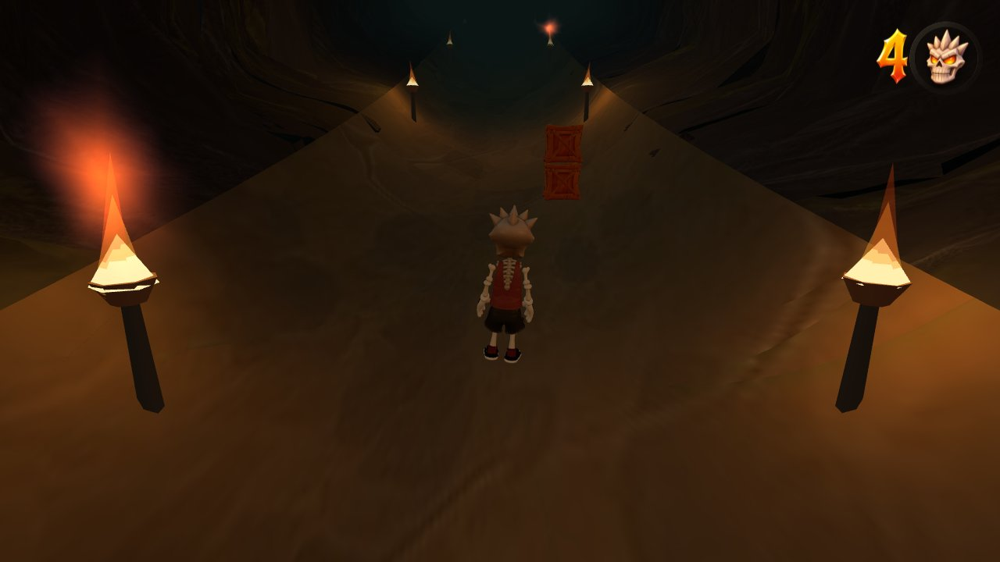
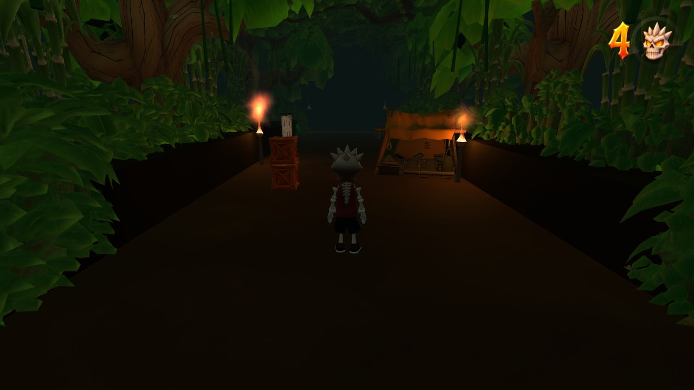
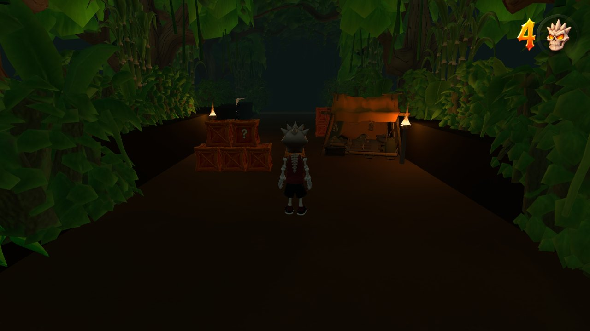
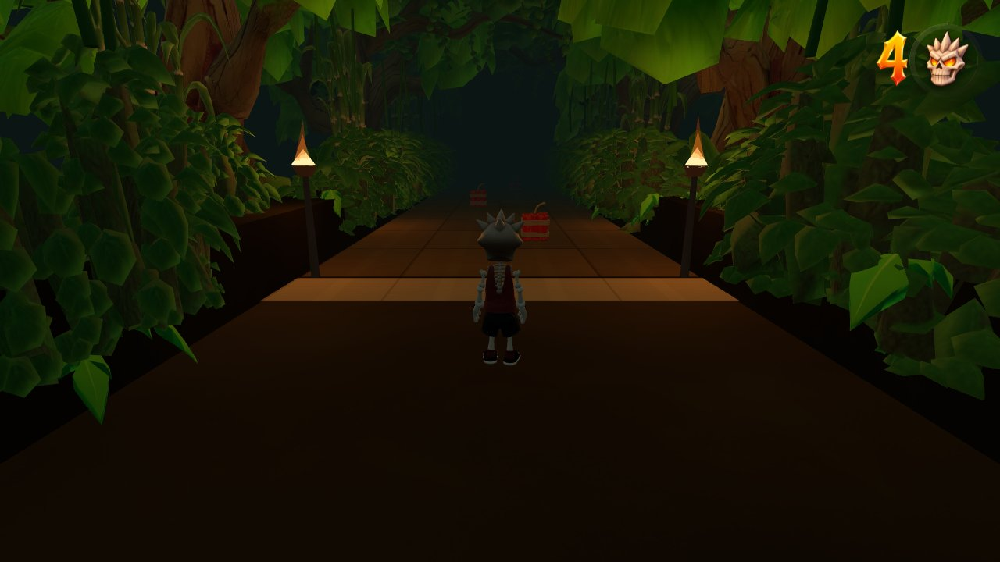

# Nightmare Grove — crate/enemy review

Replaced 24 isolated ordinary rewards with **18 supply groups holding 56 crates**. Small pairs sit in the early refuges; larger blocks and pyramids serve the short later checkpoint sections. Two tunnel pairs mark arrival and the final count check. Seven lives on safe ground become ordinary rewards. No masks or enemies are added: the concealed pressure fields remain the challenge, and masks do not protect against them.

The four TNT crates and one Nitro retain their positions and whole-field wiring. Main inventory is **61 counted crates**, distributed **10 / 11 / 10 / 10 / 10 / 10** between checkpoints. Five checkpoints and the unchanged 24-box Easy Street bonus give a **90-box parent tally**. Mean counted cluster size is 2.65, with only the five hazard crates standing alone. Supplies stay between the existing braking and clue-reading zones, without revealing hidden safe ground.

Validation:

- Eighteen separately staged centre-route approaches collect all 56 ordinary rewards with normal movement/spin inputs and no deaths or field detonations. Full reset restores 62 physical crates and rearms every field. Native support rays find ground beneath every tested lower-tier corner; the maximum 0.381 m height difference is on the unchanged circular tunnel floor.
- All ten native field crossings reach supported camps without deaths or detonations. Three extended sequences continue through delayed braking, supply collection, checkpoint activation where present, a clue-reading pause and the next approach. These are separate runs, not a continuous full-course or all-box clear. The original shared process exhausted its Node heap after nine successful crossings; the final speed jump passed in a fresh process, and the runner now isolates each crossing.
- The existing minefield suite verifies all ten pressure fields, four trapped rails, TNT/Nitro wiring, safe spots, all five checkpoint returns, tunnel support, real pressure/pit deaths and editor validation. Original explosive collection is outside the new ordinary-reward harvest. An old buried-mine assertion reproduced on the original source: it expected the former 0.96 m dimensions. The fixture now checks the current 1.152 m size, its unchanged 0.08 m pressure lid, and current CrateArt ownership instead of the retired explosiveBundle field. Runtime code is unchanged.
- A normal jump activates the actual refuge bonus entrance once and returns to supported parent ground with every field armed. Easy Street is unchanged from the [Ghost Train review](../ghost-train/README.md). A fresh browser journey collects all 24 bonus crates and banks them into the same Nightmare Grove parent.
- Browser checks pass staged tunnel collection, checkpoint activation, a real pressure-field death, restoration of five after-checkpoint crates and the armed field, and a staged exit. Five inspected 1280×720 full-render views cover tunnel supplies, early and later refuges, and the retained TNT grid. Both consoles are clean.
- All 2,172 non-crate components, the five explosive components, level settings, movement, animation and artwork compare exactly. The published level pack and shared bonus are untouched. Native traversal/camp scripts and their browser replay reader now accept configurable output paths so they run in the reusable cloud workspace.
- Required level checks, build and release-size check pass: `9f735c3e0337ff2e9d6f`, 959,312,526 / 1,000,000,000 bytes.

Elapsed: approximately 25.2 minutes from 16:14 UTC. The requested fifteen-minute main-course allowance was exceeded by native crossing and browser validation. Raw replays remain in `/workspace/crate-review/grove`. Publishing is authorized and awaits GitHub authentication. Full limitations are recorded in `validation.json`.

