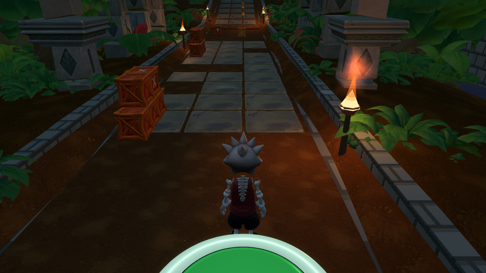
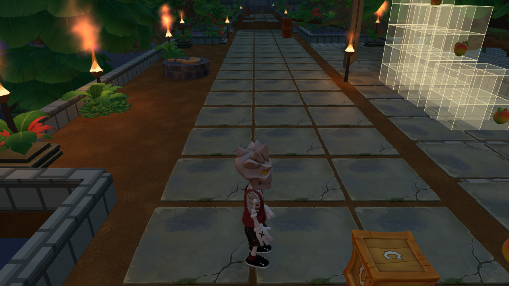
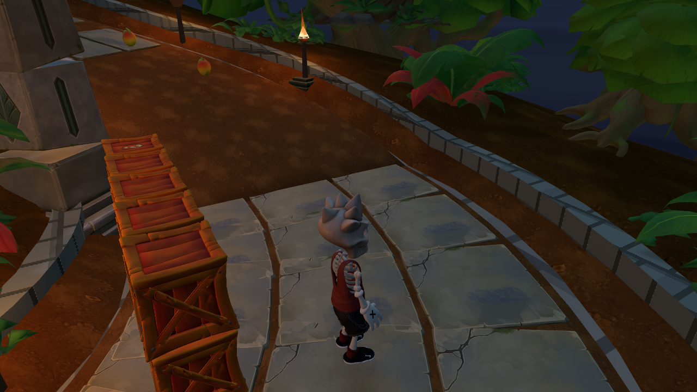
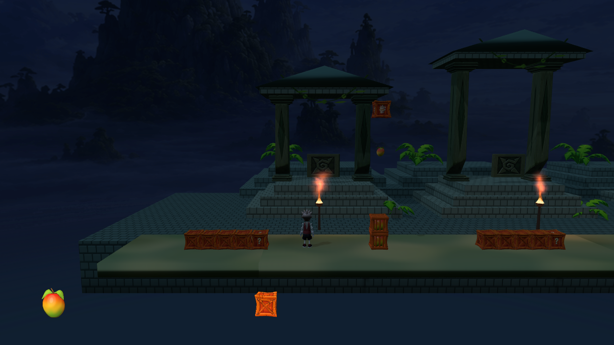
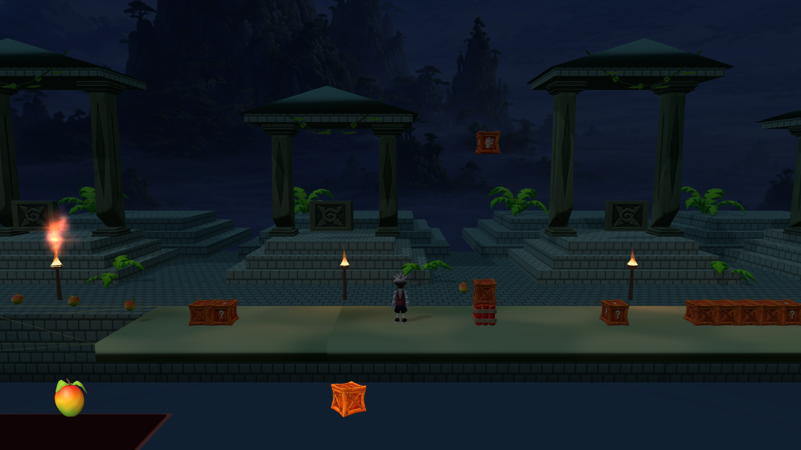

# Temple of Embers — crate/enemy review

Grouped the main supplies into 22 optional caches and seven stair pairs. The course has **133 counted crates**, three masks and **10–12 boxes per checkpoint section**. Its 174-box tally includes 12 checkpoints and 29 bonus rewards. All eight enemies, three arrow puzzles, two TNT relays and 48 outlined metal steps remain. Ember Reliquary gains four single-tier five-box deliveries and a touching receiver pair.

- A continuous native route finishes in **133.78 simulated seconds**, activating all 12 checkpoints without death. Separately staged input-driven approaches collect all 114 revised ordinary rewards. Every bottom-box footprint is checked; the final audit finds no overhanging collectible crates.
- Eleven native main puzzle cases cover upper-first solutions, wrong orders, the lantern staircase and a real rebound/double-jump attempt from the nearby bowl cargo. Eight unmasked enemy encounters, 168 patrol-support probes, 3,625 route-floor probes, checkpoint recovery and tiki phases pass.
- The continuous native bonus collects all 29 rewards and its standalone gem in **75.93 simulated seconds**, without death. All three wrong orders and full retry pass. An actual cargo rebound plus double jump reaches 8.770m, below the 9m target. The real bonus platform activates once and its return stays supported.
- Browser collection, checkpoint/fall restoration and staged finish pass. A failed bonus preserves lives and banks nothing; the continuous retry banks all 29 rewards into the same parent instance. Five full-render 1280×720 views are inspected, with clean consoles.
- All 5,617 main and 122 bonus non-crate source components and settings compare exactly. The old published main snapshot differs in 37 non-crate numeric values by at most 2.62e-9; the updated pack uses the exact Node 22 source. Only the two Temple entries change. Four prior source/published snapshots, eight raw/migrated saves and 56 edited variants preserve stock selection and authored saves.
- Required level checks pass, with the relevant validator rerun after the last cache move. The final build and release check pass: `d195217e2674b8c194dc`, **959,317,549 / 1,000,000,000 bytes**.

No continuous main all-box clear or parent gem is claimed. Browser main probes are staged; actual bonus entry is verified separately in native physics. Canvas captures omit DOM HUD labels. Full-scene software-renderer startup is slow. Elapsed: approximately **56.8 minutes**, exceeding the requested 15+5-minute budget. GitHub authentication and publishing access are now verified.

