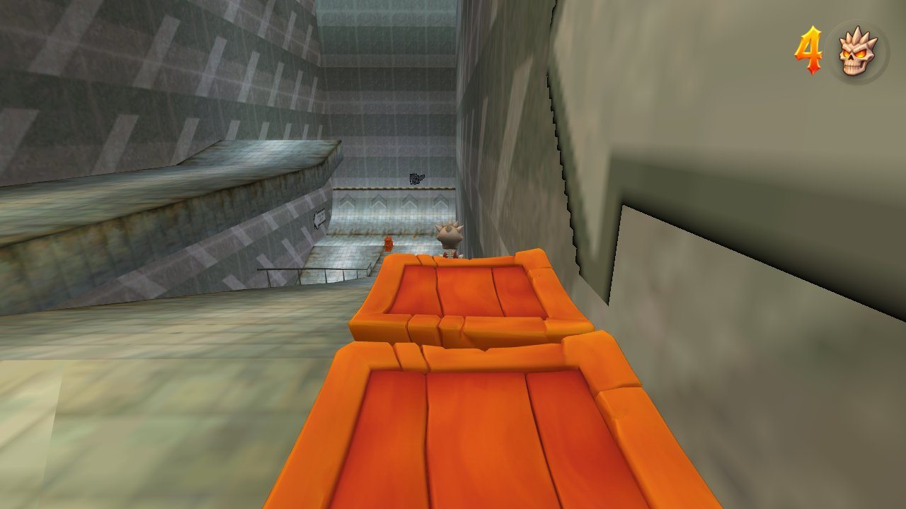
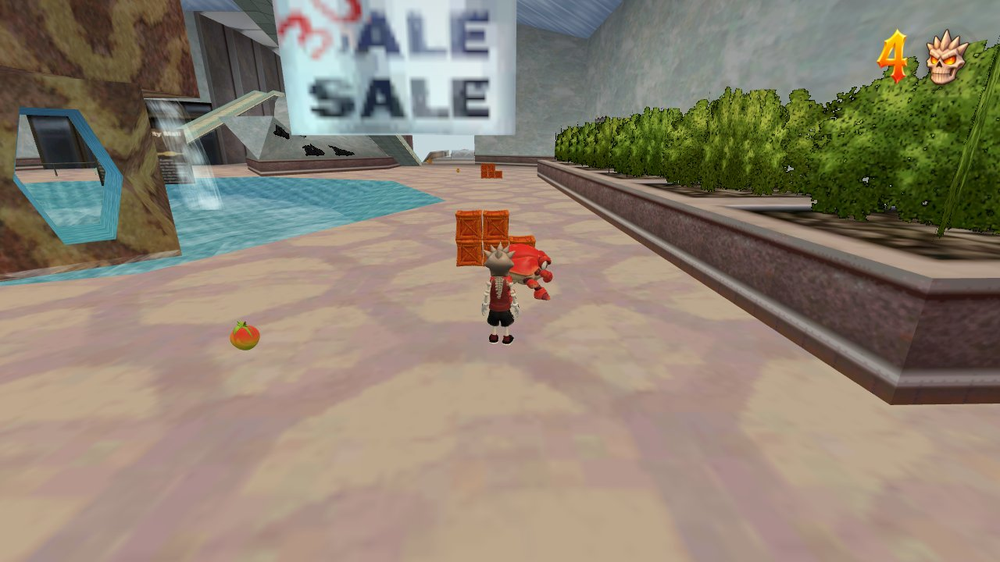
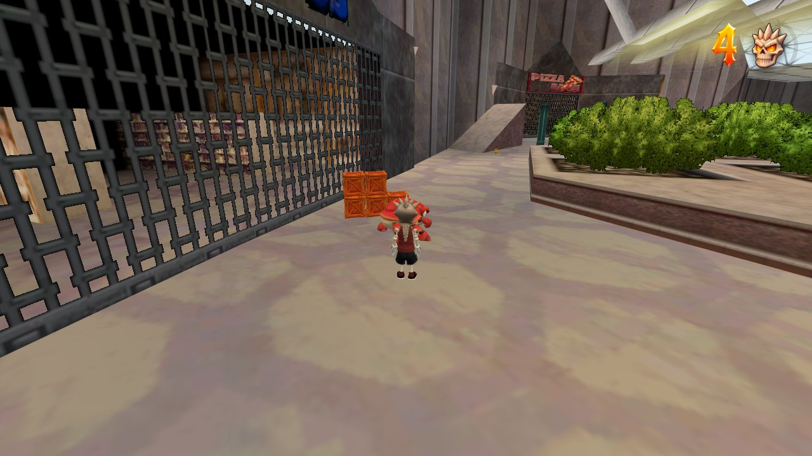
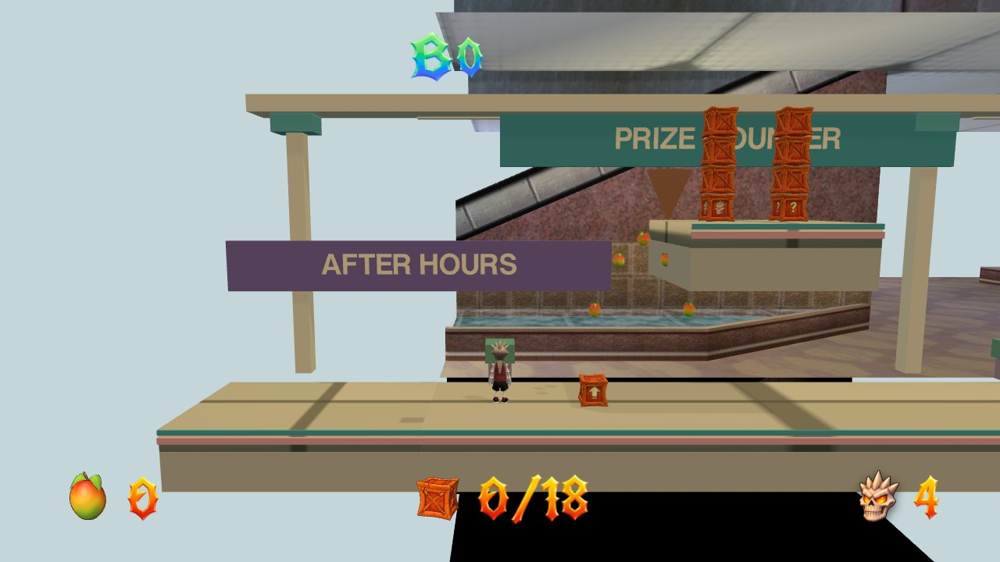
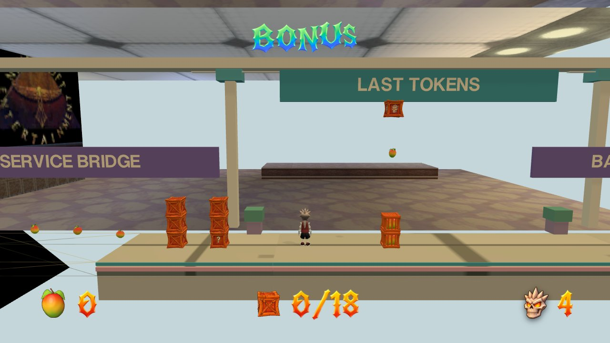

# Mayfield Mall and After Hours — crate/enemy review

Mayfield's 14 counted crates left eight of its eleven checkpoint sections empty. Ten source warehouse boxes also lacked nearby support, including a group outside the retained floor. Replaced these and the four isolated boxes with **22 supported five-box deliveries**, giving **ten crates in every checkpoint section**. The course now has **110 main crates**, ten checkpoints and 18 bonus crates: **138 counted boxes**. Three masks precede later challenges. Three optional crab patrols guard supplies on broad floors; their patrol ranges increase while their speed and counter stay consistent. The centre route stays clear.

After Hours grows from eight to **18 counted boxes** in earned reward groups: two four-high gallery columns and two three-high bridge-receiver columns. Its arrow, twelve-metre switch bridge, two finite supports and original nine-metre cap retain their jobs. Both lives remain behind the required tool puzzles. The initial experimental spread of finite-cap rewards failed its input test and was removed; the final finite target is unchanged.

Validation:

- Twenty-two separately staged normal-input approaches from the cleared main route collect all 110 main boxes. All enlarged lower-tier corners have support within 0.037 m. Three separately staged ordinary-spin counters defeat the guards without a death; full reset restores all crates and enemies.
- A separate full walking route finishes with the crystal and all ten checkpoints in 247.50 simulated seconds without a death. It uses the retained Mall, School, Warehouse and Kona surfaces. No continuous main all-box clear is claimed.
- The continuous 18-box bonus finishes in 43.43 simulated seconds without deaths. Destroying the arrow first blocks the upper rewards; skipping the bridge causes a real fall; spending the upper finite support first leaves the high cap inaccessible. Reset restores all 19 physical crates and hides the bridge. These negative cases share a profile that already earned the standalone gem; their evidence concerns access to the physical targets.
- Native inputs activate the actual arcade bonus platform once and verify its supported return. Browser checks use a debug entry trigger to test the detour state flow: failure preserves parent lives, retry restores the room, and a continuous run banks all 18 boxes into the same parent.
- Browser opening collection, checkpoint activation, restoration of five collected crates after a staged death, and a staged finish pass. Five inspected 1280×720 full-render views cover deliveries, guards and both bonus reward areas; consoles are clean.
- All 2,763 non-crate components retain their serialized values, and level settings are unchanged. The published pack has no Mayfield override and remains untouched. Movement, animation and artwork are unchanged.
- Required level checks, build and release check pass: `33fa0d85bcda5732230f`, 959,310,252 / 1,000,000,000 bytes.

Elapsed: approximately 31.0 minutes from 14:49:20 UTC. This exceeds the requested 15 + 5 minute budget; reward iteration and full validation account for the extra time. Raw probes remain in `/workspace/crate-review/mayfield-mall`. Publishing is authorized and awaits GitHub authentication.

