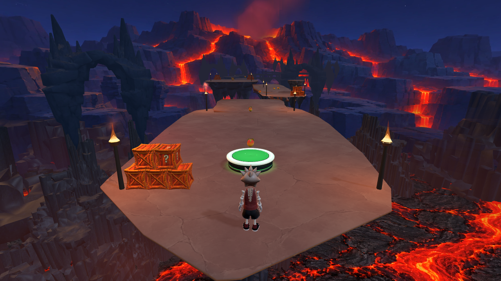
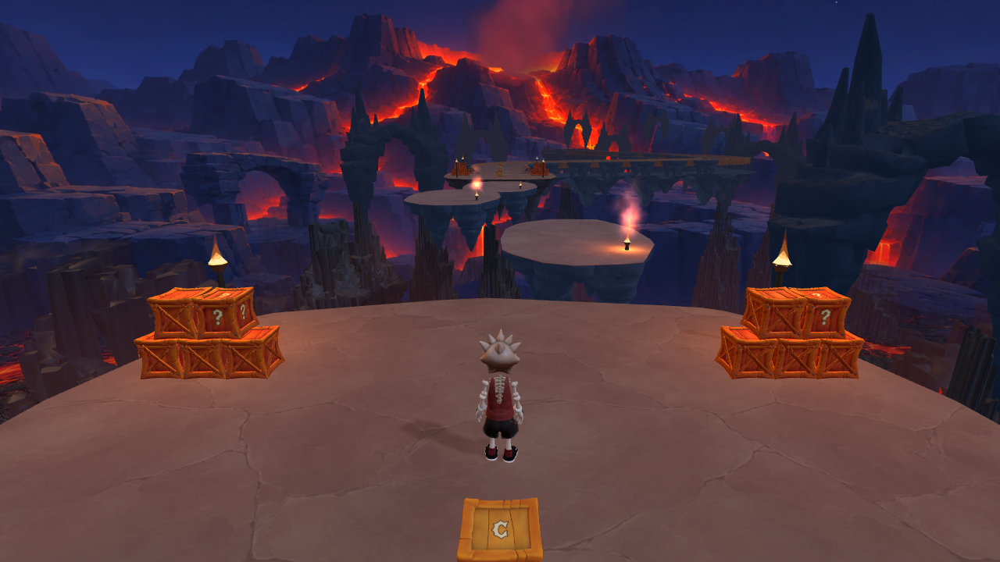
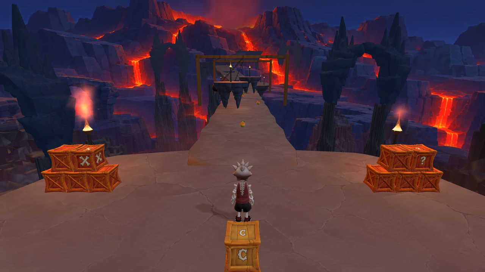
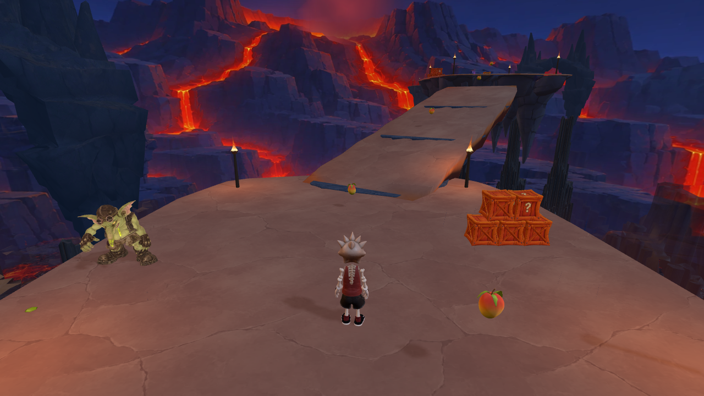
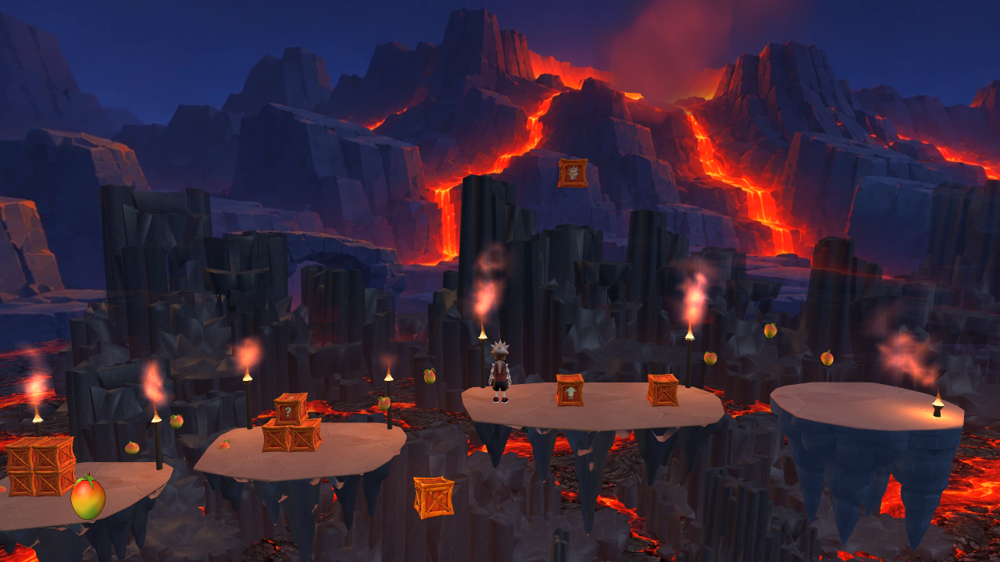
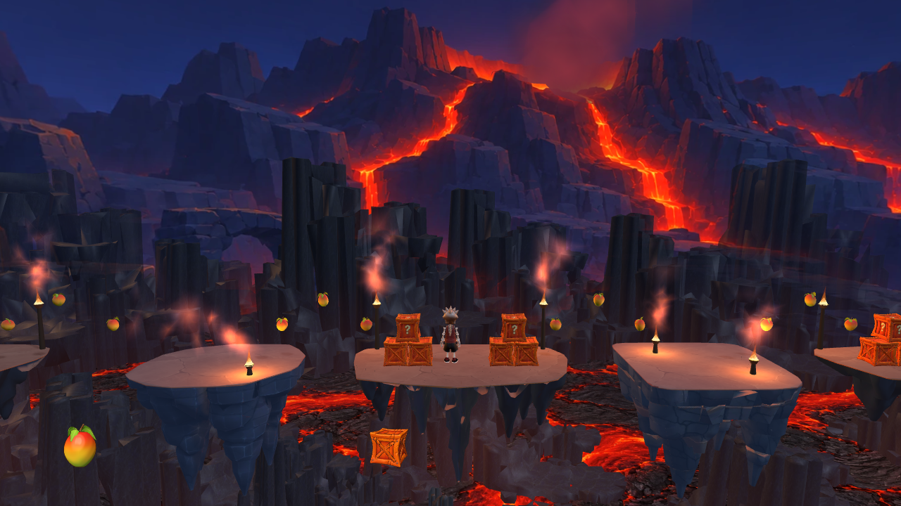

# Guptus Eruptus — crate/enemy review

Added **80 main-course crates in sixteen five-box pyramids**, two groups per authored chapter. All sit on permanent ground beside the mounted route, with three masks before the workbay, crown and final exam. The four existing enemies retain their two enemy types and original placement. Moving decks, timed pads, rail transfers and launchbacks remain the course's main challenges. The first cache rewards a short backtrack behind the spawn.

Seven checkpoint crates and the **25-box Caldera Counterweights** room give a **112-box parent tally**. Main clusters average five boxes, with no singles. The route-projection audit reports **10 / 10 / 10 / 10 / 15 / 5 / 10 / 10** boxes between checkpoints: the west workbay cache projects onto the preceding lateral rail leg. The median is ten, and each authored chapter holds two caches.

The bonus grows from sixteen to twenty-five counted boxes in ten groups, averaging 2.5. Low cargo formations reward stable landings. The idle multihit becomes ordinary wood. The high life rises from 13.2m to 15.2m so it requires its arrow with the current character silhouette, and the later life remains beyond the ferry and timed-rock crossing. New stacks stay two layers high and do not bridge either crossing.

Validation:

- Sixteen separately staged normal-input approaches collect all eighty main boxes without deaths; full reset restores eighty crates and four enemies. Every lower-tier corner has exact floor support. This is separate from the full traversal, not a continuous all-box clear.
- A continuous mounted run clears all eight chapters in **70.98 simulated seconds**, including actual moving-platform, timed-pad and grind contacts. It banks six checkpoints with no death or reset; all seven checkpoints remain present. Four simple bypass strategies fail as intended. Original and changed runs reproduced the same crown-pilot stall frame for frame. The corrected test handoff accepts a safe position on the existing 24m dock; movement and geometry are unchanged.
- The continuous native bonus collects all twenty-five crates, earns its gem and makes actual ferry and live-pad contacts in **61.65 seconds**. Destroying the arrow first then performing an asserted real double jump leaves the high life intact: maximum head 13.584m versus the life base at 15.2m. A real stomp on the nearby cargo followed by an actual double jump also fails to replace the arrow (head peak 14.763m). Retry restores all twenty-five boxes and zero credit.
- A normal jump from the staged summit approach activates the actual bonus platform once. Its return lands on supported parent ground without triggering the nearby finish.
- Browser checks pass staged opening collection, checkpoint activation, a real fall and five-box restoration, and a staged finish. A failed bonus attempt keeps parent lives and banks nothing; a fresh retry restores all twenty-five crates. A browser floor double jump also leaves the raised life intact after the arrow is lost; reset restores every box. A continuous browser bonus journey then collects and banks all twenty-five into the same parent.
- Six inspected 1280×720 images captured with the existing normal-gameplay render hook cover opening caches, the scissor-deck dock, workbay, crown and two bonus landings. Both browser consoles are clean.
- All 360 main and 94 bonus non-crate components and settings compare exactly. Enemy positions, artwork, movement, animation and the published pack are unchanged. Required level checks, build, release-size check and volcano regressions pass: `06dd1662d9c48a9825df`, 959,313,361 / 1,000,000,000 bytes.

Elapsed: approximately 62.3 minutes from 16:39:50 UTC. The twenty-minute main-plus-bonus budget was exceeded by baseline diagnosis, native traversal and browser verification. Raw traces and initial diagnostic attempts remain in `/workspace/crate-review/guptus`; `pilot-corrections.json` records their scope. Publishing is authorized and awaits GitHub authentication.

Canvas captures omit DOM HUD text; the crate and fruit icons below the bonus views are HUD overlays.

