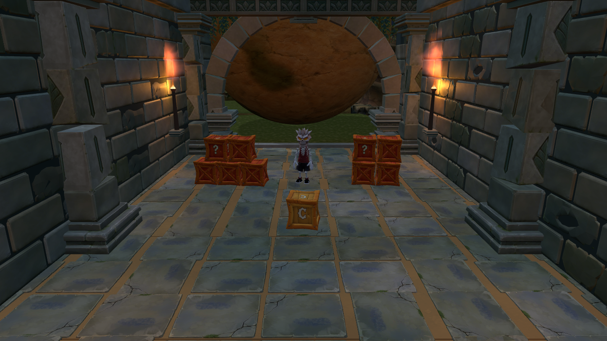
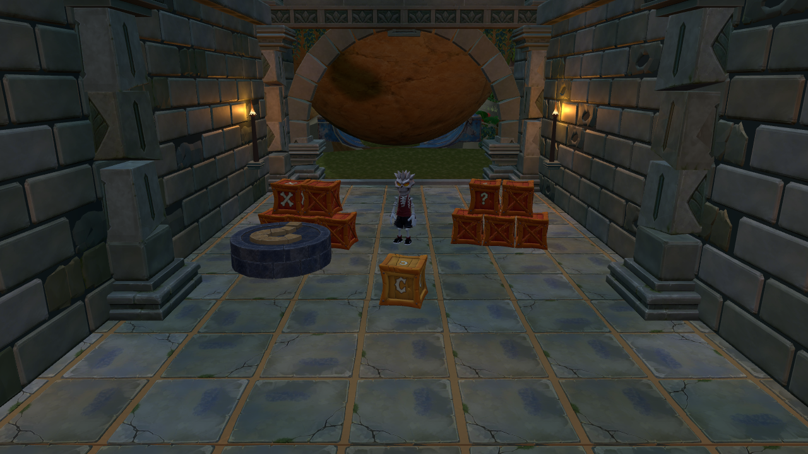
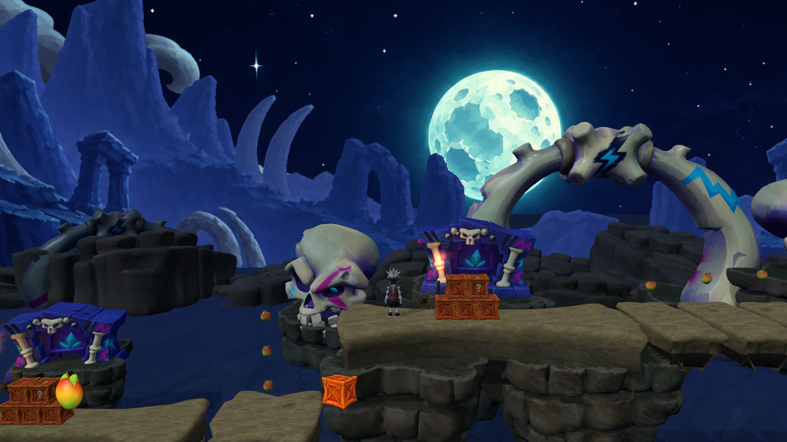
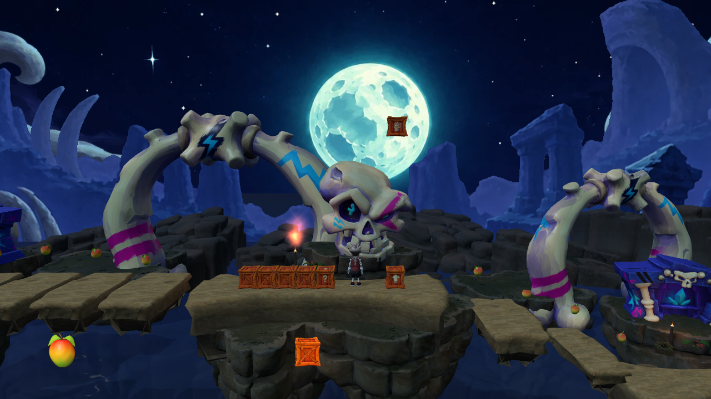

# Rolling Bones and Moonbone Vault — crate/enemy review

Rolling Bones now has **77 counted crates**, eleven in each of seven checkpoint sections. Forty-four ordinary supplies form ten sheltered groups, leaving the restart lanes clear. The opening mask, two risky branch lives, 23 wooden smash-wall crates, 40 steel obstacles, seven Nitro and the final cleanup switch retain their jobs. Three masks precede the difficult stretches. Mean cluster size rises from 1.62 to **4.05**, and only three counted crates stand alone.

Moonbone Vault rises from 16 to **22 crates**: four five-box deliveries, its arrow and the high life. The life moves to **15m**, so the arrow must survive until used. An actual ordinary-crate rebound, double jump and repeated air spins peak at **14.834m** and cannot substitute for it. The real lift ride and four crumbling bone crossings remain. No combat enemies are added to the chase, its shelters or the traversal bonus.

Both continuous main routes finish without deaths. The ground route activates all six checkpoints; the high route activates five. The 44 new supplies are collected through normal inputs in staged probes with inactive pursuers; all 104 new footprint corners are supported. The seven old slope flags retain physical ground at all corners. Native and browser bonus runs collect all 22 boxes without deaths; the browser banks them into the same parent instance. Spending the arrow early blocks the life, skipping the bridge footing causes a real death, and a retry restores every box. Checkpoint recovery preserves banked credit and restores the five later crates. Actual normal-input bonus entry and the supported return pass.

All non-crate geometry, camera, movement and art remain intact; only a bonus group label changes. These are source-owned courses, so the published editor pack is unchanged. Two previous stock snapshots, four raw/migrated saves and 28 authored variants verify archive handling. Editor capture applies crate scaling once. Required level checks, build and release gate pass: `b2f5bf68d75083366ae6`, **959,321,422 / 1,000,000,000 bytes**. Four full-render views and the lite browser pass have clean consoles.

The main all-box run is not claimed: complete main traversal and new cargo collection are separate tests. Earlier controller failures are preserved; correcting the controller's crystal assumption and its extrapolated final-curve steering required no gameplay changes. Elapsed: approximately **56.3 minutes**, exceeding the requested 15+5 minutes and including the cloud startup verification.

