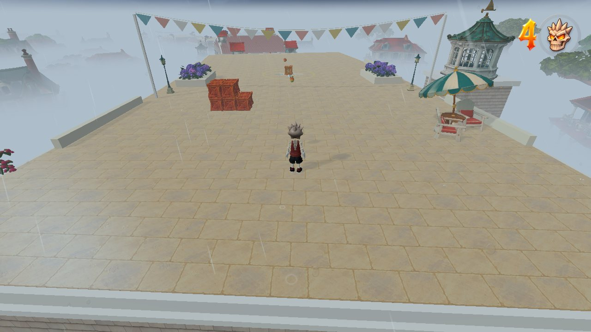
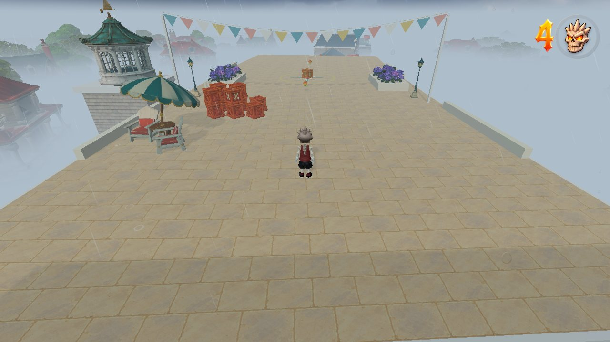
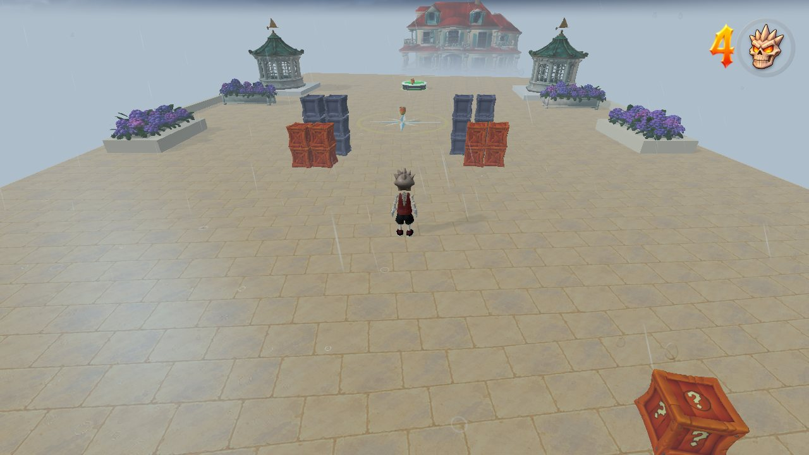
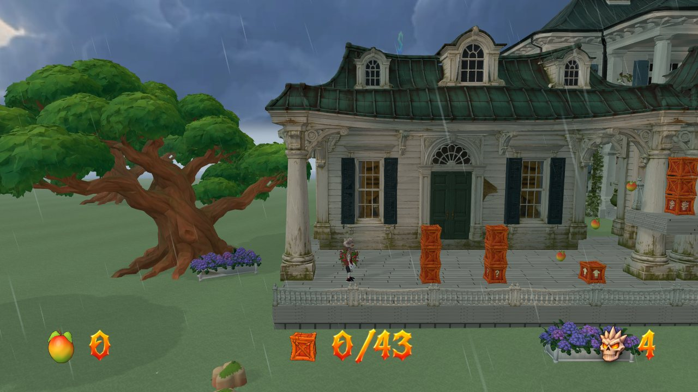
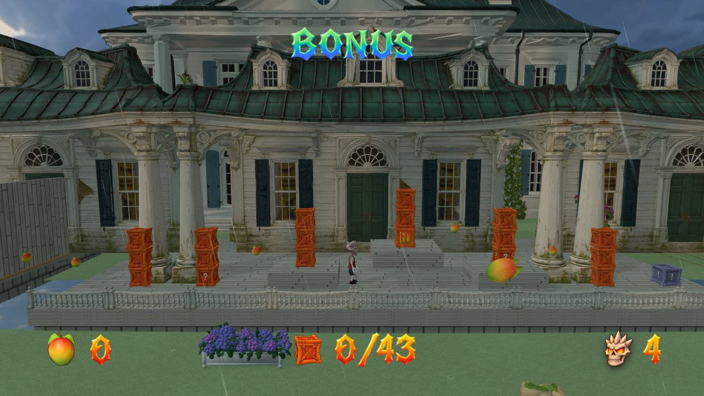
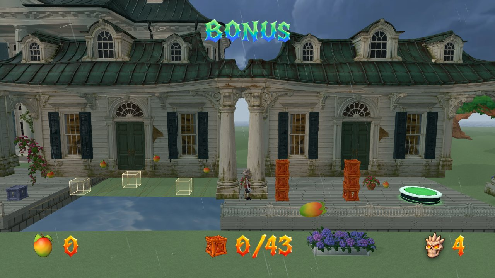
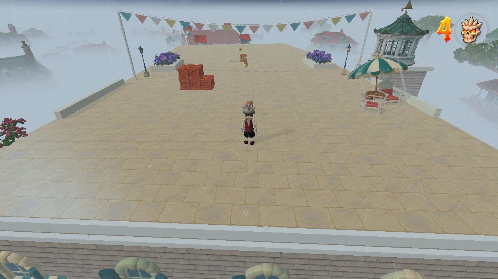

# Hogsworth Harbour and The Storm Parlour — crate/enemy review

Expanded six district delivery piles from four to ten crates and the two final club deliveries from one to four. Replaced three unsupported multi-hit caps with wood, retaining the three masks before later districts. The course now has **79 counted main crates**, **six checkpoints** and **43 bonus crates**, for a **128-box parent tally**. Its 24 steel flight cases remain unchanged. The checkpoint sections contain 10, 12, 14, 10, 12, 11 and 10 boxes.

The new supplies occupy existing fixed refuge roofs and the broad final courtyard, outside the wet running line. Seven remaining singles mark optional fork rewards, transfer rewards and catering stops. The mean counted cluster size rises from 2.18 to 4.65; singles fall from 24.3% to 8.9% of counted boxes. No enemies are reintroduced: the roof gaps, wet footing, wind and optional branches already supply the route's pressure, and the retired pig actors stay retired.

Storm Parlour now has 43 crates in small supply columns. The pantry hamper supports two caps; the three restored-board landing markers and shelf arrow remain single tools/targets. Two safe-path life rewards become wood; the optional upstairs invitation retains its life. Mean cluster size rises from 1.35 to 2.53, with four singles among 43 boxes. The permanent shelf is an assisted arrow destination, not a strict arrow-only height gate. The audit's fruit-only arrow label misses that platform destination; the normal-input journey reaches it while preserving the arrow for collection on return.

Validation:

- Nineteen separately staged normal-input approaches collect every main crate. All lower-tier corners of the eight enlarged piles sit on supported floor, with zero measured height error. Full reset restores all 103 physical main crates.
- A separate complete skate run crosses 44 roofs, 43 jumps and all six checkpoints in 100.38 simulated seconds without a death or tuning change. No continuous main all-box run is claimed.
- The bonus clears all 43 crates continuously with ordinary movement and repeated spins. Retry restores all 44 physical crates, hides the three repair boards, refolds the spin bridge and clears box credit. Its sheltered footing remains dry.
- The lite browser verifies opening collection, checkpoint restoration after a staged fall, a staged finish, continuous bonus collection and banking of all 43 boxes. A separate ordinary short jump from a staged approach into the unrepaired bonus gap returns to the parent without spending a life or banking credit, and leaves retry available.
- Six inspected 1280×720 full-render views cover three roof supply sites and three porch views. Both final browser consoles are clean. The slow-walk failure check times out at the existing edge-teeter protection; a separate short-jump check verifies failure and actual re-entry with all 44 crates restored, repair boards hidden and the bridge folded. A further full-render check reloads the course twice and inspects its native 1280×720 view with no shader errors. The first lite attempt cleared and banked the bonus, then its failure-walk check timed out. That attempt also exposed duplicate fog GLSL in cloned materials on course revisit. The shader callback now retains each clone's own uniforms and injects the inherited code once; the focused regression verifies independent ownership and disposal. Repeating the slow walk also reaches edge-teeter protection; the final short-jump check exercises the intended failure instead.
- Only the `rooftop-relay` entry changed in the published pack. All thirteen other entries, all 2,148 non-crate components in this entry, its settings and its existing numeric editor adjustments are preserved. Source and published crate lists match; movement, animation and artwork are unchanged. The pack's component order follows the source and only this level's stock certificate was refreshed, after proving exact preservation of all component values and the complete bounded-runtime source match. This removes an avoidable 9.6 MB snapshot duplication.
- The broader optional `test-level-sync` suite fails on an older `sky` stock-certificate mismatch; both its data and certificate are unchanged from HEAD. Focused Hogsworth compaction, bounded roundoff and edit-retention checks pass.
- Required level checks, build and release-size checks pass: `4bdb920695972f6dc797`, 959,308,568 / 1,000,000,000 bytes. The native porch test now checks full retry restoration and writes to a configurable scratch directory.

Elapsed: approximately 57.4 minutes from 13:51:37 UTC, exceeding the requested 15 + 5 minute budget because of browser traversal, retry diagnosis and release compaction checks. Raw probes remain in `/workspace/crate-review/rooftop-relay`. Publishing is authorized and awaits GitHub authentication.

