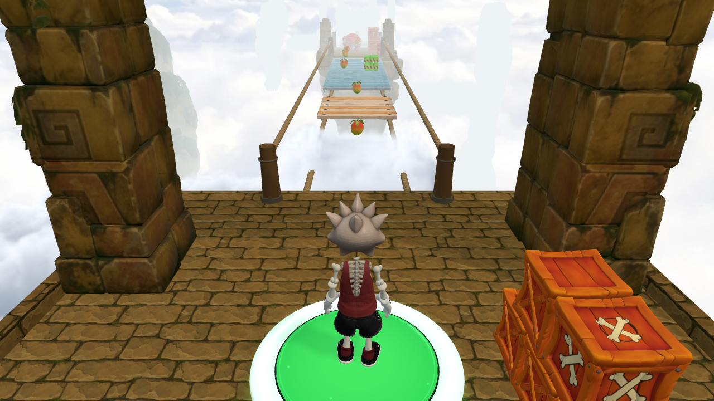
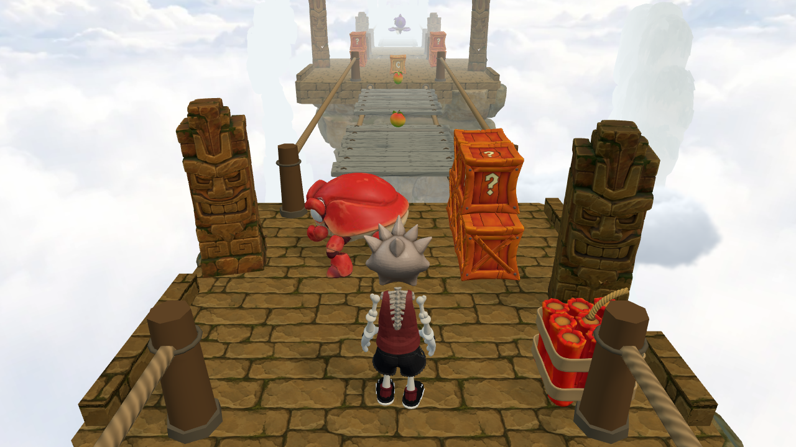
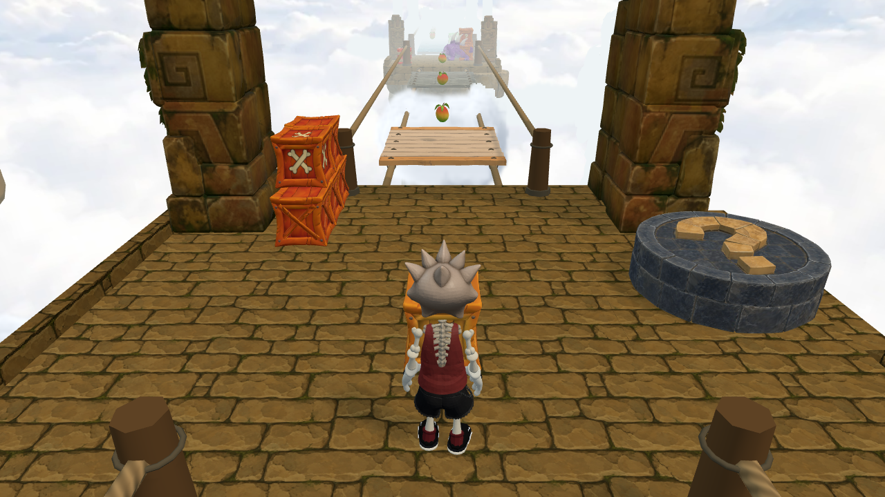
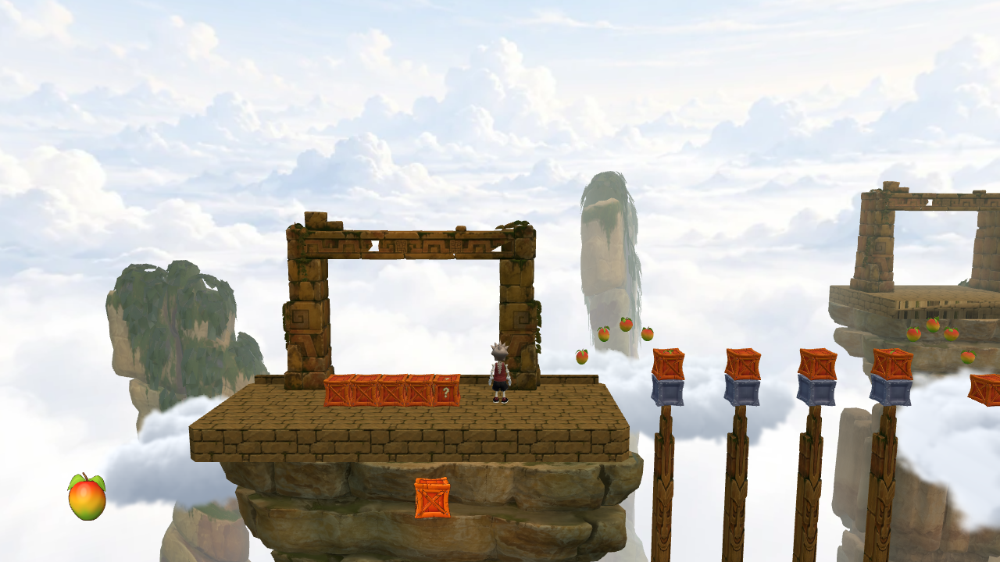
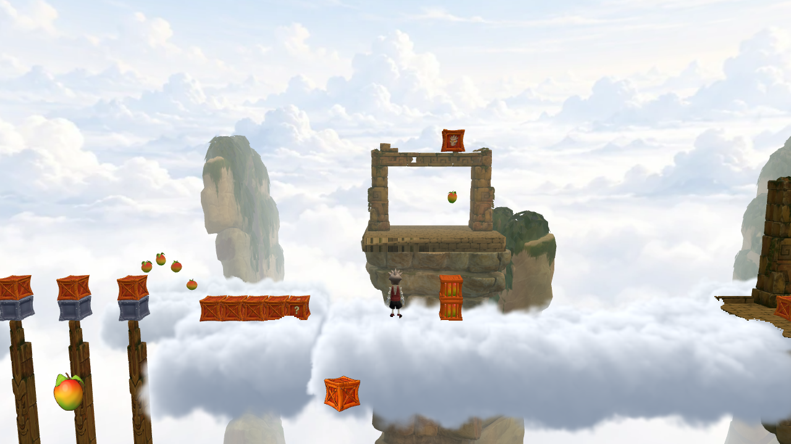

# Sky Bridge — crate/enemy review

Replaced scattered ordinary rewards with **sixteen five-box deliveries** on fixed masonry. Eight original explosives retain their lane and refuge roles, making **88 counted main boxes**. Three masks prepare the first enemy, high span and final skating chapter. The four original enemy kinds, bridges, seven checkpoints, runways, ropes, camera and artwork remain unchanged. Section counts are **12 / 12 / 12 / 12 / 10 / 10 / 10 / 10**.

**Cloudtop Lockers** grows from seven to **22 counted rewards**. Single-tier arrival, relay-recovery and exit rows complement the four retained steel stepping stones and original two-high finite-bounce stack. The earned life remains at 9m. The parent tally, including checkpoints and bonus, is **117**.

Validation:

- An uninterrupted native main route clears all seven checkpoints, three icy spans and seven falling spans in **44.38 simulated seconds**, without death. Separate input-driven approaches collect all eighty ordinary rewards, verify supported lower-tier corners and restore all 89 physical crates and four enemies on reset. No continuous main all-box clear is claimed.
- Native construction checks retain sixteen board skins, thirty-two rope posts and sockets, three supported ground patrols and the retained floater, temple-wall clearance and safe checkpoint spacing. Charged rope bypass, TNT stomp/escape, lethal Nitro contact and Mossback stomp pass.
- A continuous native bonus run earns every box and its standalone gem in **47.72 simulated seconds**, without death. Skipping the relay anchors causes a real fall; exhausting the upper striped support blocks the high cap despite an observed double jump. A cargo stomp with a real apex double jump reaches **8.770m**, below the 9m cap. Retry restores all 26 physical boxes and zero crate credit.
- A normal jump from a separately staged supported approach activates the actual bonus platform once; the return point remains supported.
- Browser opening collection, checkpoint activation, a real fall and five-box checkpoint restoration, and staged finish pass. Bonus failure preserves parent lives and banks nothing; retry restores all 26 boxes. The continuous browser bonus clear banks all 22 rewards into the same parent instance.
- Five inspected full-render 1280×720 views cover three main landings and both bonus puzzles; both browser consoles are clean. Canvas captures omit DOM HUD labels; the lower fruit/crate icons are HUD overlays.
- All 390 main and 60 bonus non-crate components and settings compare exactly. Only the Sky Bridge pack entry changes. Six historical stock versions, twelve raw/migrated saves and 84 authored variants pass archive/selection checks. The new exact snapshot certificate fixes the previously stale Sky certificate, and the prior stock save is preserved.
- Required level checks, build and release-size validation pass: `65ee7f9fae03df303c39`, **959,314,989 / 1,000,000,000 bytes**.

Elapsed: approximately **32.8 minutes** from 18:25 UTC. Raw checks and initial harness diagnostics remain in `/workspace/crate-review/sky`. Publishing is authorized and awaits GitHub authentication.

