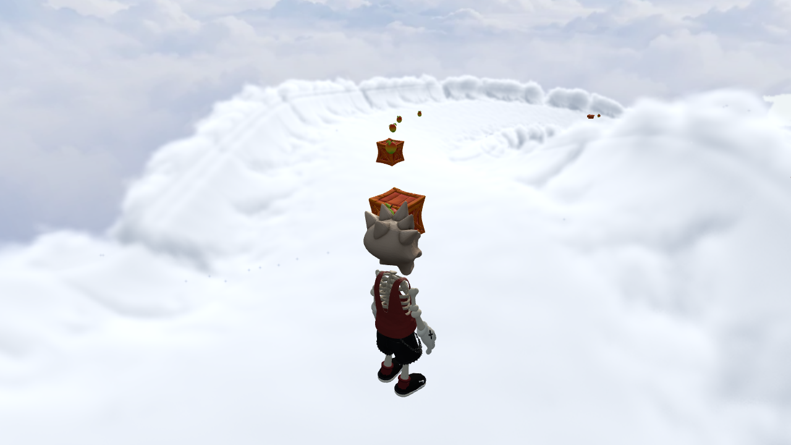
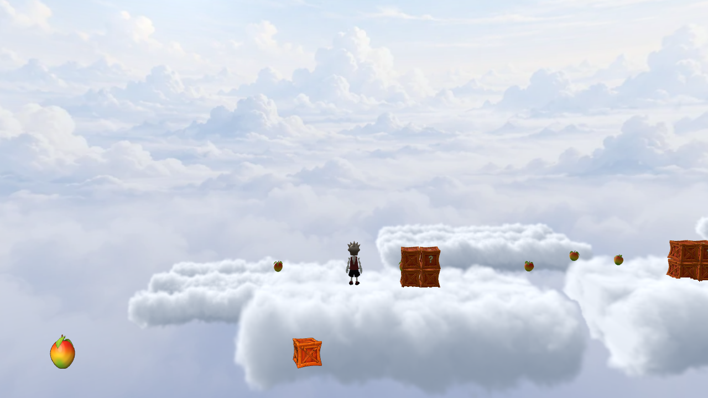
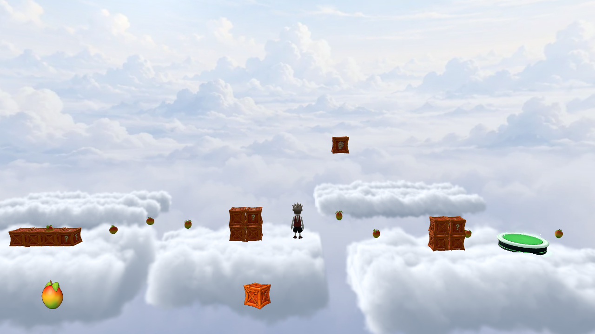

# Skystream and Cumulus Cache — crate/enemy review

Skystream retains its **60 wood crates in twenty three-box steering runs**, seven checkpoints, three loops and four gaps. Its main source is unchanged. The 13–18m spacing rewards steering at speed; all jump takeoffs have more than 24m clearance and landings more than 28m. Part VIII's momentum rule supports the separated crates and open speed-critical stretches. Checkpoint section counts remain 12/6/6/18/6/9/0/3; this is an explicit mode exception to ordinary platform-level density. No attack enemies are added.

Cumulus Cache grows from 18 scattered crates to **25**: six four-box deliveries and a life above the final gap. Five deliveries are two-by-two stacks and one is a four-box row, with a mystery cap in each. The former free life and mask are removed. A normal charged crossing passes safely beneath the life; holding position over the gap, double-jumping and spinning earns it before landing. This is a tested optional risk, not an exclusive tool gate. The final life bottom is **187m**; earlier lower placements obstructed the normal crossing and were corrected.

Native main traversal collects all 60 crates and seven checkpoints, clears every loop and gap, and finishes without deaths. A real fall and checkpoint recovery also pass. All 240 main crate corners have local road support; the static audit's 55 slope flags remain, with actual floor variation from -0.659m to +0.675m. All 56 bonus base corners are exactly supported. Native bonus completion earns all 25 crates and the standalone gem without deaths. A missed crossing causes death and retry restores all boxes. Chrome enters through the actual bonus platform using normal input, verifies failure recovery, then completes the continuous 2,610-frame bonus route and banks 25 into the same parent instance. Three inspected native-resolution views have clean consoles.

Main source and bonus non-crate components/settings are preserved exactly. The published editor pack, movement, animation, geometry, camera and art are unchanged. One prior stock snapshot, two raw/migrated saves and fourteen authored variants pass; no archive hash additions are needed and crate migration runs once. Required level checks pass, with the level validator and lazy-source test repeated after the final life-height adjustment. Final build and release pass: `a9b37f2c67ba1eda78bb`, **959,321,948 / 1,000,000,000 bytes**.

Main and bonus all-box journeys are separate; a combined parent gem run is not claimed. Elapsed review: **31.2 minutes**, exceeding the requested 15+5-minute budget.

