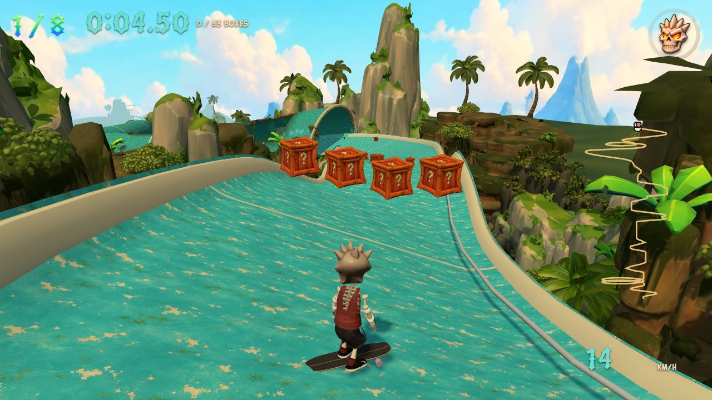
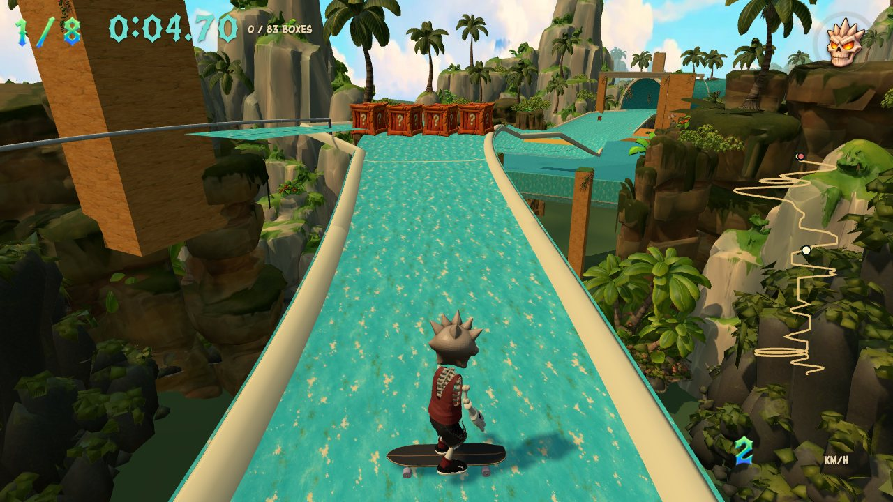

# Slipstream — crate/enemy review

Retained the existing race layout. The published course has **83 gem boxes**, **108 roulette pickups in 27 four-choice rows**, and **four ammunition pickups** (one TNT and three Nitro). The ammo is collectible race equipment rather than a lethal crate on the fast lane. Twenty-eight ordinary boxes become numbered time-freeze targets in time trial. There are no patrol enemies, checkpoint crates or bonus room; seven racing opponents supply the pressure.

The empty boxes mark steering choices, landings and optional shoulder paths. The four-choice item rows offer lanes at racing speed. Adventure checkpoint quotas do not apply: a fall returns a racer to supported ground while retaining unique box credit, world state and elapsed time. Item and ordinary-box refills let following racers collect their own credit. The box gem can be earned separately from winning. The retained singles, pairs and loose fields follow the mode grammar in bible III.3 and the steering, landing and time-trial rules in VIII.1. Race equipment supplies protection and attacks, with no role for mask/life rewards or a remote Nitro switch.

The bible's generic audit explicitly skips this mode. Its label describes race items but does not account for the 83 gem boxes, so that skip is not used as proof of an empty all-box layer. The dedicated runtime inventory, supported approaches and collection tests below provide that evidence.

Validation:

- Eighty-three separately staged normal-input spin approaches collect every gem box with no fall. All 112 item pickups are also collected with normal input, including the raised shoulder choices and the four specific ammunition pickups. All 27 roulette rows have ground beneath their four options. These are access tests, not one continuous all-box run.
- One complete native race traverses the published 4,093.31 m course. The human wins in 167.73 simulated seconds with zero falls, collecting ten gem boxes. All seven rivals finish, the last at 202.60 seconds. Rival falls use ordinary nonfatal recovery; all actors record zero deaths.
- Race contracts verify per-rider credit, unique-box rewards, full-slot behavior, item refills, nonfatal stun and recovery, explosive equipment counters, retry, time-trial gating and win-only crystal awards. The actual published finish verifies live arrivals, finite roll-out, stable result clocks and trial/retry behavior.
- An old HUD test expected every regular-HUD element to be hidden. The existing runtime deliberately retains the portrait because it owns SPECIAL; the assertion now checks that portrait and the hidden adventure counters separately. Runtime code is unchanged.
- The browser starts the real event, drives the opening alongside moving rivals, collects a box, recovers from a real staged fall with lives and credit preserved, crosses a staged finish and restores all boxes on retry. Two inspected 1280×720 full-render views show the item lanes; their positions and elapsed time are staged to clear the start overlay. Both consoles are clean.
- The preceding Tunnelbore commit's successful level checks, build and release check remain valid: runtime and assets are unchanged, version `e9643c927c81ab080eea`, 959,307,565 / 1,000,000,000 bytes.

Elapsed: approximately 27.5 minutes from 12:23:41 UTC, exceeding the fifteen-minute main-course request. Raw logs and probe scripts remain in `/workspace/crate-review/slipstream-race`. Publishing remains authorized and awaits GitHub authentication.

