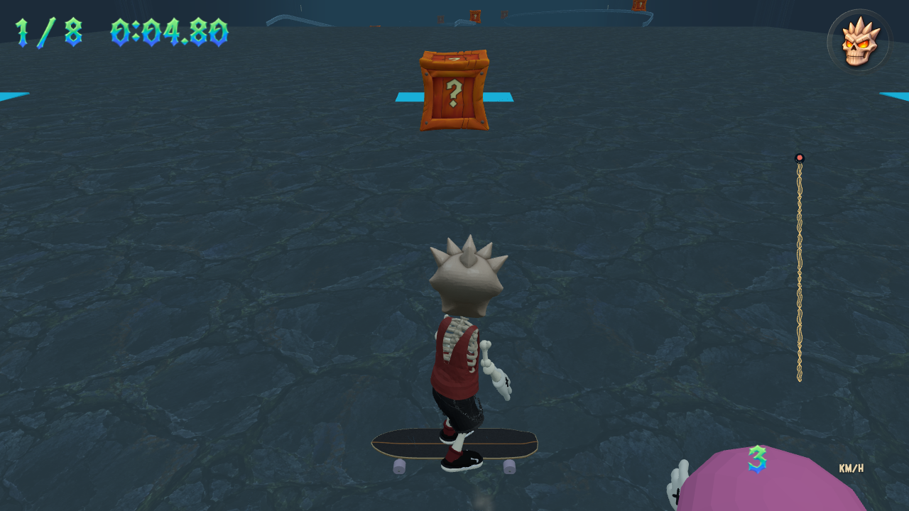
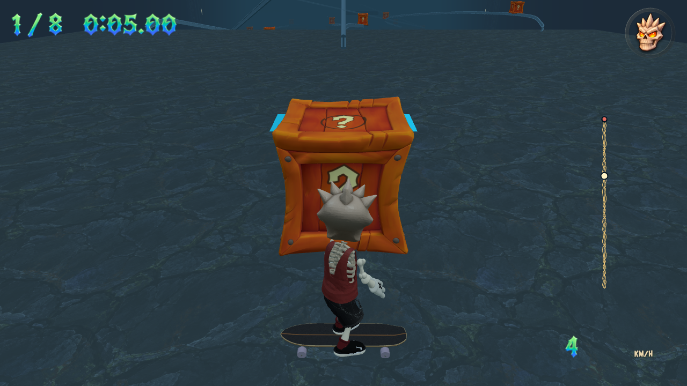
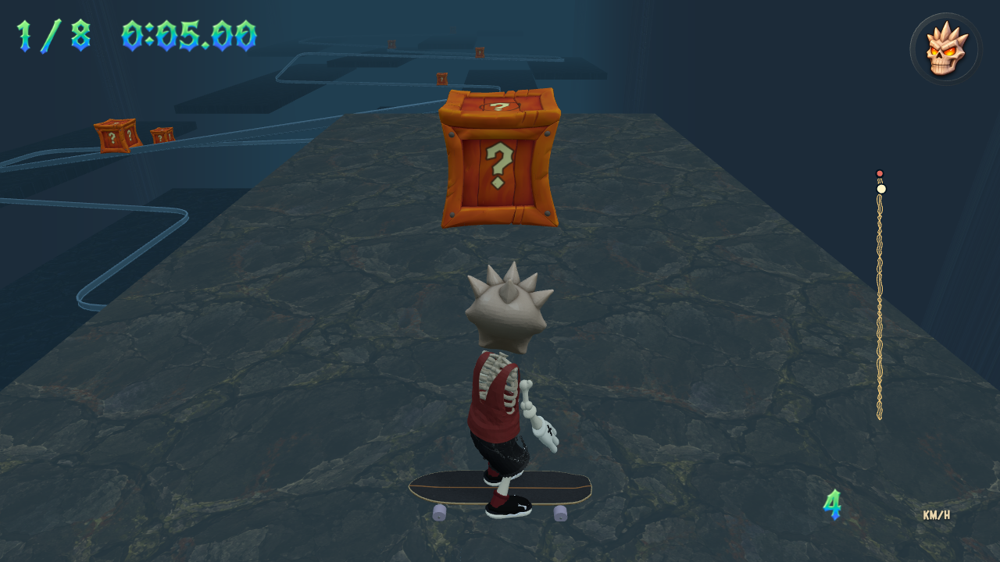

# Spaghetti Rails — crate/enemy review

Retained **706 reusable racing-item boxes**, **183 authored rails** and **904 connected platforms**. The campaign awards its crystal and gem for a race win. There are no adventure gem boxes, patrol enemies, checkpoint crates or bonus room. Seven rivals provide the competition; six recovery heights and the vertical wrap make missed rails cost time without consuming lives.

Items mark the three primary lines, recovery rails, launch strips and optional spring/kicker rewards. They are contact pickups, deliberately enlarged and hovering **0.9m** above their authored anchor. Their **1.5-second refill** lets following riders use the same route. Grouping them into adventure piles would alter the steering and item rhythm of this race.

Validation:

- All **649 rail pickup volumes** contain the normal rider line on their named native rails; all **57 deck items** have supported anchors. The minimum pickup-volume margin is 0.306m and maximum floor-anchor error is 0.000000m. The audit accounts for race hover, enlarged pickups and native surface seating, which can shift a box from its raw anchor.
- A complete native eight-rider race finishes for every racer without deaths, race resets or injected placements. The reference rider finishes in **109.57 simulated seconds**, grinding **2563.98m** of the **3467.84m** course. The last rival finishes by **305.98s**. Every rival catches several authored rails; movement tuning is unchanged.
- Layout checks pass 86,044 coverage samples, 2,352 native ground probes, the connected platform graph, body clearance on all authored rails, eleven downhill approaches, three kicker receivers and five separately staged 288m wrap recoveries.
- Ordinary contacts collect, use and refill items on all six height tiers. Earned SPECIAL accepts its real command, the six-second balance item expires correctly, and all eighteen spring routes land on their useful reward receivers. These are separate staged trials, not a continuous all-item collection.
- Browser opening collects and uses items while grinding. A staged vertical miss wraps onto real ground without a life loss or race reset. Staged finish and complete retry restoration pass. Three inspected native 1280×720 views cover arrival, an interchange and a spring receiver; both browser consoles are clean.
- The campaign regression preserves the original save identity, rejects losing-result rewards, awards wins, and unlocks persistent time-trial medals.

Source, movement, animation, artwork and the published pack are unchanged. The preceding Torchlight required checks, production build and release validation remain valid: `fa387e11c8e1fa024fc1`, **959,314,619 / 1,000,000,000 bytes**. The generic adventure-crate audit skips race modes; direct runtime checks establish this inventory. No continuous all-706-item clear is claimed or required.

Elapsed: approximately **15.6 minutes** from 18:09:15 UTC. Raw evidence remains in `/workspace/crate-review/spaghetti`. Publishing is authorized and awaits GitHub authentication.

