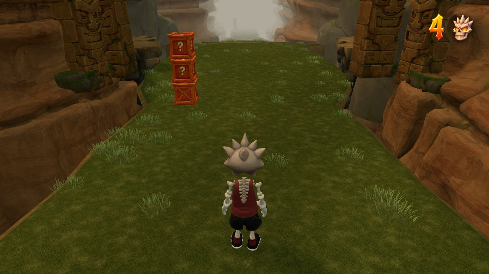
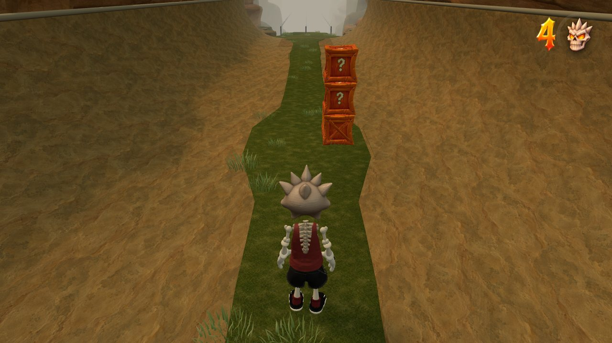
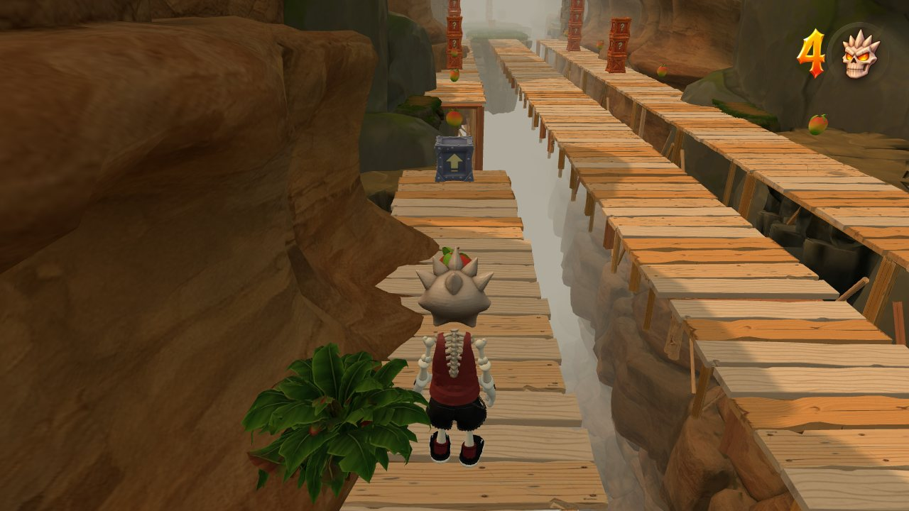
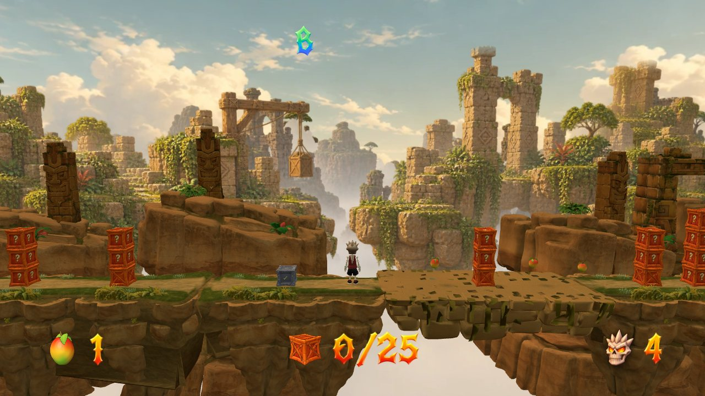

# Uga Ambush and Quayside Cargo — crate bible refresh

UI course `test` uses `carlisle-coast.ts`; it is distinct from the later campaign course named Carlisle Coast. Reviewed against Parts 0, XV and XX of the gameplay bible. [Validation](validation.json), [before](before.json), [after](after.json).

| Measure | Before | After |
|---|---:|---:|
| Main counted cargo | 140 | 166 |
| Main single-crate clusters | 102 | 0 |
| Main mean cluster size | 1.29 | 3.46 |
| Enemy kinds / actors | 8 / 28 | 2 / 20 |
| Bonus counted cargo | 6 | 25 |
| Bonus single-crate clusters | 4 | 1 |
| Parent tally including checkpoints and bonus | 160 | 205 |

The clear route keeps its travel lanes, rails and timed landings. All-box play adds the high stair and lift detours, local outline reveals, both dock branches, and remotely credited warehouse Nitro. Section cargo counts are `10, 10, 10, 10, 20, 10, 6, 10, 10, 10, 10, 10, 10, 20, 10`: the market has ten ordinary plus ten optional boxes, the split dock has ten on each branch, and the short 32 m crest connection has six. Lives remain only on the high stair/lift detours; five masks prepare the following encounters. Crabs and spikers replace the broad enemy roster, with readable speed/range limits and the first spiker moved beyond the checkpoint approach.

Each ordinary formation supplies a safe-bank harvest, a mode-change rest, a guarded flank, an optional height reward, or a branch-count decision. The two gray switches each reveal six optional crates. The warehouse Nitro pair and its cap clear from the off-line green switch near the exit. Unneeded arrows, unsupported special-crate jobs and safe-line lives are removed. The retained dock arrow moves from Z −2087 to −2092.2: a held bounce and double now cross the unchanged gap on foot. The final channel group is three high with one low tail, so all four clear at charged board speed.

Quayside retains its TNT takeoff, high life and native switch bridge. Arrival, refuge, recovery, bridge and exit cargo form nine groups. The bridge switch reveals both its original mesh and three new crates. The lone floating life is intentionally above the timed launch support: tested floor and neighboring-cargo attempts reach 7.595 m and 8.329 m, below its 9 m base, after the donor is removed. An actual early ground spin kills the attempt; skipping the bridge also causes a fall. Retry restores every crate and the unrevealed bridge.

## Verification and limits

- Separate normal-input scenarios harvest all 163 ordinary main boxes; the green switch credits the other three. Both reveals work independently, hard retry restores all cargo/outlines/switches, and 600 enemy patrol probes remain supported. No continuous main all-box clear is claimed.
- Four stair steps and both side-scroll transfers remain reachable without the removed arrows. The adjusted dock launch passes native physics and the real browser. The three-box and four-box channel groups clear at 21.61 and 24.77 m/s contact speed respectively.
- Native and browser bonus runs collect all 25 crates and finish without death. These are standalone bonus previews; the parent's linked tally is independently verified as 205.
- Main browser evidence includes the opening harvest and separately staged checkpoint activation, kill-plane death/recovery, finish, and continuous dock crossing. All four lite/full modes have clean consoles. Nine native-resolution 1280×720 views and two lite finish images were inspected.
- Comparison with `ae71736a` preserves all 3,892 main and 134 bonus non-crate/enemy components. Patrol selection, kind, speed/range and the first spiker position intentionally change; movement, animation, hazards, native art and the shared editor pack do not.
- Required level checks, build, focused support/wall/rail/switch checks and release-size verification pass. Release: 959,277,006 / 1,000,000,000 bytes; build `97b04893cf0a40ce7131`.

The broader legacy rail render-surface test has an existing failure at `(5, −13.883, −1379.062)`, with −0.535 m ground clearance. It reproduces exactly in the untouched committed course. This pass retains that terrain; the focused `--crates-only` path still checks every cargo footprint against ground, walls and all authored rails. See [baseline evidence](baseline-rail.txt) and [scope note](known-baseline-rail.json).

Elapsed time: 65.2 minutes from approximately 08:44 UTC, including GitHub authentication assistance and repeated physical validation. This exceeded the requested 15-minute main plus five-minute bonus budget. Publishing is authorized, but the GitHub device login expired without authorization.

