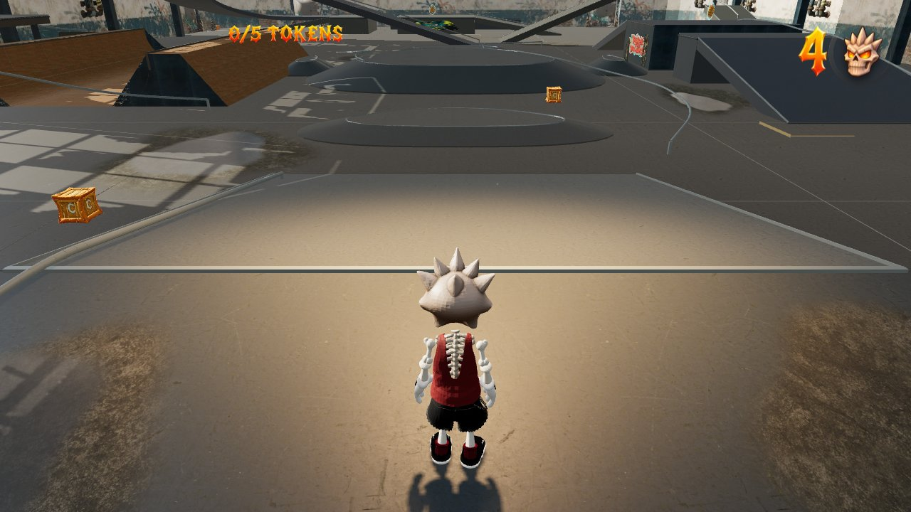
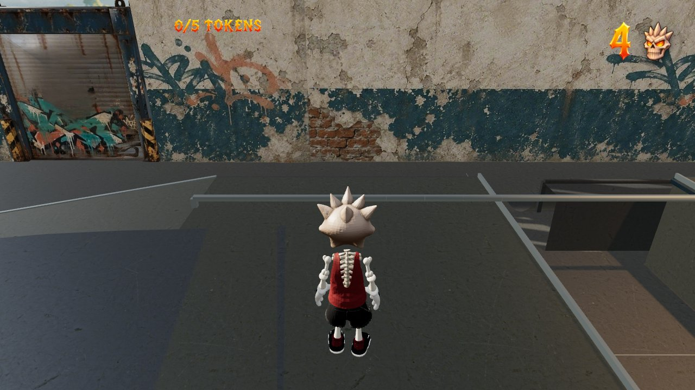
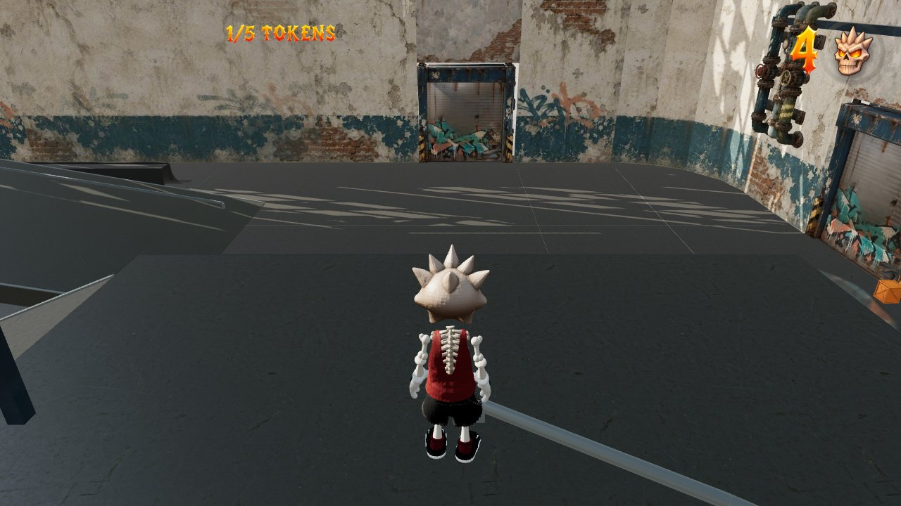

# Factory Fuss — crate/enemy review

Retained the existing **five-token skate park**: no regular crates, enemies or bonus room. Three supported checkpoints provide recovery between the freely chosen challenges. Each token rewards a named movement line: loading gap, gallery grind, workshop transfer, crane rail or maintenance transfer. The exit requires all five. Missed transfers return to the continuous floor, and earned tokens survive a soft retry.

The mode's reward decisions are the five raised token routes. Adding routine crate groups or enemy patrols would change those riding lines and their objective. The generic crate audit deliberately skips free-skate parks; direct runtime inventory confirms this layout. The published pack has no Warehouse override.

Validation:

- Native structure checks pass supported spawn and enclosure, eleven authored rail catches, six halfpipe pump/return probes, and all three checkpoint activations and supported retries. Token checks reject underside contact, keep the exit locked before completion, accept an arbitrary order, preserve tokens through soft retry and clear them on hard restart. These individual probes use staged starts.
- A separate continuous browser run starts at the real spawn and uses `collectathon-east-first` through the standard Gamepad API. It earns tokens **3, 4, 5, 1, 2** and reaches the exit in **70.58 simulated seconds**, with **zero deaths and zero position snaps**. It travels 721.03 m and records 54 rendered grind samples. No player placement, direct physics stepping or camera changes occur during this journey. At the browser's low frame rate, the original loading-dock jump release arrived at the lip and missed; the successful plan releases 2.1 m earlier. Only the input plan changed, and both attempts are retained.
- Separate staged browser checks activate the Crossroads checkpoint through ordinary movement/spinning, then test a real kill-plane death and supported respawn.
- Three inspected 1280×720 full-render views cover arrival, the loading gap and the crane receiver. Both browser consoles are clean.
- Game source, assets and published data are unchanged. The preceding Mayfield level checks, build and release validation remain valid: `33fa0d85bcda5732230f`, 959,310,252 / 1,000,000,000 bytes.

Elapsed: approximately 14.8 minutes from 15:20:40 UTC.  Raw evidence remains in `/workspace/crate-review/warehouse`. Only the east-first route was continuously replayed for this review; automated input does not establish novice discoverability. Publishing is authorized and awaits GitHub authentication.

