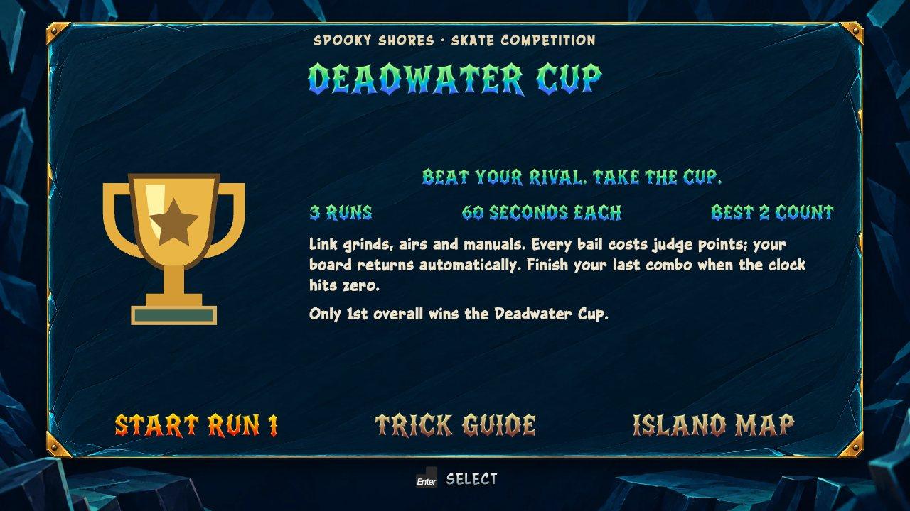
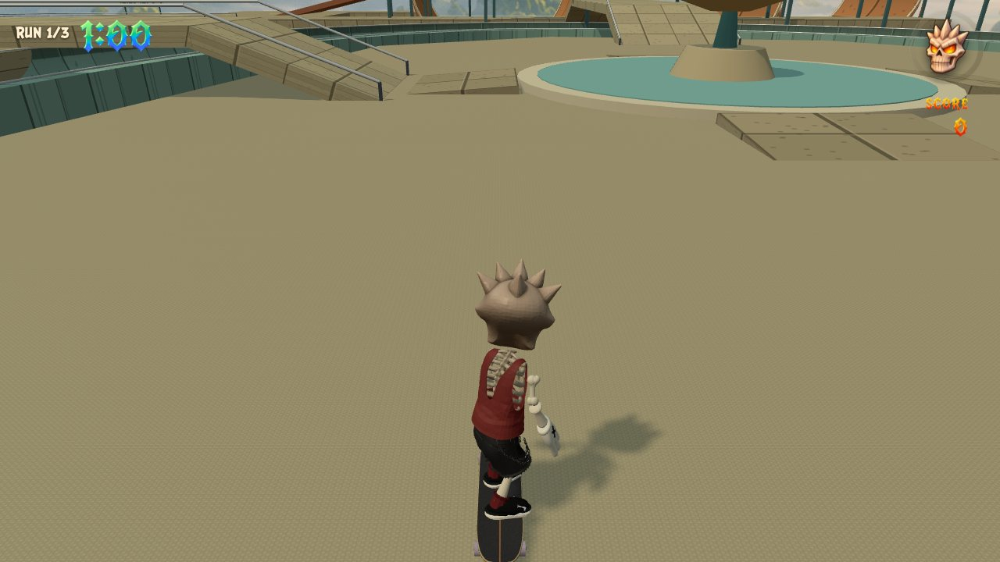
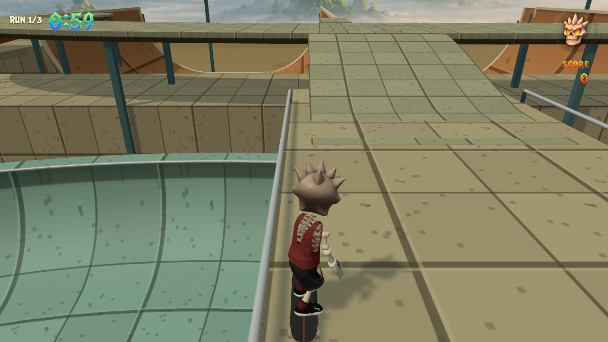

# Deadwater Cup — crate/enemy review

Retained the existing crate-free competition. Its seven halfpipes, 442 runtime grind rails, bridges and connected park support three judged sixty-second runs, with the best two scores counting. There are no patrol enemies, adventure checkpoints or bonus room. Adding crate quotas, reward detours or explosive puzzles would obstruct the skating and combo lines without serving this mode's objective.

Validation:

- The unchanged circulation suite skates eight connections in both directions, passing all sixteen cases without a bail or out-of-bounds return. Maximum sampled height difference is 0.404 m.
- Three fresh sand falls preserve banked points, lives and judge marks, break the active combo and return to spawn. A later fall returns to recent supported ground.
- Focused native checks preserve all seven original halfpipe radii and floor heights, verify supported spawn, earn live points on an original bridge rail and complete the optional vert loop with at least 1,000 points. The three-run event and independent venue trophy save pass with supplied scores.
- The original `tools/test-waterpark-cup.mjs` stops at a stale map-position expectation: it expects `[86,6,4]` for `waterpark`; the current map uses `[53,3,-160]`. A scratch copy excludes the legacy map-coordinate, campaign-array-index and map-migration assertions while retaining the venue tests and current campaign-graph validation. The original suite is not claimed to pass, and map data is unchanged.
- The lite browser starts the event, skates 23.1 m, performs an ollie and lands with no death. A separately staged bail recovers onto the board without life loss. The full browser's intro, courtyard and bridge views were inspected at 1280×720; both consoles are clean. View positions are staged, and no complete three-run browser playthrough is claimed.
- The preceding Tunnelbore commit's successful level checks, build and release check remain applicable because this review changes documentation only: version `e9643c927c81ab080eea`, 959,307,565 / 1,000,000,000 bytes.

Elapsed: approximately 7.9 minutes from 12:51:34 UTC. Raw logs and focused probes remain in `/workspace/crate-review/waterpark-cup`. Publication is authorized and awaits GitHub authentication.

