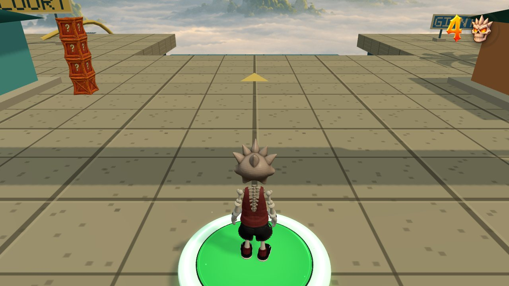
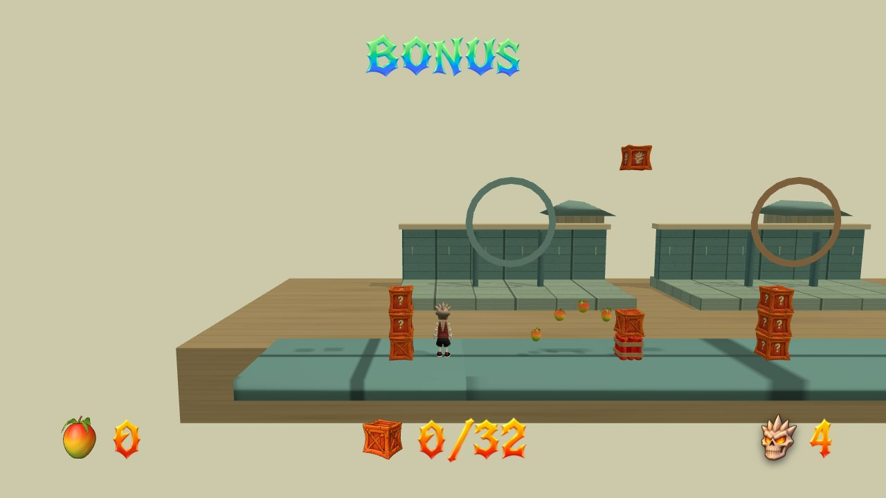
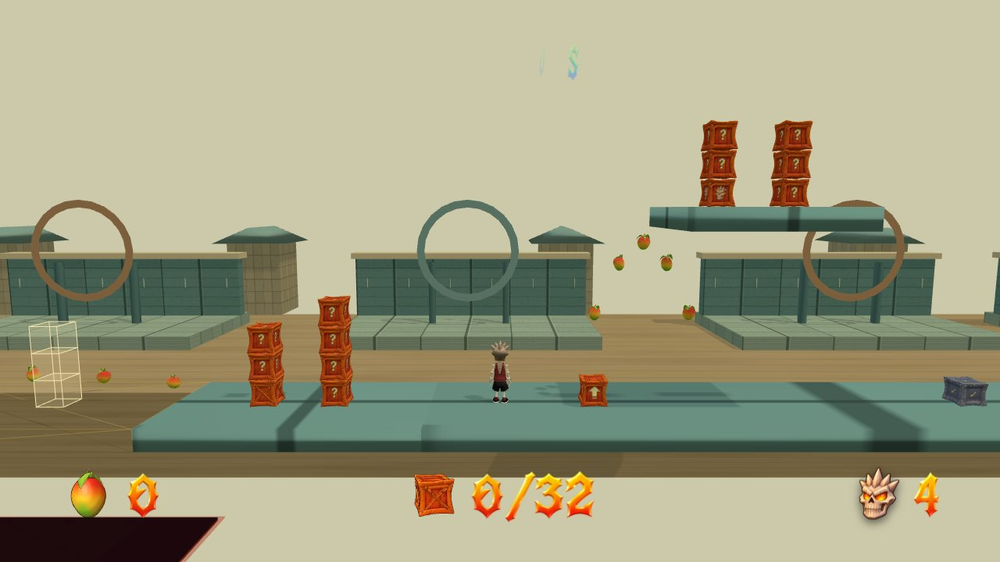

# Deadwater Park and Deadwater Valve House

Main cargo grows from five singles to thirty boxes in nine groups (mean 3.33, no singles). Ten boxes occupy each checkpoint section, on fixed admission, arcade and finish floors. These are optional harvests beside the fast clear route. The vert, pool spines, jump approaches, flumes and loops stay clear. Existing zero-patrol selection is retained: the course's speed and terrain supply its challenges, and the cargo adds no new enemy counter. There are no safe-line lives or ineffective masks against fall deaths.

The Valve House grows from nine to thirty-two counted boxes in twelve groups (mean 2.67, two intentional singles). The TNT-supported high life, bridge switch and retained arrow still gate their original rewards. Added payload sits on the earned bridge, gallery and safe recovery floors. The legacy TNT cap uses the final 1.152 m grid; the gallery stacks sit on their actual 8.4 m floor.

Validation:

- Nine separately staged normal-input harvests collect all thirty main boxes without death. Every footprint has native floor support; full reset restores every crate.
- Both complete native downhill routes pass all five transfers, four jumps and three loops in 85.72 / 85.65 simulated seconds. Real upper-vault failure and checkpoint recovery pass.
- Continuous native and lite-browser bonus journeys collect all thirty-two boxes, earn the gem and finish without death. Early TNT spin, skipped bridge and lost arrow each produce their intended failure; retry restores all boxes, nine outlines and both reveal surfaces.
- Three additional staged attempts from neighboring cargo fail to replace the TNT or arrow. These are measured attempts, not an exhaustive reachability proof.
- Main lite-browser review covers opening harvest, staged checkpoint activation, real kill-plane recovery and a separately staged finish. Six fresh full-render 1280×720 views are inspected across the pair, with clean consoles in all four modes. No continuous main all-box clear or full browser downhill clear is claimed.
- All 1,733 main and 101 bonus non-crate components and every environment setting remain identical. Movement, animation, artwork and the published editor pack are unchanged.
- Required level checks, production build and release-size check pass (959,303,170 / 1,000,000,000 bytes).

Elapsed: approximately 17.2 minutes from 10:41 UTC. Publishing is authorized and awaits GitHub authentication.

