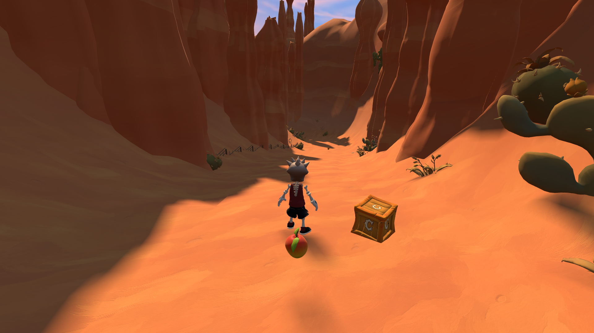
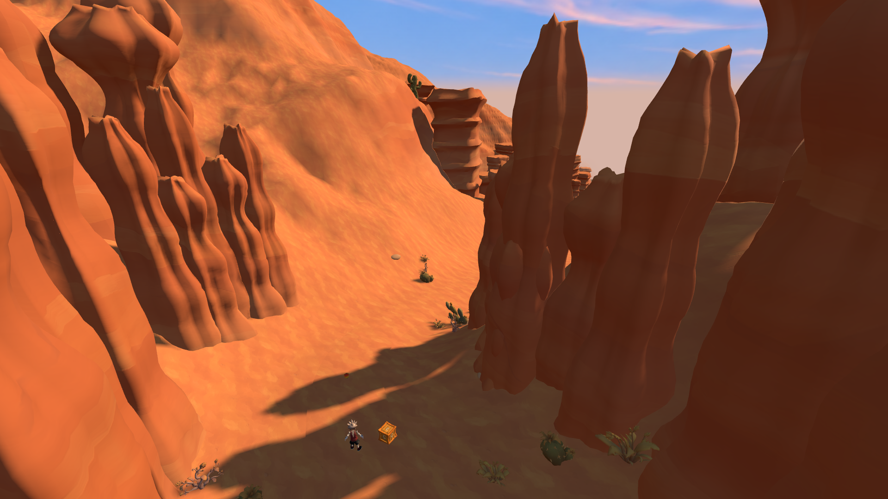
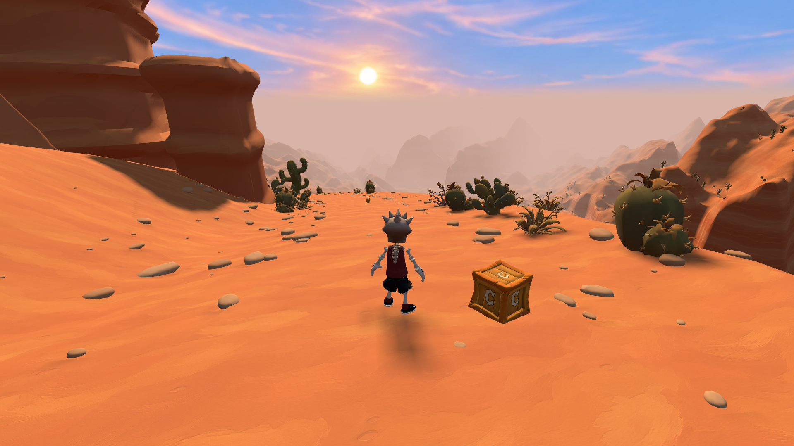
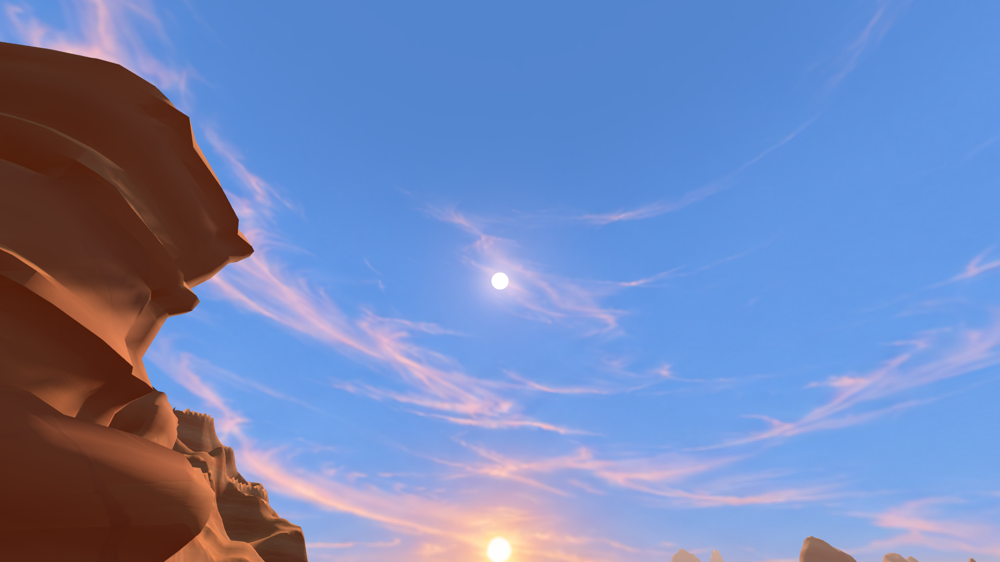

# Dusty Road — rooted canyon and sunlight

The tall formations now sit below the lowest ground across their complete
rotated footprints. Adjacent terrain grids share matching boundary vertices;
the outer landscape continues back to the launch. The two measured
amphitheatres retain their original upper surfaces and gain rock faces closing
their open lower edges. Small rocks are soft, pressed clay shapes.

The original cloud painting and horizon remain unchanged. Its small sun disc
is relocated in the sky shader to match the physical light, with the same
azimuth and a higher elevation. This lights more of the rideable route.
Dusty Road and Cactus Cache use a larger shadow volume, a world-aligned shadow
texel grid, and a fade at the distant sandstone shadow boundary.

## Evidence

- [Native geometry survey](survey.json): 563 hoodoo footprints and 75 sculpted
  formation bases are buried; all 1,483 measured-rim openings are closed;
  5,528 boundary probes find no unsupported seam. Sun rays clear terrain and
  rocks at 275/350 route samples (78.6%). Plants are not included in this sun
  survey. The protected layout comparison passes.
- [Runtime and renderer measurements](review.json): the complete 5.6 km
  traversal, both jumps, 17 checkpoints, pit recovery and finish pass. The final
  173-cell native bake also passes support and valley-landing checks.
- At 720p, moving the shadow focus 40 metres changes 2–4 of 290,304 sampled
  near-ground pixels above the 3/255 comparison threshold. At native 1080p,
  1–2 of 653,184 pixels change. Repeated stationary control frames are identical.
- Full-render checks include narrow canyon, switchbacks, valley approach,
  scenic overlook and Cactus Cache. No console errors or failed assets.
  Switching to Banana Bay restores its ordinary 96 m shadow half-width and
  600 m shadow depth, with no desert heat resources retained.
- Typecheck/build, release-size check, Banana Bay sky isolation and map sky
  checks pass. `check:levels` still stops at the pre-existing Waterpark disposal
  assertion (`tools/test-waterpark-decks.mjs:49`). The earlier full-suite run
  recorded 182 passing and 23 failing commands on base revision `ab895907`.

The route, jumps, plants, camera spine, sky image, collectibles, bonus entrance
and finish placement remain unchanged. Every terrain/rock cell keeps its full
authored geometry at all viewing distances and in reflections. The release is
974,153,459 bytes against the 1,000,000,000-byte hosting limit.

