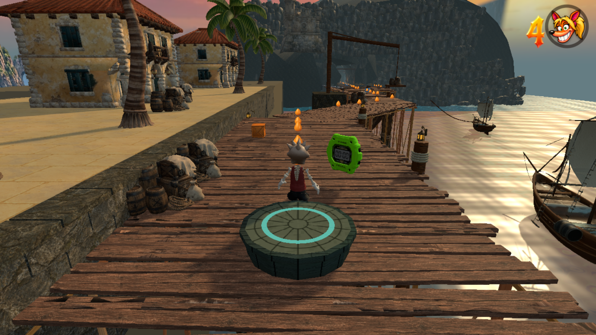

# Drowned Crown — local quality repair

This records the earlier material repair. The [composition continuation](../excellence/README.md) contains the current work and approval state.

**The user rejected the published visual quality. The storyboard target has not been met.** Paid generation and publishing are frozen. This branch is a local proof, not a completed environment rebuild.

The previous asset pass consumed 435 Meshy credits. This repair consumed no further Meshy or image-generation credits. It reuses the existing models and textures.

The repair fixes the warehouse's incorrect plaster emission, mismatched boardwalk UVs, the seven-metre gap between the original masonry quay and the dock, and oversized outdoor torch flames. Stone blockwork and coping now meet the deck; mooring lamps and the nearest boat are composed at a readable distance. The sunset and harbour reflection direction are aligned. The level lighting is provisional and must be reviewed through the remaining rooms before release.

The headland still reads as repeated rock modules. The quay needs more authored construction detail and variation. These corrections do not establish visual parity with the storyboards.

This is the unedited full-render game view: grounded player at `[-72,2,203]`, ordinary follow camera, HUD retained. Camera evidence is in `view.json`. It is the twentieth retained player-view capture; the previous 19 and the 13 storyboards remain intact.

Validation: focused level checks, build, shared boardwalk regression, a complete production-Player route (six checkpoints, zero deaths, 138.82 seconds), and a clean-console full-render capture passed. `browser.json` records the passing ordinary-input Chrome traversal of the outdoor section (three jumps, two checkpoints, zero deaths, clean console). `safety.json` records passing pit/checkpoint recovery and mast collision.

Local preview: `http://127.0.0.1:5194/?playtest&level=drowned-crown`. Nothing from this repair has been pushed or deployed.
