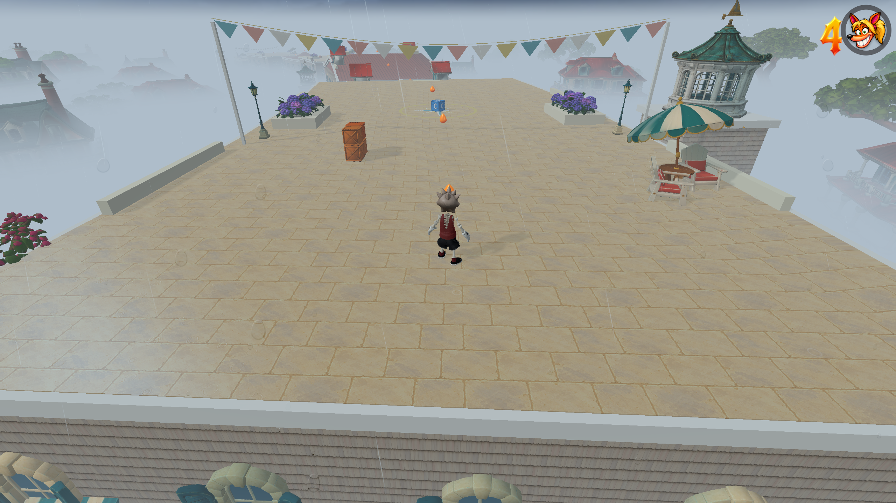

# Full-suite audit — 26 October 2026

All **201 test-command occurrences** in the 43 groups of `npm run check:all` were attempted: **161 passed; 40 failed**. This is a failing baseline, not a clean bill of health. The reported blank/reloading tab was **not reproduced**, and no crash fix is claimed.

The suite ran from 18:11:25 to 18:36:06 UTC on 25 October (07:11–07:36 NZDT on 26 October): **24 minutes 42 seconds**. Node v24.19.0 / npm 10.9.4 on the user's Mac. The canonical command passed its first nine groups, then stopped at Chimeworks. The remaining groups were expanded from package.json and every constituent command was run serially, retaining each failure. Assertions after an early failure inside an individual script were not necessarily reached. No source, tuning, asset or test-expectation edits were made during this audit.

## Crash investigation

- **22/22 additional checks passed:** the full renderer group plus stability reporting, rooftop enemies, rain, storm and height fog. Logs and timings are in [crash-checks/report.json](crash-checks/report.json).
- A separate real Chrome session visited rooftop-relay → sky → treehouse-trail three times at **2560×1440 MAX**, then survived two deliberate WebGL context losses/restores and returned to normal CRT presentation. No page crashes, JavaScript errors, failed requests or sampled GL errors occurred. The simulation paused during each context loss, then rendering, weather and all seven rooftop enemies recovered. [Browser evidence](browser-stability.json).
- Resource counts plateaued from the second to the third visit: rooftop **203 geometries / 79 textures / 118 programs**; sky **215 / 68 / 123**; treehouse **255 / 118 / 142**. Sampled JS heap was approximately 222–249 MiB. These are bounded samples, not proof against prolonged memory pressure or a browser-process termination.
- The full rooftop main route finished with ordinary controller-input simulation: **44 roofs, 43 jumps, six checkpoints, 101.65 simulated seconds, zero deaths**, source match and unchanged tuning. Rendering used 2560×1440, and the finish and graphics-reset images were inspected at original resolution. [Route evidence](rooftop-route.json).
- The user's open in-app browser reported no console warnings/errors when inspected. Its persisted stability history showed boot/visibility/normal exit records, without a recorded JavaScript error or graphics-loss event. That does not rule out abrupt browser-process death, where no final event can be saved. Tests used a separate browser context and did not reload the user's game.

## Scope and validation

`npm run build` passed (TypeScript + Vite). `npm run check:release` passed: **996,773,696 / 1,000,000,000 bytes**, 1,814 files. The build emitted its normal large-chunk advisory. Headless fixture asset-404 warnings in some test logs come from their mocked loaders; the separate live browser run had no failed requests.

The target was the live local workspace at port 5267, including its existing uncommitted source. A 2,506-file hash snapshot remained unchanged from 18:14:39 UTC through final verification. [Source consistency](source-consistency.json) and [file hashes](source-before.json) are retained. Local rooftop/movement/rendering files matched published commit `608b8c426d5160c7edf6242dfa939cad3e009419`; other local/public differences, principally the separate audio-options release, are explicitly listed in [compared-published.json](compared-published.json). This was not an exact full-suite run of that published commit.

## Failure assessment

Several failures are confirmed stale source matchers, snapshots or incomplete mocks. Others remain unresolved gameplay, editor or character failures and must not be dismissed as fixture drift. First follow-ups are the movement replays (Jungle Cup rhythm, vert release, ledge catch, locomotion recovery, fatal-fall camera and rescue contact), Country Club validation, material/atmosphere round trips, and conventional-rig animation validation. No test was weakened to produce a pass.

| Failed command | Assessment | Evidence / remaining question |
| --- | --- | --- |
| [test-chimeworks.mjs](leaves/10-01.log) | outdated roster assertion | tools/test-chimeworks.mjs:165 requires slipstream-continuous; src/levels/slipstream-migration.ts:14-15 explicitly retires that ID in favor of slipstream-race. |
| [test-six-island-campaign.mjs](leaves/11-01.log) | outdated campaign fixture | Actual roster includes authored Coconut Cart Rally; expected list at tools/test-six-island-campaign.mjs:18 omits it and still expects 11 placeholders / 27 playable levels. |
| [test-warp-room-return.mjs](leaves/11-14.log) | outdated authored visual value | Assertion at line 471 expects causticsStrength 0.32; src/mapOceanPreset.ts:23 authors 0.18. |
| [test-park-tuning.mjs](leaves/12-01.log) | outdated movement expectation | Diagnostic using the exact fixture measures charge=23.1, target=23, overdriveCeiling=23.1. src/skateOverdrive.ts intentionally adds the first 0.1 m/s overdrive increment. |
| [test-jungle-cup.mjs](leaves/12-03.log) | outdated campaign route fixture | Fixture clears treehouse/jungle/test/sky/dark/slip before expecting Jungle Cup unlocked, omitting the current Banana Bay, Ripcord River and Beach Street prerequisites. |
| [test-jungle-cup-runtime.mjs](leaves/12-05.log) | outdated map migration expectation | Test expects the older 12-point map and hardcoded -47/-31 positions while current campaign migration preserves authored changes and has an expanded six-island map. |
| [test-jungle-cup-skating.mjs](leaves/12-06.log) | movement assertion requires review | Charged-speed fixture expects a fixed target; separate park diagnostic proves overdrive changes that assumption. This file has not yet been isolated beyond its first failed assertion. |
| [test-jungle-cup-layout.mjs](leaves/12-14.log) | unresolved gameplay replay failure | Rhythm-line jump/grind sequence bails. Earlier arena support, pocket airs, bank entry and channel checks in this file passed; do not weaken the failed replay. |
| [test-unity-level-ports.mjs](leaves/13-01.log) | test harness module-resolution failure | Data-URL transpilation does not resolve the newer relative ./coastal-town-art import. This is not the Vite browser module loader. |
| [test-quaternius-crouch.mjs](leaves/15-03.log) | animation assertion requires review | Line 51 expects no scalar tracks; current clip contains scalar tracks. No runtime crash is shown by this assertion. |
| [test-vert-ollie-sequence.mjs tools/fixtures/vert-ollie-release-edge-replay.json](leaves/16-03.log) | unresolved gameplay replay failure | Supplied replay ends in air where ride is expected at test line 923. |
| [validate-ledge-traversal.mjs](leaves/17-01.log) | unresolved gameplay replay failure | Ledge scenario returns ride where hang is expected at test line 783. |
| [validate-landing-indicator.mjs](leaves/20-01.log) | test harness source-inspection mismatch | Physical landing checks completed, then AST matcher at line 310 failed to find level.update as a direct expression in the fixed-step loop. Current loop nests the update in runtime branches. |
| [test-run-facing.mjs](leaves/21-01.log) | outdated source-pattern assertion | Line 96 requires selfDrivenPlanar to equal walkVelocity directly. Current code intentionally blends recovery speed first, then uses walkVelocity outside recovery (src/player.ts:18155). |
| [test-locomotion-replays.mjs](leaves/21-02.log) | unresolved gameplay replay failure | Test-course replay does not reach the expected grounded recovery at test line 125. |
| [test-locomotion-idle.mjs](leaves/21-03.log) | outdated animation fixture | Line 35 expects zero procedural drivers; current authored idle has nine. No change made to authored animation. |
| [test-surface-friction.mjs](leaves/24-01.log) | source-pattern assertion requires review | A regex expects sand-name assignment and friction flag within 240 characters in level.ts; the runtime curve checks preceding it pass. |
| [test-camera-speed-effect.mjs](leaves/25-01.log) | test harness missing dependency | Extracted production expression uses THREE.MathUtils.lerp, but test new Function does not supply THREE; main.ts imports THREE normally. |
| [test-camera-look.mjs](leaves/25-02.log) | outdated source-pattern assertion | Line 182 only accepts a one-expression blur callback; src/touch.ts:358 now has a block callback that still releases controls. |
| [test-camera-fall-replay.mjs](leaves/25-07.log) | unresolved gameplay replay failure | Camera replay line 33 reports that expected fatal-fall holds are missing. |
| [test-air-rescue.mjs](leaves/27-03.log) | unresolved gameplay contact failure | Rescue fixture line 427 reports a side-contact/stomp classification mismatch. |
| [validate-editor-roundtrip.mjs](leaves/31-01.log) | map route fixture requires review | tools/editor-runtime-regressions.mjs:114 assumes a direct jungle → test-course edge. campaignMapTravel returns null for that pair, then the harness dereferences position. Current worldMap.route explicitly returns null for absent edges. Other map pose/transform assertions immediately before this passed. |
| [test-level-security.mjs](leaves/32-01.log) | outdated map bounds fixture | Test expects x/z/y bounds 512/512/128. src/level.ts:3317 uses 1536/512/256, and the current test-world-map-save.mjs tests those exact expanded bounds and passed. |
| [test-terrain-support-budget.mjs](leaves/32-06.log) | unresolved level validation failure | tools/test-terrain-support-budget.mjs:269 rejects the current country-club source. Earlier terrain budget checks passed. Requires isolating the rejected component/property; no browser crash was demonstrated. |
| [test-legacy-scenery-capture.mjs](leaves/32-07.log) | legacy scenery fixture requires review | The Descent capture has zero legacy pine/scenery owners versus the fixture’s 214 pines and named centre-line/mountain groups. The harness subsequently dereferences a missing group. Asset replacement versus an export regression has not been resolved. |
| [test-level-switch-transactions.mjs](leaves/32-08.log) | scenery assertion requires review | Switching to dark succeeds, but the fixture cannot find the named warp pad inset child at line 217. Requires checking the current pad asset contract; this assertion is not evidence of a renderer crash. |
| [test-editor-material-fidelity.mjs](leaves/32-10.log) | unresolved material round-trip failure | Native Unity sand and reconstructed sand differ in material.fog at line 85. Keep this failure until the intended rendering/capture contract is verified. |
| [test-editor-atmosphere.mjs](leaves/32-11.log) | unresolved atmosphere round-trip failure | Capturing Jungle Ruins under a different ID changes effective ambient/fog/backdrop values. The log preserves all reported mismatches. No expectations were loosened. |
| [test-editor-current-components.mjs](leaves/32-13.log) | editor control fixture requires review | The mesh inspector fixture cannot find a control labelled walkable collision. Other current-component editing cases continue and pass. Needs current UI-contract validation. |
| [test-editor-runtime-integration.mjs](leaves/32-14.log) | test harness incomplete mock | The fake jungleAssets object at line 141 provides only setView; current Level.updateSceneryView calls setWeatherWind too. Real JungleAssetKit implements that method in src/jungleAssets.ts:516. |
| [test-animation-suite.mjs](leaves/34-01.log) | unresolved animation schema failure | A starter suite made for a conventional humanoid rig contains a tail track targeting a joint absent from that rig; validation fails at line 325. This is not a player tab-crash reproduction. |
| [test-character-lab.mjs](leaves/35-02.log) | outdated source-pattern assertion | The regex requires label: "CHARACTER" with double quotes. src/main.ts:1575 still exposes CHARACTER but uses single quotes. |
| [test-cartoon-glove.mjs](leaves/35-03.log) | character fixture requires review | Reset stretchable-bone maxScale is 9.085 versus expected 2.765 at line 446. Could reflect the updated character proportions/rig; not dismissed without a geometry review. |
| [test-stretchable-bone.mjs](leaves/35-05.log) | outdated source-pattern assertion | The regex requires upperLegBone.root.visible = false. Current src/player.ts:19977 uses !!this.rivalColor to support race rivals. |
| [test-meshy-head.mjs](leaves/35-07.log) | outdated source-pattern assertion | The fixture searches for the exact call applyOverlay(dt); current src/player.ts:19301 supplies the second batchBailDeformations argument. The later appearance call remains present. |
| [test-procedural-footwear.mjs](leaves/35-10.log) | numerical tolerance failure requires review | A vertex correction differs from zero by 1.7907269101630572e-8, exceeding the test’s 1e-8 tolerance at line 388. No tolerance was changed. |
| [validate-ocean-port.mjs](leaves/36-03.log) | outdated source-pattern assertion | The validator expects the old literal coastReviewQuery.has("coastphysics") in main.ts. Coast physics is now represented in the central tool directory/routes. Other ocean tests ran independently. |
| [test-visual-treatment.mjs](leaves/39-01.log) | source-pattern assertion requires review | The regex requires !bonusBackdropActive in the sky visibility expression; current main.ts:798 uses !LITE && !fogBackdrop. Requires confirming the intended bonus backdrop contract, not blindly updating the regex. |
| [test-factory-defaults.mjs](leaves/39-02.log) | outdated tuning snapshot | The expected browser snapshot omits grindTransferSpeed, grindTrickBoost, pipeTurnRate, teeterEdgeDistance and the trickLandBoost fields now present in TUNING. No tuning values were changed. |
| [test-special-system.mjs](leaves/41-01.log) | outdated source-pattern assertion | The regex requires private die(): void and tightly bounded source spacing. Current die accepts cause/origin and still clears uberTimer before entering dead state at src/player.ts:16782. |

## Complete group results

Counts are command occurrences, not individual assertions. Some commands appear in more than one package script.

| Group | Passed | Failed |
| --- | ---: | ---: |
| check:level-select | 1 | 0 |
| check:swimming | 4 | 0 |
| check:fruit-hud | 2 | 0 |
| check:bare-spins | 1 | 0 |
| check:milk | 3 | 0 |
| check:levels | 20 | 0 |
| check:nightworks | 1 | 0 |
| check:local-data-reset | 1 | 0 |
| check:audio | 3 | 0 |
| check:chimeworks | 0 | 1 |
| check:campaign | 20 | 2 |
| check:competition | 17 | 5 |
| check:unity-ports | 8 | 1 |
| check:ground | 1 | 0 |
| check:crouch-jump | 3 | 1 |
| check:pipe | 2 | 1 |
| check:ledge | 0 | 1 |
| check:rope | 2 | 0 |
| check:rail-air | 1 | 0 |
| check:landing-x | 0 | 1 |
| check:run-facing | 3 | 3 |
| check:carve-grip | 2 | 0 |
| check:skate-speed | 3 | 0 |
| check:surface-friction | 0 | 1 |
| check:camera-speed | 4 | 3 |
| check:bail-recovery | 3 | 0 |
| check:air-rescue | 2 | 1 |
| check:crate-types | 3 | 0 |
| check:crate-jump | 1 | 0 |
| check:nst-port | 1 | 0 |
| check:editor-roundtrip | 0 | 1 |
| check:editor-security | 6 | 8 |
| check:interpolation | 1 | 0 |
| check:animation | 6 | 1 |
| check:character-lab | 6 | 5 |
| check:ocean | 8 | 1 |
| check:crt | 5 | 0 |
| check:render-quality | 9 | 0 |
| check:look | 0 | 2 |
| check:skateboard | 3 | 0 |
| check:special | 0 | 1 |
| check:combo-hud | 2 | 0 |
| check:spin-effects | 3 | 0 |

Machine-readable evidence: [summary](summary.json), [full command results](suite.json), [failure details](failures.json), [canonical output](check-all.log), [continuation output](continuation.log), [build](build.log), [hosting size](release-size.log). First-nine-group results are recorded in the canonical log; subsequent commands each have a log under `leaves/`. Two additional original-resolution images are [native rooftop](rooftop-native.png) and [route finish](rooftop-finish-native.png).

Stored logs replace the local workspace prefix and omit embedded transpiled-module data URLs; trailing whitespace is normalized. Assertions, errors and exit results are preserved.
