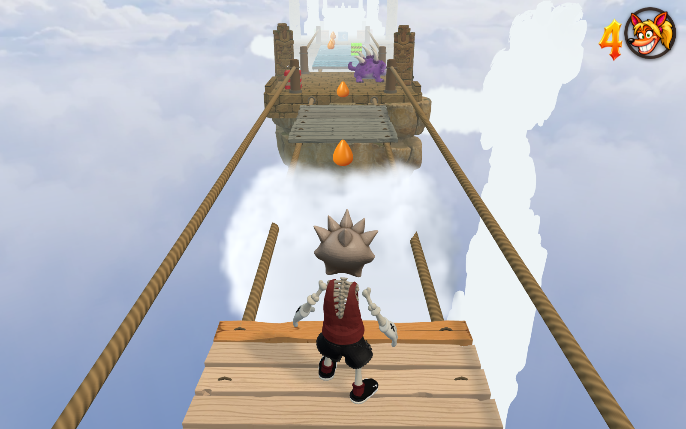
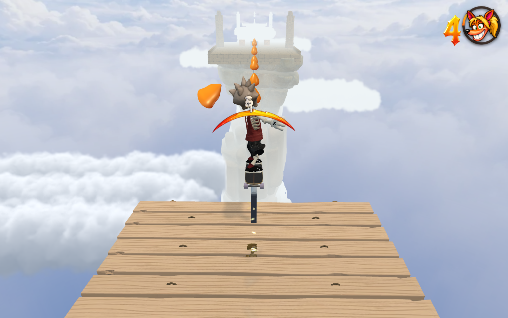
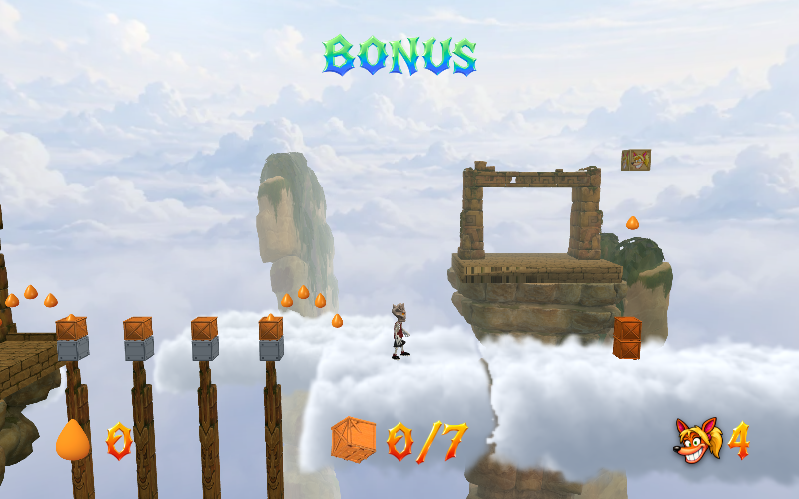

# Sky Bridge clouds and skate extension

29 October 2026. Source: `src/levels/sky-bridge.ts` and
`src/levels/sky-bridge-bonus.ts`.

Sky Bridge now spans 488 m from spawn to finish, twice its previous 244 m.
The original ice, falling boards, enemies, explosive placements and bonus
entrance remain. Two original timber decks become soft cloud platforms.
Ten cloud banks decorate the main course; four decorate the bonus.

The added half alternates two exposed grind crossings with two 16 m skate
jumps. Rails are 40 m and 35 m long. Broad stone receivers and four additional
checkpoints let every section restart from rest. The final receiver starts
at Z=-473, the gate is at Z=-483, and its Nitro-clear switch sits beside the
touchdown lane. The new sections use ordinary board acceleration, charging,
grinding and jumping; no speed injection or movement tuning is involved.

Cloudtop Lockers replaces its receiver court and long wooden bridge with two
cloud platforms. Their flat support retains the original intervals [21,29]
and [29,52] at Y=0. The relay chasm, four steel anchors, finite bounce puzzle,
seven counted crates and return landing keep their authored positions.

## Rendering and support

All new clouds use the existing full-volume cloud-platform implementation and
fixed 360p cloud compositor, including its soft edge/intersection treatment.
The main course has 12 cloud volumes and the bonus has six. Two in each level
have smooth, hidden collision surfaces. The 14 scenery clouds are nonsolid.
The rest of the scene follows the selected render resolution. No renderer,
player, global tuning, sky or geometry-detail policy changes are needed.

The only shared runtime edit recognizes the exact previous published Sky
Bridge snapshot so it upgrades to the new source. Modified editor copies
remain protected. `public/levels.json` changes only the `sky` entry.

## Validation

- `test-sky-bridge-cloud-extension.mjs`: full 488 m normal-input journey,
  all three ice slabs, seven falling decks, seven checkpoints, both grinds
  and both board-origin jumps; zero deaths or bails. Four independent
  checkpoint starts finish from rest. A deliberate edge jump causes a real
  fall and restores the earned final checkpoint.
- `test-themed-bonus-puzzles.mjs --courses-only --id=sky`: the bonus finishes
  with all 7/7 crates, the gem and zero deaths.
- Existing surface, construction, explosive and original-route regressions
  pass. Ray probes confirm the scenery supplies no hidden ground and the
  skate gaps remain open. Exact cached-source migration preserves edits.
- Source/public synchronization, `check:levels`, production build/type checking
  and release-size validation pass. No `check:all` run.

Compact native evidence is in [native-route.json](native-route.json),
[checkpoint-retries.json](checkpoint-retries.json) and
[bonus-route.json](bonus-route.json). The deterministic native pilot completes
the whole course in 2,394 simulation frames; this is test evidence, not an
estimate of human play time.

Browser evidence is recorded by `tools/sky-bridge-clouds-browser.mjs`: a
continuous lite run, a full-render native extension run, a 720p/CRT view and
native bonus views. The pilot supplies ordinary input samples after the
documented initial fixture position; it does not alter movement or contacts.
Both [lite](browser-lite.json) and [full-render](browser-native.json) pass with
no console errors. Full rendering uses 1600×1000 for native and 1152×720 for
the 720p setting; clouds remain 576×360 in both, including in the bonus.

## Timing

Prompt received at 01:22:27 UTC. Complete course, all stationary checkpoint
retries and deliberate fall recovery were validated by 01:56 UTC: approximately
34 minutes from prompt to the verified playable route. Browser review,
documentation and release checks follow that milestone.
