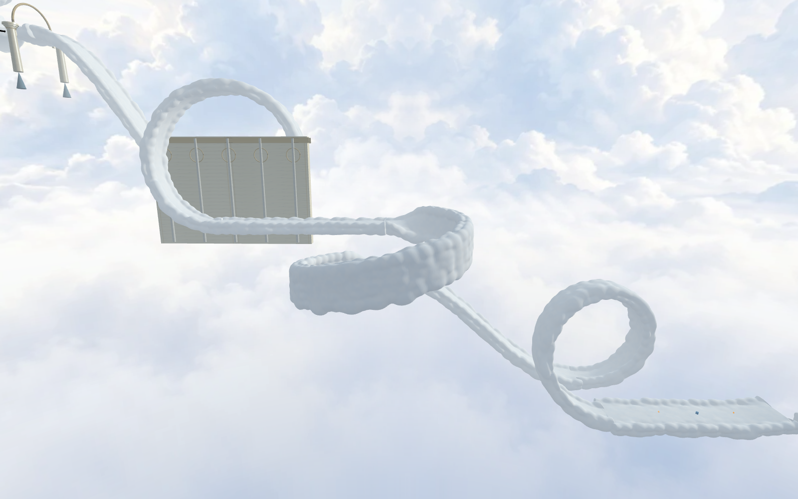
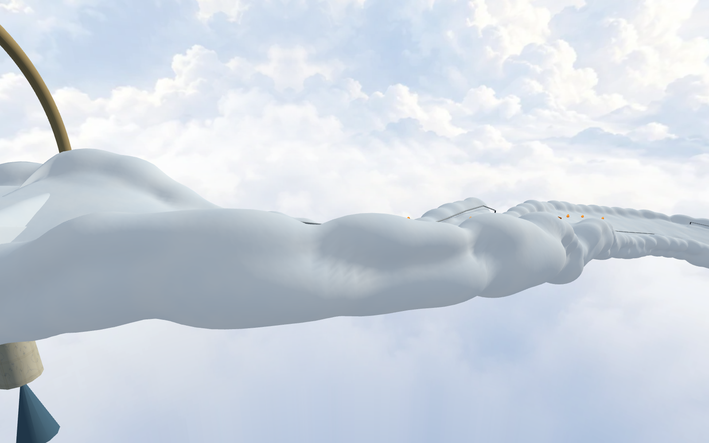
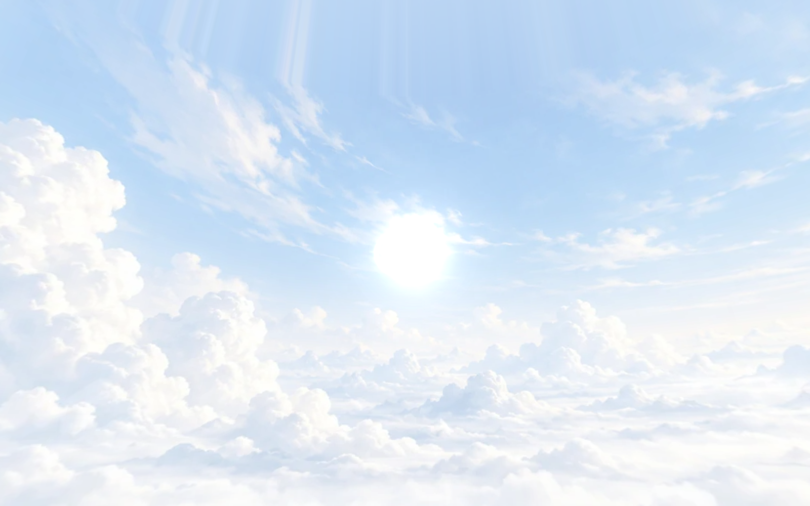

# Skystream cloud road — 28 October 2026

The entire road is a procedural cloud volume above an independent smooth contact
ribbon. Ellipsoid distance fields blend broad billows and round shoulders; a
predictor/corrector follows their implicit contour, then sweeps it along the
actual road frame. The shallow cap stays within 25 cm of the driving surface.
The shell uses 112 points per contour and approximately 65 cm longitudinal
spacing. Visibility chunks retain all authored geometry at every distance.
Subtle procedural shading adds soft blue body colour and diffuse light fill.
No centre stripe or edge vines are present.

The finale is upright → horizontal wall ride → upright. The middle ring retains
its full 14 m width, banks in/out over 45 degrees, and holds a vertical inward
surface for the middle 270 degrees. All rings use the same sampled frame for
visual geometry, analytic wheel contact and camera roll. The third ring's
approach supplies its speed through a 60 m gravity descent. Existing movement
tuning, rails, boxes and shortcut rules are preserved.

The original cloud panorama is retained, with a gentle blue tint strongest at
the bottom and fading to zero at 50% of the sky image. A directional HDR disk and
multi-radius glow share the sun-light direction with GPU-occluded lens flare.
The flare uses Three.js's existing MIT-licensed
[Lensflare addon](https://threejs.org/docs/pages/Lensflare.html); the cloud volume
and procedural textures are authored here, with no new external assets.

## Validation

- `tools/test-skystream.mjs`: full native route, 67/67 main-course boxes, seven
  checkpoints, four gaps, three loops, zero deaths/bails to the finish. A
  deliberate missed edge then reaches the kill plane and respawns supported.
- `tools/test-skystream-clouds.mjs`: orthonormal wall frames, inward winding,
  30/60/120 Hz motion, entry/exit continuity, banked camera, visual clearance,
  finite detailed mesh and separate collision.
- Existing loop ride/camera, Skystream falls, shortcuts and sanctuary wall checks
  pass. The camera fixture now supplies the current production dependencies.
- Full-render Chrome completes the same 67-box route with all three loops and
  no console errors. Native/MAX and normal 720p CRT presentation were inspected.
  Subsequent shell-only contour refinement passes the same clearance test and
  final MAX/CRT visual inspection; gameplay geometry is unchanged.
- Required `check:levels` package script passes. Only Skystream changes in the
  built-in level source. No duplicate editor snapshot is added to the archive.

The native and browser route reports are stored alongside these images. The
existing bonus contributes separate boxes beyond the 67 main-course boxes.

The integrated production build (`tsc --noEmit && vite build`) and release-size
check pass: 1,847 files / 997,070,170 bytes within the 1,000,000,000-byte budget.
Full native traversal also passes after integrating the current player runtime.
The production browser confirms all three loop types, supported spawn, 206 cloud
meshes / 1,626,016 triangles, hidden contact ribbons and active sun. Its stamp is
`Codex/sol fork · build 10-28 09:18 UTC`; no console or failed-request errors.

The original skybox and gentle lower-half tint were re-reviewed at MAX/native
and normal CRT presentation after the user's final sky direction.

The 29 October rendering follow-up adds baked light penetration, shared filtered
noise and selective volumetric shoulder/underside wisps. See the [lighting and
fringe implementation, measurements and validation](lighting/README.md).

The subsequent full-send iteration replaces the main course's opaque shell with
continuous bonus-style density rendering. See the [full-volume implementation,
GPU costs and validation](volume/README.md). The preceding shell/fringe sections
and images document earlier iterations, not the current default renderer.

The latest [optimization and clearance pass](optimization/README.md) retains
that full density, cuts measured cloud GPU time by 20–28%, separates the riding
plane from the cloud crown and strengthens the lower blue sky gradient.
