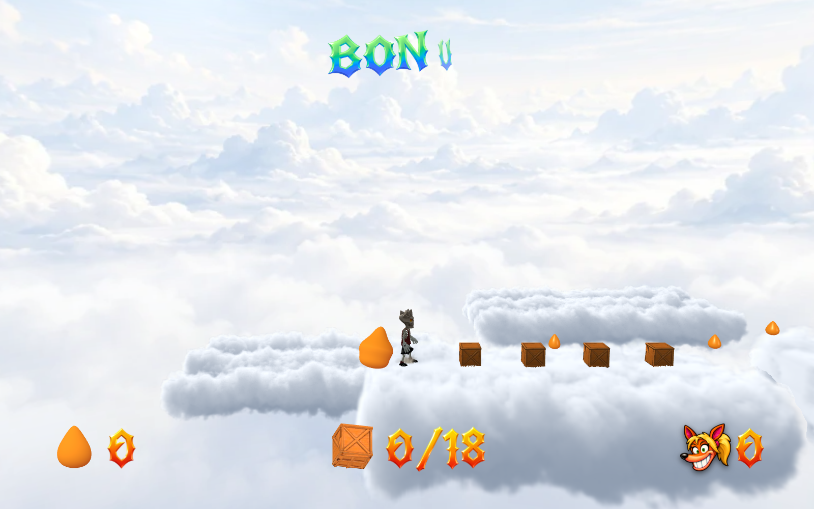
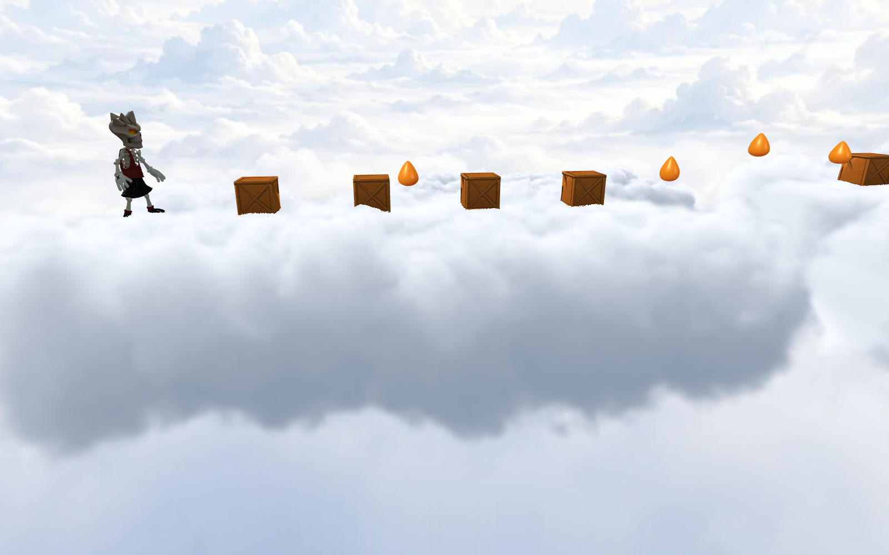
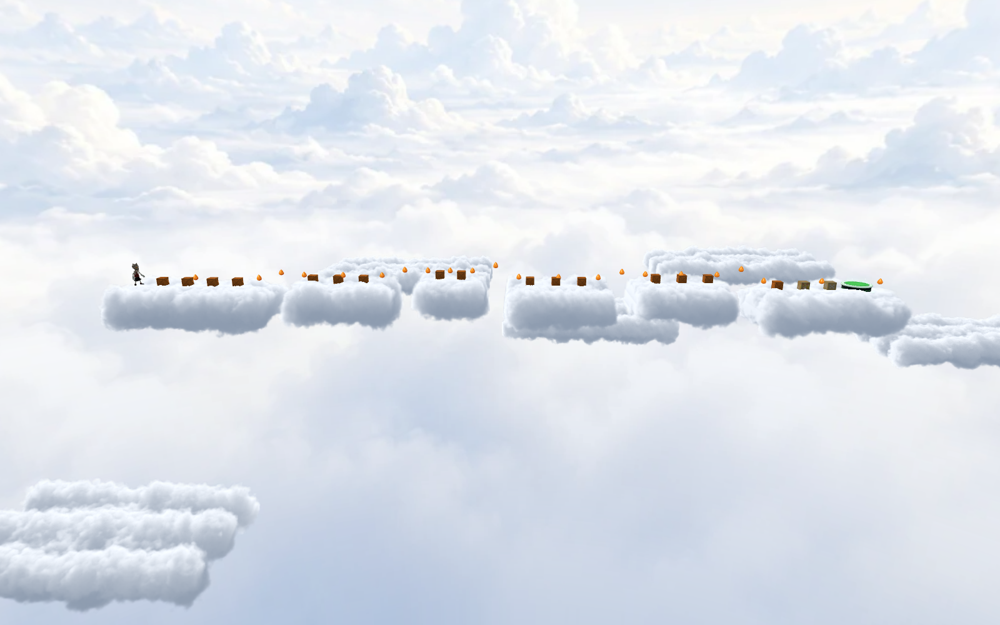
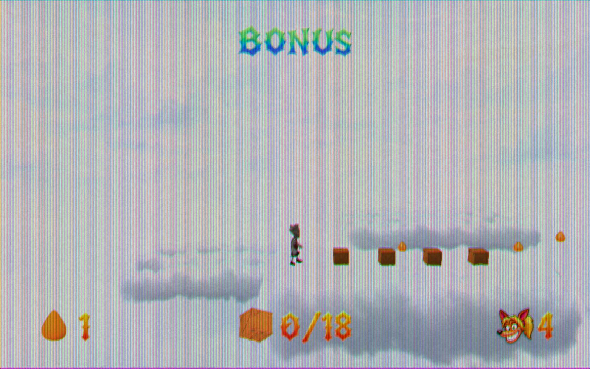

# Skystream cloud bonus and rail removal

Skystream now links to **Cumulus Cache**, a source-owned bonus with six airborne
cloud landings, five 2.6 m gaps and 18 rewards. Scenery banks sit behind and below
the route. Original cloud panorama, lower-half blue fade, sun bloom and flare
remain active. There are no cliffs, masonry supports, rails or swinging ropes.
The main course omits the saved Slipstream's 20 separate rails and single rope
swing; its ordinary surface-edge policy and movement tuning remain unchanged.

## Cloud rendering

Each island is a procedural 3D density field, formed from merged ellipsoids and
three scales of noise. Sun transmittance and a broad scattering term are baked
into the field. An 80-sample volume march produces soft silhouettes, internal
shade and thin illuminated fringes. Depth comes from the cloud density rather
than its enclosing box, so the player and crates overlap the cloud correctly.
The six flat contact surfaces are hidden and independent of the rendered clouds.
Scenery volumes have no contact surfaces. Every view uses the same full density
field; there are no distance-based geometry or volume swaps.

This is an original implementation informed by
[Guerrilla's cloud research](https://www.guerrilla-games.com/read/the-real-time-volumetric-cloudscapes-of-horizon-zero-dawn)
and [GPU Gems' volume-rendering overview](https://developer.nvidia.com/gpugems/gpugems/part-vi-beyond-triangles/chapter-39-volume-rendering-techniques).
The noise helper is the existing MIT-licensed Three.js `SimplexNoise` addon.
No new external assets or packages are required. Twelve volumes occupy
39,172,672 texture bytes, with explicit texture disposal on leaving the bonus.

## Validation

- `tools/test-skystream.mjs`: full 4.4 km route, 67/67 main-course boxes,
  seven checkpoints, four gaps and three loops; no death or bail. A deliberate
  fall returns to the earned checkpoint. Main-course rails/ropes are absent.
- `tools/test-skystream-bonus.mjs`: schema/editor roundtrip, campaign aliases,
  smooth surface probes, genuine unsupported gaps, 18/18 boxes and all five
  jumps, no death; a standalone run finishes normally.
- `tools/skystream-bonus-browser.mjs`: real Chrome lite fall/recovery; full-render
  parent → bonus → failed return → retry → 18/18 clear → parent. Rewards bank
  correctly, failed attempts preserve inventory, and the same parent level
  survives. Native/MAX 1600×1000 and normal 720p/CRT reviewed, no console errors.
- Full-resolution cloud close-up and wide route overview reviewed separately.

[Main route](native-main.json) · [Bonus route](native-bonus.json) ·
[Browser flow](browser-session.json) · [Visual diagnostics](visual-review.json)

Required `check:levels`, production build/type checking and release-size checks
pass. The packaged build also passed native/normal Chrome smoke with zero console
errors: [production browser](production-browser.json), [checks](checks.json).
Release output is 997,082,213 / 1,000,000,000 bytes.
